# MultiModelStudio 26.2 — руководство пользователя и специалиста

Актуальность: 22 октября 2026 года. Интерфейс Avalonia. Руководство описывает все пользовательские разделы и формирует полный каталог команд из текущего кода. Включены управление ресурсами, локальное CPU/GPU обучение, QLoRA 4-bit, проверка качества, пробный чат, проекты, переносимые артефакты, объектная память, сетевые сценарии и надёжная передача истории. Аппаратная поддержка конкретного окружения определяется отдельной физической приёмкой.

Часть I объясняет возможности программы; часть II проводит по интерфейсу; часть III предназначена для специалиста. Во встроенной помощи раскройте нужный заголовок. Поиск находит разделы по словам: например, «видеокарта», «память» или «токенов». Отдельный HTML содержит оглавление, поиск и встроенные изображения; интернет для чтения не нужен.

Скриншоты получены из настоящих представлений Avalonia в изолированной демонстрационной рабочей области. Имена, пути, сообщения и показатели — примеры, а не результаты измерений и не ваши данные. Размер окна и backend влияют на расположение и доступность элементов.

## I. Общее описание — назначение программы

MultiModelStudio объединяет модели, среды запуска и помощников в одной рабочей области. Можно вести разговор с одним или несколькими агентами, возвращаться к сохранённым сессиям, подключать документы и инструменты, создавать задания и наблюдать за выполнением.

Приложение не является самой нейросетью. Оно хранит настройки и историю, собирает контекст запроса и передаёт его выбранному движку. Для ответа нужны совместимая модель и работающий runtime: локальная программа или сервер. Возможности помощника зависят от модели, движка и разрешений агента.

Self-contained сборка включает .NET, поэтому отдельно устанавливать его обычно не требуется. Файлы моделей, сторонние движки и дополнительные модули памяти поставляются отдельно либо подготавливаются предусмотренными средствами программы. Наличие настройки не означает, что зависимость уже установлена.

## I. Основные понятия

**Модель** — веса нейросети и запись о них: название, путь, формат и параметры. Несколько агентов могут использовать одну модель.

**Профиль среды выполнения** — способ запуска: backend, адрес сервера или путь к программе, параметры CPU/GPU и соединения. Профиль не заменяет файл весов.

**Агент** — помощник с именем, инструкцией, моделью, профилем, разрешениями памяти и инструментов. Разные инструкции создают разные роли при одинаковых весах.

**Сессия** — сохранённый разговор и его участники. Продолжение сессии возвращает историю; оно не означает повторную установку модели.

**Контекст** — сведения для текущего ответа: сообщения, инструкции, источники, результаты инструментов и разрешённая память. История может быть длиннее контекстного окна модели.

**База знаний** — коллекции документов для поиска фрагментов. **Память** — записи, используемые между запросами. Ни то ни другое само по себе не обучает веса модели.

## I. Сценарии работы

1. **Начать работу.** Проверить компьютер, выбрать среду и модель, получить тестовый ответ, создать помощника и открыть чат.
2. **Продолжить разговор.** Найти сессию, открыть её, проверить доступность участников и продолжить с сохранённым контекстом.
3. **Поручить самостоятельную работу.** Выбрать агента и задание, настроить запуск, контролировать результаты. Для зависимых действий использовать мультиагентный план.
4. **Обучить и проверить модель.** Подготовьте материалы, запустите локальное обучение, сравните ответы с исходной моделью и откройте отдельный пробный чат. Текущий пилот использует CPU и HF-модель; изменение инструкции, памяти или температуры само по себе не является обучением.

Модели, память, MCP и параметры GPU — настройки, обслуживающие сценарии. К ним можно перейти из текущей работы и затем вернуться кнопкой «Вернуться».

## I. Возможности и ограничения

Можно организовать многомодельный чат, искать сессии, подключать источники контекста, управлять инструментами, дополнительными модулями, автоматизацией и сетевыми связями. Поддержка изображений, инструментальных вызовов и потоковой выдачи зависит от backend и модели.

На одной видеокарте могут работать несколько моделей, если хватает памяти и это допускает движок. Это не означает одновременную генерацию с полной скоростью. Помимо весов нужны память контекста и промежуточные буферы. Для тяжёлых заданий полезны последовательный запуск и явное распределение ресурсов.

Базовая память отделена от тяжёлого дополнительного модуля. Использование памяти агентом по умолчанию отключено. Установка модуля не даёт всем моделям автоматического доступа ко всем записям.

GPU-путь MOTEKA — экспериментальный кандидат Vulkan. Обучение, совместимость любых архитектур и гарантированная производительность на любой видеокарте не заявляются.

## I. Карта всех функций программы

**Рабочая область и проекты.** Создание, открытие, архивирование и повторное открытие проектов; отдельные права инструментов, агенты, история и черновики проекта; безопасный возврат из редакторов в исходный сценарий.

**Чат и сессии.** Один или два независимых чата, несколько участников, потоковые ответы, адресный ответ агенту, редактирование, копирование, удаление, повторная генерация и закрепление сообщений, вложения, поиск, продолжение, переименование, сохранение и экспорт сессий. Источники контекста, метрики и результаты инструментов показываются рядом с ответом.

**Модели и среды выполнения.** Регистрация и сравнение GGUF, чтение метаданных и исходных значений, шаблон чата, ограничения tools, llama.cpp CLI/server, внешние OpenAI-совместимые API, vLLM и MOTEKA. Доступны диагностика, health-check, CPU/GPU-профили, выбор устройств, безопасные стартовые значения, загрузка и выгрузка модели.

**Агенты.** Создание, клонирование, импорт и экспорт шаблонов, включение и выключение, системная инструкция, модель, runtime, параметры ответа и контекста, память, документы, навыки, права и лимиты инструментов. Общие проектные права и права конкретного агента проверяются вместе.

**Память.** Просмотр, поиск, закрепление, исправление новой ревизией, оценка, вето, откат, объединение эпизодов, контролируемая консолидация, отношения и разрешение конфликтов. Отдельно поддерживаются обслуживание индекса, модули памяти, проверяемые сводки и объектная память C1 с источниками, грантами и историей.

**База знаний.** Коллекции и документы, загрузка, проверка и повторная привязка источника, отзыв доступа, извлечение текста, индексация и переиндексация. Эмбеддинги могут быть локальными или предоставляться совместимым HTTP-сервисом.

**Инструменты и MCP.** Каталог инструментов, жизненный цикл провайдеров, многоуровневые разрешения, подтверждение или отказ для отдельного вызова и ограничение времени/числа вызовов. MCP поддерживает stdio/HTTP-профили, тест, авторизацию, подключение, ресурсы, шаблоны промптов и фоновые задачи.

**Самостоятельная и совместная работа.** Ручные, календарные, cron- и событийные задания; предварительный просмотр и журнал. Мультиагентные планы содержат шаги, зависимости, проверку и повтор запуска. Федерация, иерархия чатов, пересылка, диалоговые связи, зеркала чатов и Telegram используют явные адресаты и настройки соединения.

**Обучение и качество.** Материалы обучения и оценки, выбор Python и модели, проверка конфигурации, запуск, пауза и история. После обучения выполняются независимая оценка качества, проверка диалога, пробный чат, явная активация или откат. Переносимые артефакты имеют публикацию, импорт/экспорт, доверие, активацию и возврат маршрута к llama.cpp.

**Расширения и диагностика.** Дополнительные backend-модули можно проверить, установить, выбрать, остановить и откатить. Системная проверка, единый диагностический журнал, аудит, экспорт support bundle, сведения о ресурсах и встроенная справка работают без запуска модели. Настройки приложения включают язык, тему и рабочие параметры оболочки.

В конце руководства находится сгенерированный каталог каждой команды с точным идентификатором, назначением и доступной оболочкой. Он используется как проверка полноты перед выпуском.

## II. Интерфейс — общая схема окна

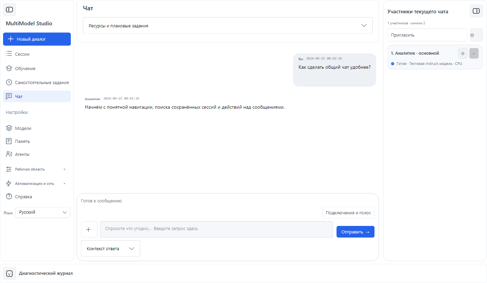

**Слева** находятся сценарии: новый диалог, сессии, обучение, самостоятельные задания и чат. Ниже — настройки: модели, память, агенты и раскрываемые группы рабочей области и сети. Верхняя кнопка сворачивает панель; внизу выбирается язык.

**В центре** открыт выбранный сценарий или редактор. **Справа в чате** — участники, их состояние и настройки. Панель участников можно свернуть, освободив место для переписки. **Сверху** доступен блок ресурсов и плановых заданий. **Снизу** расположен диагностический журнал, который раскрывается без ухода со страницы.

Синие кнопки выделяют основные действия. Флажки включают возможности. Ползунок задаёт число, а поле позволяет ввести точное значение. Серый элемент может быть недоступен, пока не выбран объект, не заполнены обязательные поля или идёт несовместимая операция.

## II. Возврат и сохранение настроек

Переходите к параметрам через меню или шестерёнку участника. Если переход выполнен из сценария, синяя кнопка **«Вернуться»** возвращает к исходной работе.

Изменённая форма и сохранённая конфигурация — разные состояния. Используйте сохранение перед запуском, если оно предусмотрено редактором. При выходе из изменённой формы читайте предложение о несохранённых правках. Возврат не является универсальной командой сохранения.

Один профиль может использоваться несколькими агентами. Его изменение затрагивает общую настройку. Для эксперимента создайте отдельный профиль и назначьте его нужному помощнику.

## II. Правая панель настроек и черновики

В разделах настроек нажмите нужный пункт в центре: его форма откроется справа. Заголовок панели показывает, что вы редактируете, а подпись — выбранный объект и область действия. Значок у края сворачивает панель; кнопка **↔** меняет её ширину. Сворачивание сохраняет незавершённые правки без записи в профиль.

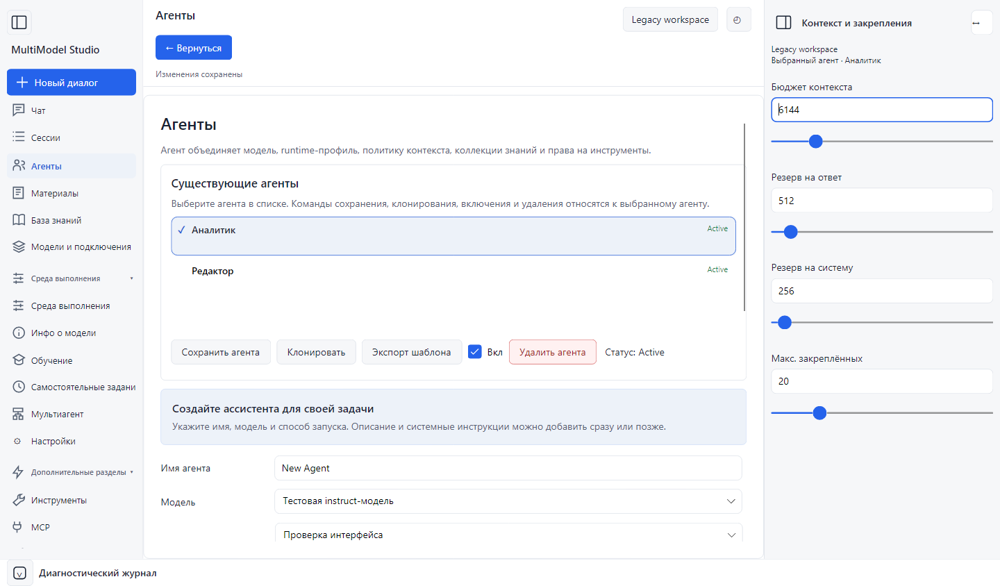

В разделе **«Агенты»** лимиты контекста, резервы и число закреплённых сообщений относятся к выбранному агенту. Их можно менять ползунком или точным вводом. **«Сохранить»** записывает изменения, **«Отменить правки»** возвращает последнее сохранённое значение. При выборе другого агента показываются его значения; незавершённый черновик первого сохраняется до сохранения или отмены.

**Общий профиль запуска** редактируется отдельно. Перед сохранением прочитайте список использующих его агентов: изменение касается всех перечисленных помощников. Переход из этой формы в лимиты или права агента переключает общие кнопки сохранения и отмены на настройки агента. Несохранённый черновик профиля остаётся доступен в списке черновиков. Кнопка скрытия профиля возвращает правую панель к доступному разделу.

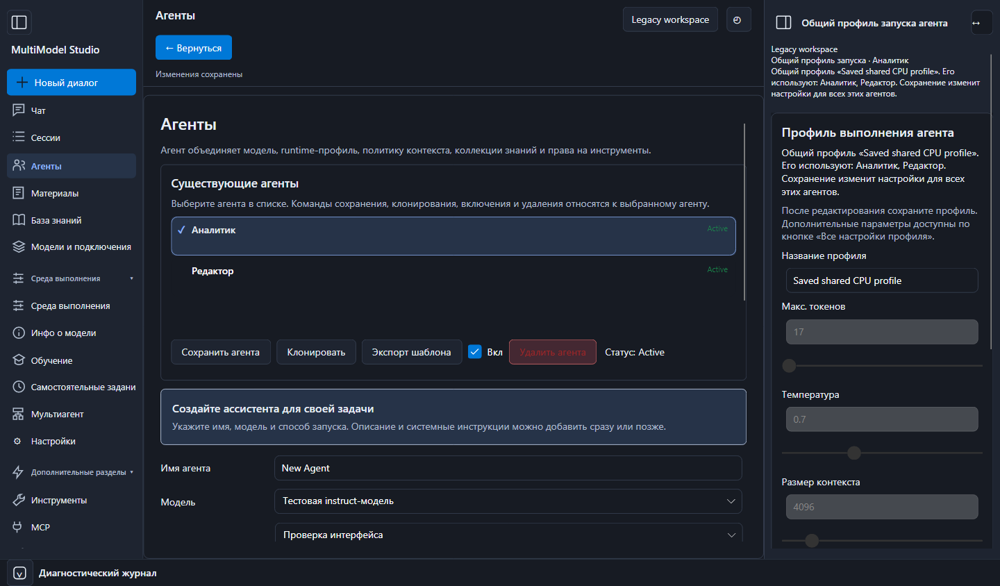

Серые поля означают, что текущий backend не подтвердил соответствующую возможность. Смена оформления или открытие панели не запускает модель и не даёт разрешений инструментам.

### Права инструментов и смена проекта

В разделе агента откройте **«Права и лимиты инструментов»**. Для каждого инструмента
есть две подписанные группы флажков: **«Текущий проект»** и **«Выбранный агент»**.
«Разрешить инструмент» даёт доступ на соответствующем уровне, «Без запроса согласия»
допускает автоматическое выполнение только при отсутствии запрета на других уровнях.
Модель должна поддерживать tools, а её разрешения настраиваются отдельно в разделе моделей.
Окончательные ограничения исполнителя сохраняются всегда.

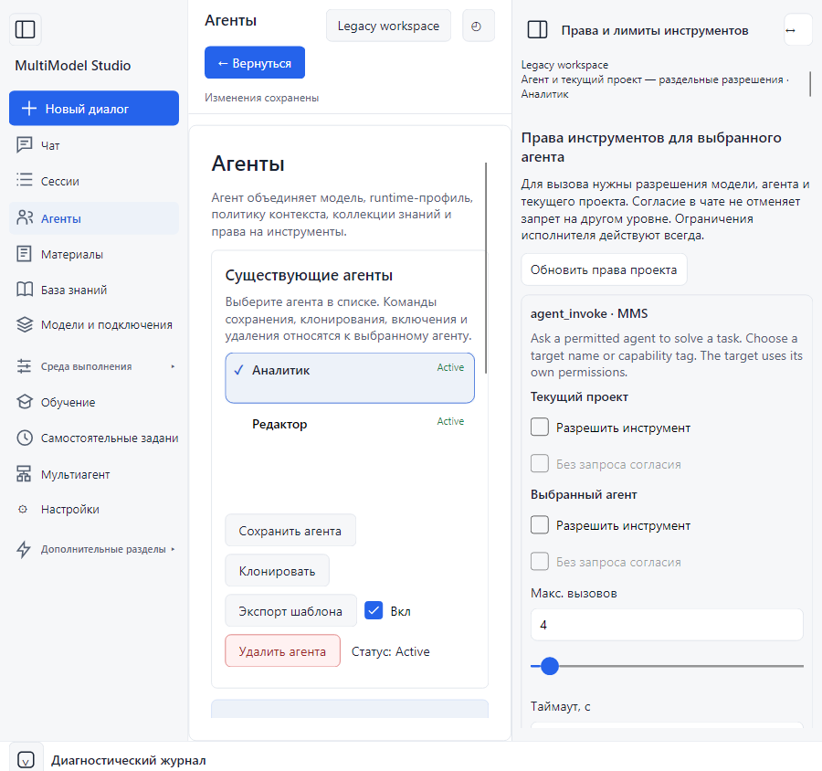

Проектные права общие для агентов одного проекта. Несохранённая проектная правка следует
за проектом при выборе другого агента; агентские настройки остаются отдельными.
Сохраните изменения кнопкой сохранения агента или общей командой сохранения.
Отмена возвращает выбранного агента и текущие проектные права к сохранённым значениям.
Лимиты вызовов и времени можно изменить ползунком или точным вводом.

До загрузки проектных прав редактирование и сохранение недоступны. Если загрузка завершилась
ошибкой, прочитайте сообщение и нажмите **«Обновить права проекта»**. Обновление получает
актуальные разрешения и сохраняет изменённые вами строки черновика. При переходе в другой
проект используются его агенты, история и права; список участников прежнего чата очищается.

Если вызову требуется согласие, чат показывает инструмент, аргументы, ограничения и кнопки
**«Разрешить» / «Отклонить»**. Агент в правой панели отмечен как **«Ожидает решения»**.
Кнопка остановки отменяет текущую генерацию вместе с ожиданием решения. Разрешение одного
вызова не даёт инструменту доступ в другом проекте и не отменяет остальные запреты.

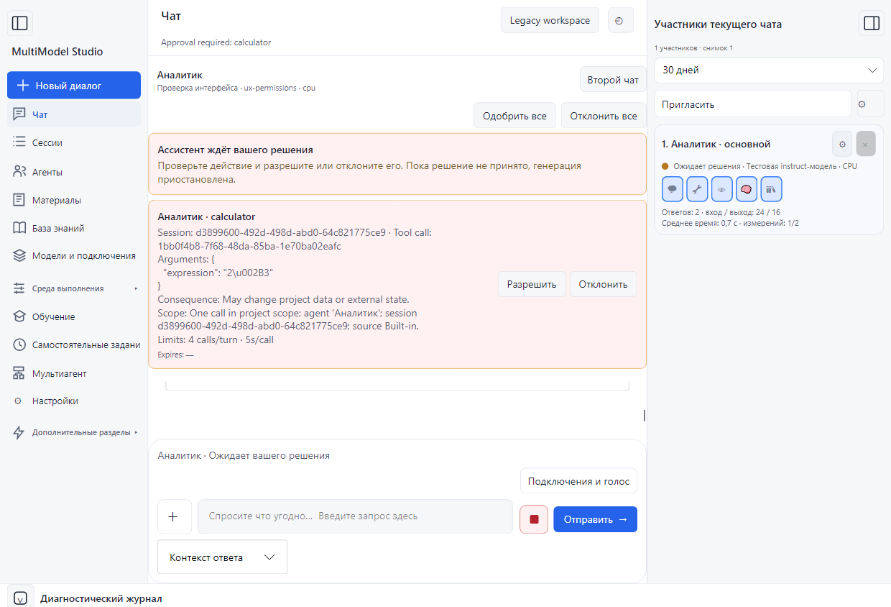

В общем чате ответы подписаны именами участников. Адресный ответ на сообщение участника
направляет следующий вопрос только его модели; результат остаётся в общей истории.
Статистика токенов и скорости доступна, если её передал движок; отсутствующие измерения
не считаются нулевыми. Иллюстрации этого раздела получены в тестовой рабочей области.

## II. Первый запуск — подготовка компьютера

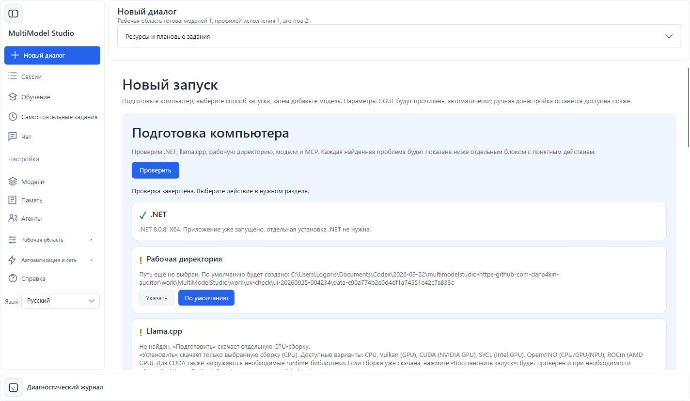

Откройте **«Новый диалог»** и выполните проверку подготовки компьютера. Программа показывает состояния зависимостей: среды приложения, рабочей папки, движка, моделей и дополнительных компонентов. Прочитайте подпись проблемного пункта: предупреждение не обязательно означает отсутствие всех моделей.

Запись модели в библиотеке, доступность файла и готовность движка — разные проверки. Запись может указывать на отключённый диск; найденный runtime может не запускаться из-за несовместимой сборки.

Для локальной работы используйте **«На этом компьютере»** и доступную подготовку runtime. При выборе сборки проверяйте совместимость и результат проверки. Готовый сервер подключается через соответствующий вариант мастера или профиль среды.

CPU — допустимый базовый вариант. Отсутствие предложения GPU само по себе не доказывает непригодность видеокарты: проверьте сборку, драйвер и профиль. Обнаруженное устройство не обязательно уже настроено для генерации.

## II. Первый запуск — модель и тестовый ответ

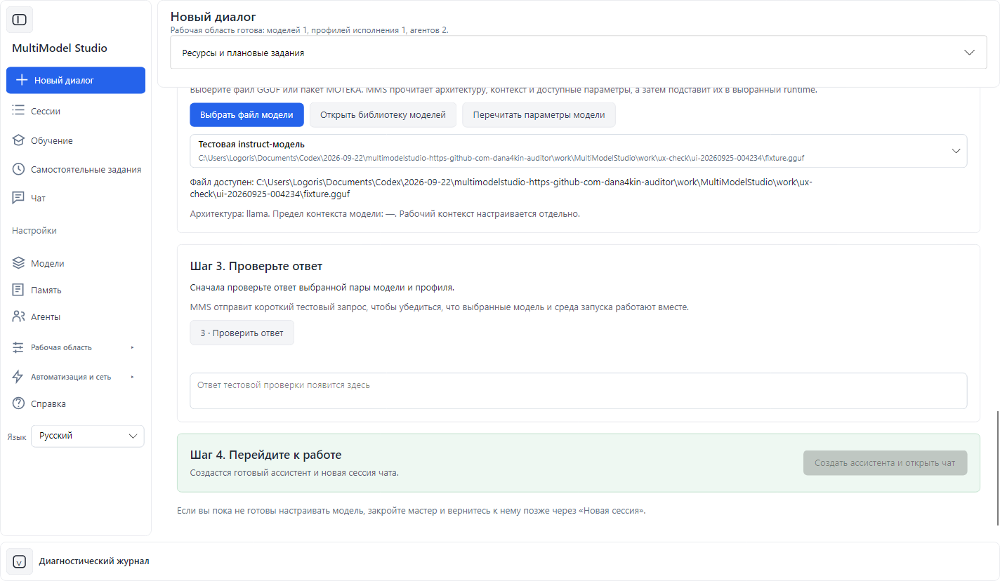

1. Выберите модель из списка либо укажите файл. Проверьте доступность пути. Для GGUF читаются метаданные; для пакета MOTEKA нужен соответствующий runtime.
2. Проверьте совместимость модели и профиля. Файл весов нельзя подставлять вместо исполняемой программы.
3. Нажмите **«Проверить ответ»**. Это реальный запрос. Результат появляется в области тестового ответа; сообщение об установке не заменяет проверку генерации.
4. После успешной проверки создайте ассистента и откройте чат предусмотренной кнопкой.

При ошибке разверните журнал и проверьте названную зависимость. Загрузка больших весов и обработка входного контекста могут занять время. Не начинайте повторную установку всех компонентов без выяснения причины.

## II. Сессии — продолжение разговора

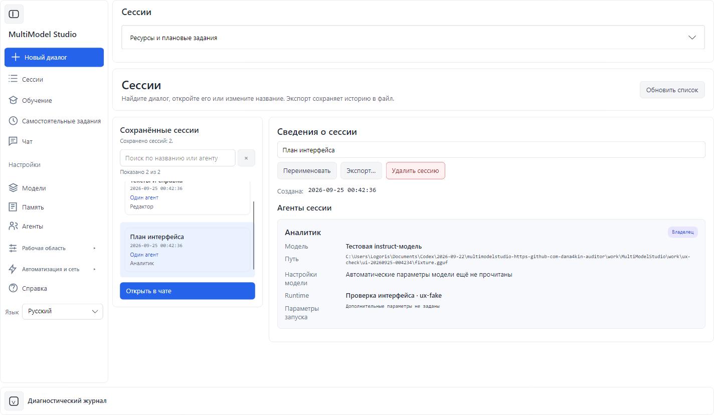

Откройте **«Сессии»**, введите часть названия или имени агента, выберите разговор и откройте его в чате. Очистка поиска возвращает полный список. Проверьте участников и сведения о выбранной сессии.

Переименование помогает различать задачи. Экспорт создаёт отдельную копию истории. Удаление сессии действует на разговор и не является способом выгрузить модель из видеопамяти.

Если модель или профиль недоступны, восстановите зависимость. Старый путь не обновляется от самого факта переноса весов. Снимок конфигурации сессии не содержит копию многогигабайтного файла модели.

## II. Чат — запрос и участники

Введите текст внизу и нажмите **«Отправить»**. Следите за состоянием участника. Для прерывания используйте остановку текущего выполнения; отмена не удаляет сохранённую историю.

Справа видны участники. **«Пригласить»** добавляет помощника; шестерёнка открывает параметры. Инструкция задаёт роль, но не гарантирует правильность ответа. Удаление участника из чата не следует путать с удалением глобального профиля агента.

Во время ответа лента следует за растущим текстом, если вы находитесь внизу.
Прокрутите вверх, чтобы читать историю без автоматического возврата к ответу;
вернитесь в конец ленты, чтобы снова следовать за генерацией. Это поведение действует
в обеих областях чата и отключается флажком **«Следовать за новыми сообщениями, когда
лента внизу»** в настройках приложения. Переход между разделами и повторное открытие
активной сессии не отменяют запрос; незавершённый ответ снова отображается в своей области.

Если появляется **«Истёк лимит времени генерации»** (`MMS-REQUEST-002`), запрос достиг
ограничения профиля исполнения. Это отличается от нажатия **«Отмена»**. На CPU продолжение
длинного разговора может занимать больше времени, чем первый короткий ответ: увеличьте
лимит времени в профиле либо сократите контекст или длину ответа. Лимит остаётся конечным
и учитывается при резервировании ресурсов для плановых заданий.

**Диагностический журнал** расположен внизу окна. Квадратная кнопка со стрелкой слева
раскрывает его, а **«Копировать журнал»** копирует строки для разбора ошибки. Причина
ошибки генерации и идентификаторы сессии/операции также сохраняются в базе; текст запроса
и ответа в эту запись не включаются. Подсказки кнопок участника сохраняются при обновлении
его статуса.

Кнопка **«+»** открывает действия с вложениями. **«Контекст ответа»** помогает проверять подключённые источники. Не каждый backend умеет анализировать изображения или произвольные бинарные файлы.

**«Подключения и голос»** содержит дополнительные способы взаимодействия. Доступность записи и воспроизведения зависит от ОС, устройств и компонентов. Не все платформы поддерживают одинаковый набор голосовых функций.

## II. Навыки участника — иконки на карточке

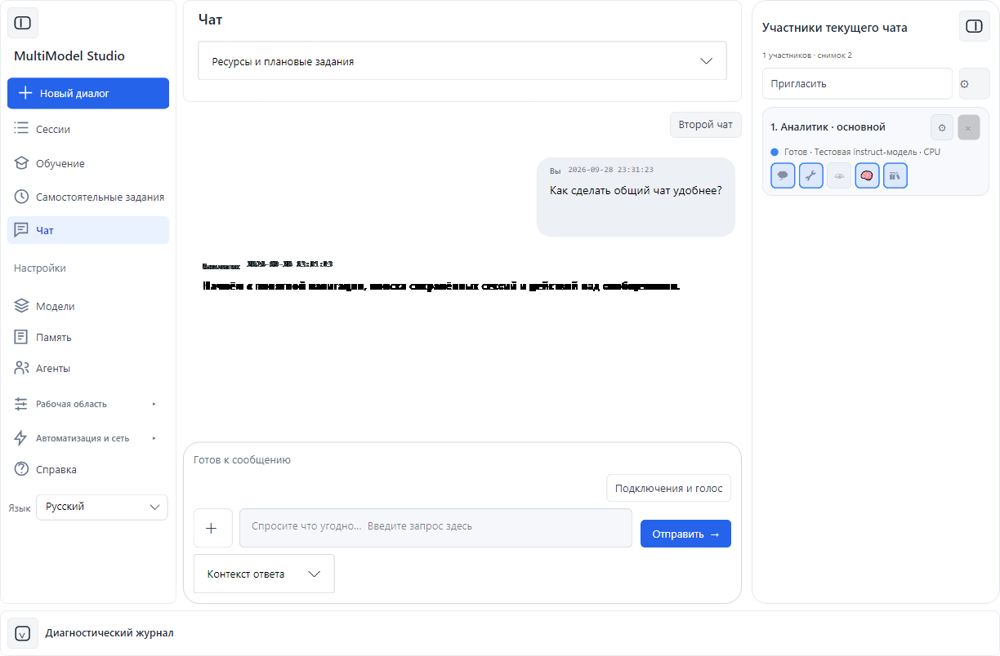

На карточке каждого участника пять иконок: 💭 размышление, 🔧 инструменты, 👁 изображения,
🧠 память, 📚 база знаний. Щелчок включает или выключает навык и сразу сохраняет профиль
агента. Выключенные «Инструменты» убирают определения инструментов у этого агента, не
меняя разрешений; выключенные «Изображения» отправляют только текст; выключенная «Память»
не подбирает память перед запросом и ничего не удаляет; «Размышление» просит llama-server
пропустить фазу размышления (для шаблонов, которые это понимают). Приглушённая иконка
означает, что выбор сохранён, но текущий runtime навык не использует — причина в подсказке.

## II. Второй чат — две независимые области

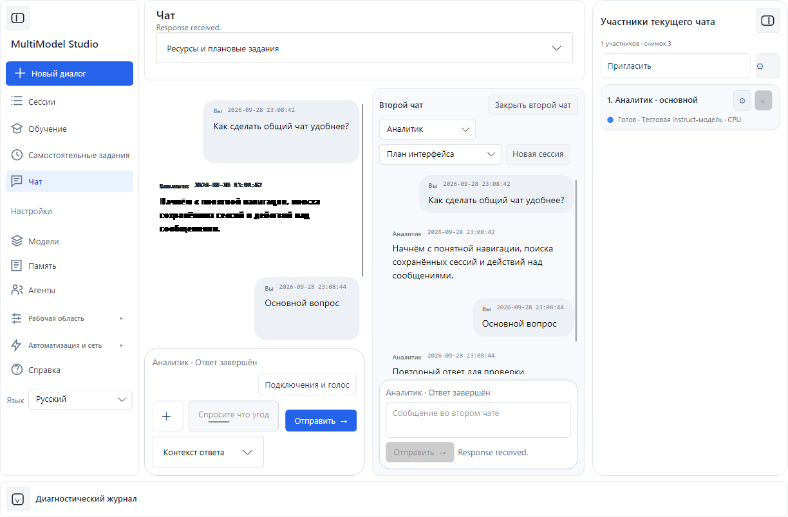

Кнопка **«Второй чат»** над лентой открывает справа вторую область. У неё свой агент,
свой список сессий, своя лента, своё поле ввода и своя отмена: пока в одной области идёт
ответ, в другой можно писать и отправлять. Новое сообщение без выбранной сессии создаёт
сессию для выбранного агента. Если обе области открыли одну и ту же сессию, ответ идёт
в ту, из которой отправлен запрос, а вторая обновляется из истории после его завершения.
Модель, разрешения инструментов, подтверждения действий и журнал общие — подтверждения
показываются в основной области. Вложения, голос и действия над сообщениями доступны
в основной области; во второй области доступно **«Фото»** — одно изображение PNG/JPEG для
следующего сообщения, оно относится только к этой области. **«Закрыть второй чат»** убирает
область, не прерывая её ответ.

## II. Действия над сообщениями и вызовы инструментов

Действия появляются при наведении на сообщение. Доступны копирование, редактирование своего сообщения, повторная генерация ответа, закрепление для контекста и удаление. Перед удалением проверьте выбранное сообщение; редактирование ответа ассистента не является редактированием собственного запроса.

История действий агента раскрывает название инструмента, состояние, аргументы и результат. Вложенные сведения могут включать JSON или код, если они действительно были частью вызова. Текст с кодом в ответе не означает, что код исполнили.

При запросе подтверждения прочитайте действие и входные данные. Автоматическое разрешение меняет поведение будущих вызовов; выдавайте его только подходящим инструментам и агентам.

## II. Источники ответа — что легло в основу

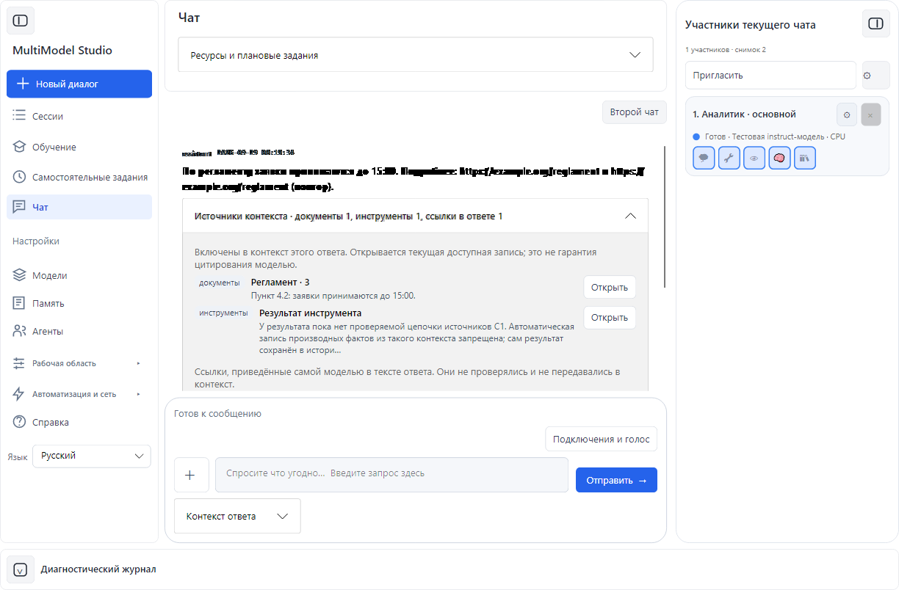

Под ответом, для которого зафиксировано происхождение, показан свёрнутый блок
**«Источники контекста»** со сводкой по типам: документы базы знаний, память, объектная
память, результаты инструментов, перенесённые сведения. При раскрытии каждая строка
содержит тип, название, путь или ссылку, использованный фрагмент и кнопку **«Открыть»** —
открывается текущая доступная запись. Отдельно перечислены **ссылки, приведённые самой
моделью в тексте ответа**: они не проверялись и в контекст не передавались, их можно
только скопировать. Передача материала модели не доказывает, что утверждение основано на
нём; ответ без зафиксированных источников блока не получает — ничего не придумывается.
Изменённый, удалённый или закрытый источник помечается «недоступен», его содержимое не
показывается. Сведения привязаны к ответу и сохраняются после перезапуска.

## II. Модели — библиотека и генерация

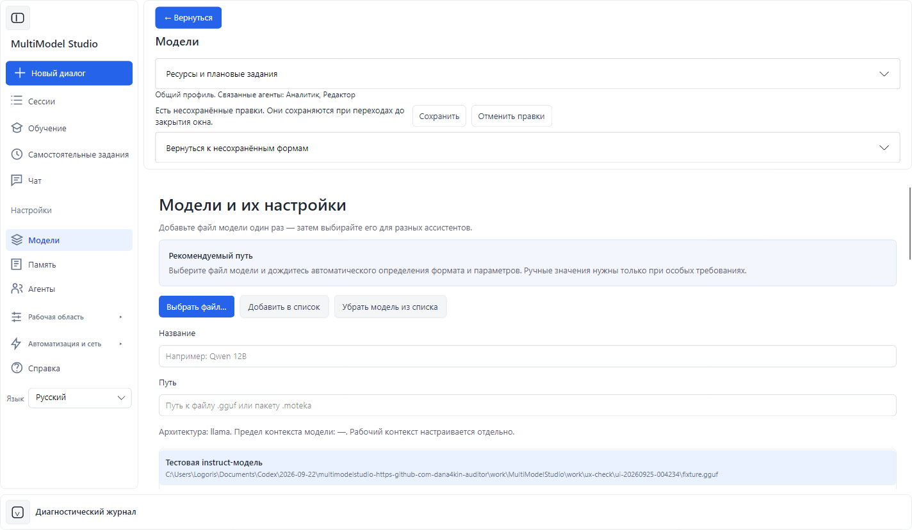

Выберите запись или добавьте файл. Название помогает ориентироваться, путь связывает запись с весами. После переноса файла обновите путь. Метаданные описывают архитектуру и характеристики модели.

Настройки генерации управляют длиной ответа и выборкой, если backend их поддерживает. Большой контекст расходует больше памяти; длинный ответ требует больше времени. Измените число ползунком или точным вводом, сохраните и выполните контрольный запрос.

**Шаблон диалога (`tokenizer.chat_template`).** Выберите модель в разделе **«Модели и
подключения»**, затем откройте **«Шаблон диалога модели»**. В правой панели показан полный
шаблон из GGUF. Включите флажок **«Использовать изменённый шаблон»**, отредактируйте текст
и нажмите **«Сохранить настройки модели»**. Поле поддерживает несколько строк и отступы;
допустим исходный текст Jinja или имя встроенного шаблона, например `chatml`.

Изменение хранится в MMS для выбранной модели и применяется её агентами со следующего
запроса. Исходный файл GGUF и веса сохраняются. **«Вернуть шаблон из файла»** восстанавливает
исходный текст и выключает переопределение; затем сохраните настройки. Можно также
выключить флажок и сохранить. Обычная отмена в правой панели возвращает последний
сохранённый вариант; несохранённые правки остаются у своей модели при переключении списка.

Поддерживаются локальный llama.cpp и управляемый MMS llama-server. Синтаксис проверяет
движок при запуске: пустой включённый шаблон отклоняется в редакторе, ошибка Jinja или
отсутствие нужных возможностей runtime показываются при запросе. Для внешнего сервера
шаблон задаётся на стороне сервера. Для API, MOTEKA и других подключений активное
переопределение модели нужно отключить — оно не игнорируется молча.

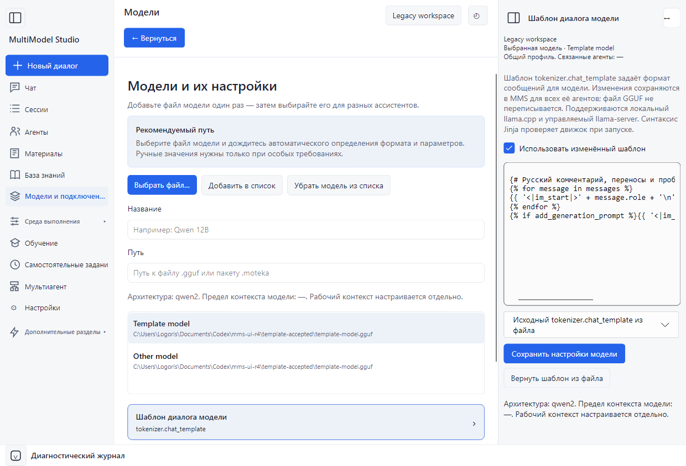

Исключение записи из библиотеки не является универсальной командой удаления весов с диска. Раздел **«Инфо о модели»** предназначен для метаданных и структуры. Специальные операции преобразования файлов выполняйте на копии и проверяйте совместимость результата отдельно.

## II. Агенты — роль и разрешения

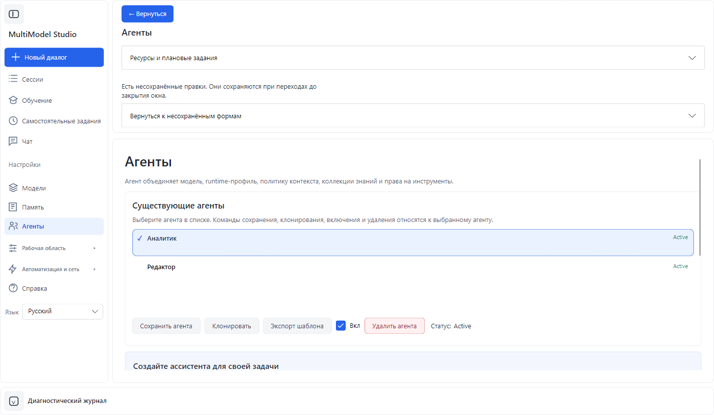

Задайте имя, инструкцию, модель и профиль среды. Инструкция описывает задачу, профиль определяет исполнение. Доступ к памяти и инструментам настраивается отдельно. Включение провайдера в рабочей области не заменяет разрешение конкретному агенту.

Разным ролям можно назначить одну модель: аналитик формирует решение, редактор проверяет изложение.
Это экономит место на диске, но каждый запрос требует вычислений. RP-7A разделяет параметры
загрузки модели и параметры следующего ответа агента: неподдерживаемая индивидуальная настройка
должна дать понятный отказ, а не быть проигнорирована.

В карточке выбранного агента откройте **«Параметры ответа»**. Рядом с каждым значением показан его
фактический источник: общий профиль запуска, настройки модели, индивидуальное значение агента или
безопасное значение MMS. Включите **«Своё значение»**, чтобы изменить только следующий запрос
этого агента; точное число можно ввести рядом с ползунком. Недоступное для выбранного provider поле
заблокировано с объяснением. Seed выбирается явно: наследовать, автоматически или фиксированное
число. **«Использовать общие настройки»** снимает только индивидуальные overrides и не меняет
модель, общий профиль и настройки других агентов. Если настройки успели изменить в другом окне,
MMS перечитает свежую revision вместо скрытой перезаписи.

## II. Среда выполнения

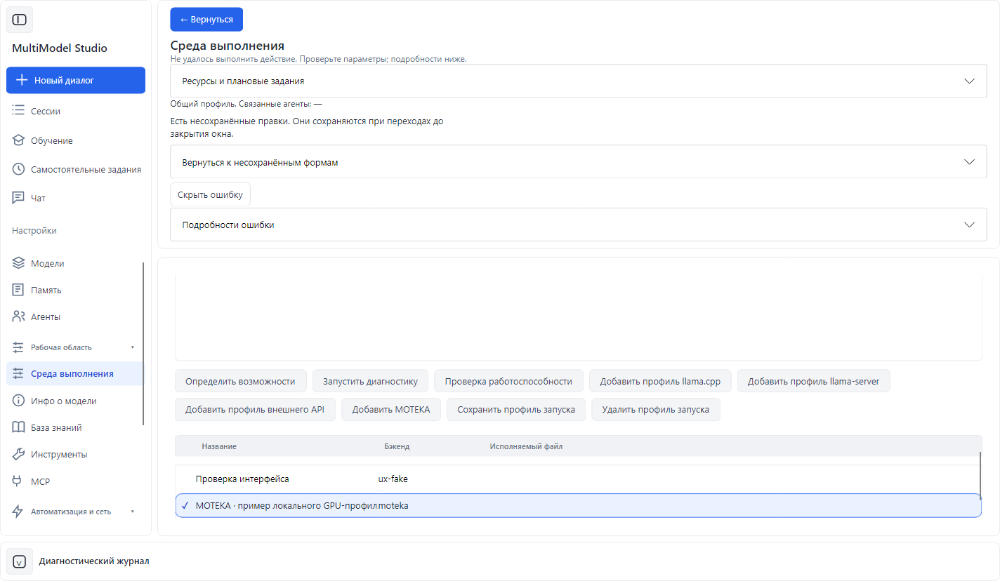

На иллюстрации указан демонстрационный путь к MOTEKA: сообщение ошибки показывает состояние недоступного компонента. Для рабочего профиля выберите реально установленную программу и повторите проверку.

В группе **«Рабочая область»** откройте **«Среда выполнения»**. Выберите профиль и backend. Для локальной программы нужен путь, для сервера — адрес и параметры доступа. Адрес, идентификатор модели и путь к весам выполняют разные функции.

Доступны адаптеры llama.cpp, серверные подключения и MOTEKA. Поля движка могут находиться в дополнительных настройках. Не переносите параметры одного backend в другой без проверки.

В расширенных параметрах блок **«Оценка памяти для выбранной модели»** показывает, сколько
по расчёту займут веса, KV-кэш на заданный контекст и рабочие буферы, и как они делятся между
видеопамятью и оперативной памятью по числу слоёв на GPU. Допущения перечислены рядом; это
расчёт для планирования, а не гарантия размещения — точные значения определяет runtime.

Тайм-аут ограничивает ожидание, но не ускоряет вычисления. Ключ API требуется там, где его требует сервер. Сохраните профиль и выполните тест. Учитывайте других агентов, использующих тот же профиль.

**Числовые настройки.** Каждый ограниченный параметр показан ползунком и точным полем.
Диапазон, шаг и подсказка берутся из общего каталога параметров, одного для среды
выполнения, агента, таблицы значений модели и остальных форм; подсказка над ползунком
говорит, откуда взят предел: предел сервиса, рабочая шкала (точный ввод допускает
больше) или ориентировочный диапазон, зависящий от модели и устройства. Значение за
пределами шкалы сохраняется и не переписывается при открытии формы; проверку выполняет
служба, а не окно. Особые значения (например, «0 — автоматически» для потоков или
«0 — только CPU» для слоёв GPU) названы в подсказке. Разделение по GPU и flash attention
выбираются из списка; ранее сохранённое нестандартное значение показывается отдельной
строкой и не теряется.

## II. MOTEKA — локальный сервер и видеокарта

**MOTEKA — Metacognitive Object-Token Episodic Knowledge AGI.**
По-русски: **Метакогнитивный AGI с объектно-токенным представлением эпизодических знаний.**

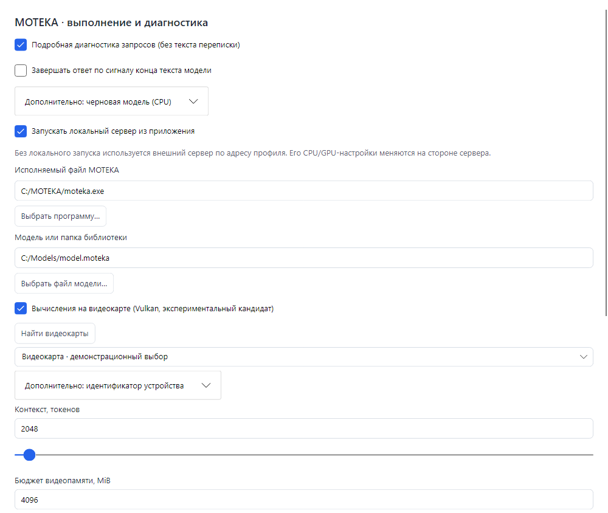

Флажок подробной диагностики добавляет события запросов без текста переписки в этих событиях. Завершение по сигналу конца текста управляет EOS. Дополнительная черновая модель относится к CPU-пути.

Включите **«Запускать локальный сервер из приложения»**, укажите программу MOTEKA и модель либо папку библиотеки. Это разные пути. Сохраните профиль перед ручными действиями.

Для GPU включите Vulkan, нажмите **«Найти видеокарты»** и выберите устройство. Дополнительное поле идентификатора предназначено для специалиста: неверный UUID вызовет ошибку выбора.

При выключенном локальном запуске используется готовый сервер. Его CPU/GPU-параметры меняются на стороне сервера; заполнение локальных полей не перенастраивает чужой процесс.

## II. MOTEKA — контекст, память и управление

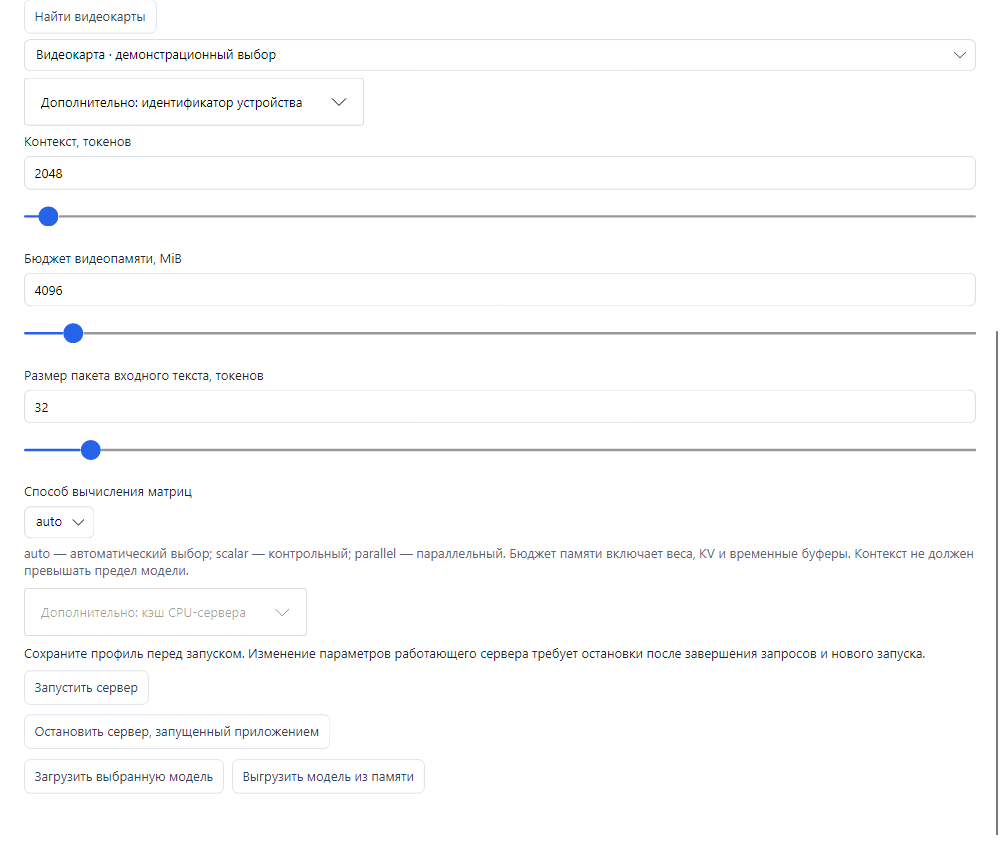

**Контекст, токенов** задаёт рабочую ёмкость контекста. **Бюджет видеопамяти, MiB** относится к GPU-пути, а не ко всей памяти компьютера. **Пакет prefill** влияет на обработку входа: увеличение может ускорить подготовку, но требует памяти.

**Проекция** выбирает способ GPU-вычислений; начните с автоматического. CPU prefix cache относится к повторному использованию префикса CPU и не заменяет GPU-бюджет.

Запуск и остановка управляют сервером, созданным MMS. Загрузка и выгрузка относятся к выбранной модели. Перед остановкой завершите или отмените активный запрос. После изменения параметров работающего сервера нужны остановка и повторный запуск.

Для первого теста используйте небольшой контекст и умеренный пакет. При нехватке памяти уменьшите их, освободите устройство или возьмите меньшую модель. Повышение числа в поле бюджета не создаёт физическую память.

## II. Память — записи и дополнительный модуль

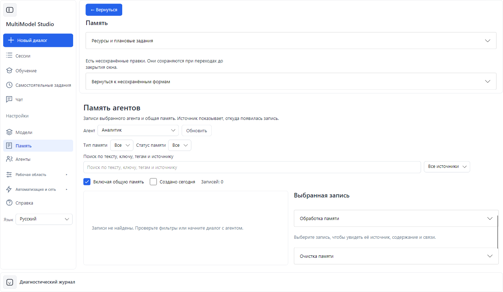

Фильтры помогают различать источники, типы и состояния записей. Проверяйте происхождение утверждений: автоматическое извлечение может ошибаться.

Установка модуля, подготовка индекса, включение поиска и разрешение агенту — отдельные действия. Сложный смысловой поиск требует соответствующего модуля и зависимостей. Базовая программа не обязана постоянно держать тяжёлую модель памяти запущенной.

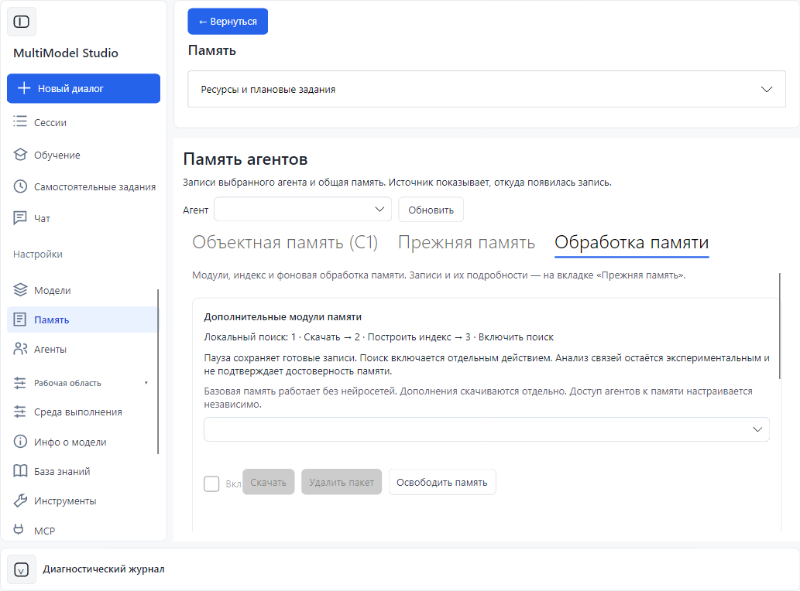

Модули, индекс и фоновая обработка вынесены на отдельную вкладку **«Обработка памяти»**,
чтобы карточка выбранной записи не делила место с ними. Следите за состоянием индекса; обслуживание можно приостанавливать предусмотренными средствами. Смена модели эмбеддингов может требовать пересоздания индекса. Предложения связей и сводок — результаты обработки, а не доказательство истинности.

Общая память передаёт разрешённые сведения агентам, но не является общим скрытым состоянием нейросетей. Веса не меняются от добавления записи. При очистке внимательно выбирайте область действия.

## II. База знаний

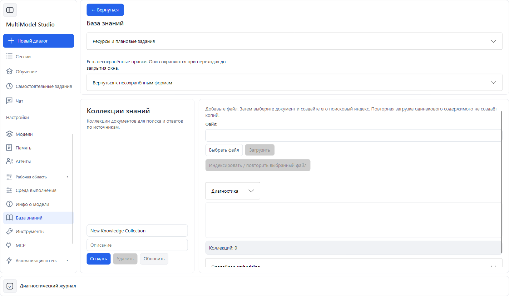

Создайте или выберите коллекцию, добавьте поддерживаемые документы и дождитесь обработки. При ошибке изучите состояние конкретного документа. Подключите нужную коллекцию через настройки агента и контекста.

Поиск возвращает релевантные фрагменты, а не обязательно весь документ. Для важных выводов проверяйте первоисточник. Вложение удобно для разового обсуждения, коллекция — для повторного поиска. После изменения исходника может потребоваться обновление индекса.

## II. Инструменты

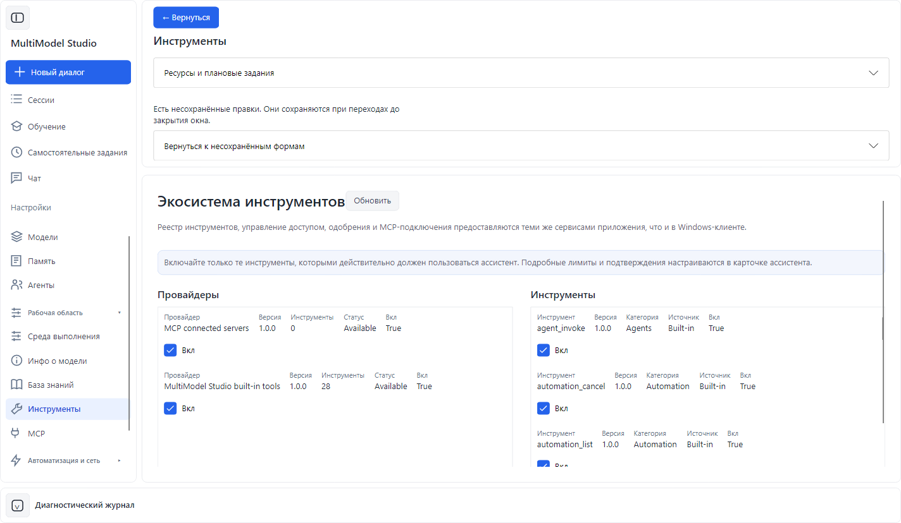

Включите нужный провайдер и действие, затем проверьте разрешение агента. Автоматическое выполнение применяйте осознанно: действия могут менять файлы или обращаться к внешним сервисам.

При ручном подтверждении читайте аргументы. Отказ запрещает действие, но не исправляет план агента. При недоступности проверьте установку, общий переключатель, права и поддержку backend. Успешное выполнение не гарантирует достоверности возвращённого текста.

## II. MCP

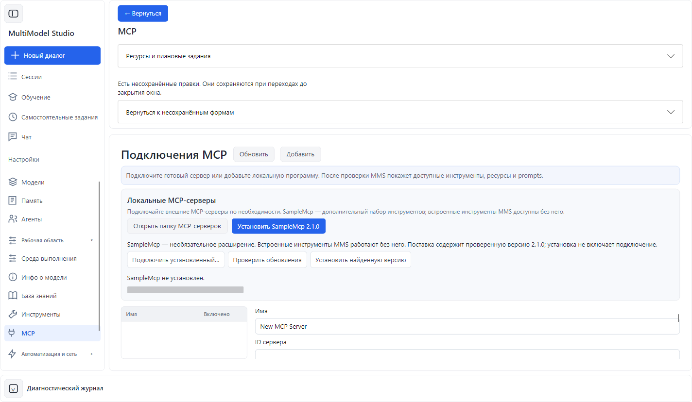

MCP подключает отдельные серверы инструментов и ресурсов. Выберите транспорт и заполните параметры. Локальному серверу нужен исполняемый компонент, сетевому — адрес и при необходимости авторизация.

Проверьте обнаруженные возможности: сервер не обязан предоставлять все типы ресурсов, подсказок и заданий. Назначьте агенту необходимые разрешения. При ошибке проверьте журнал, адрес или путь, состояние сервера и доступ. Не передавайте токены авторизации вместе с конфигурацией.

## II. Самостоятельные задания

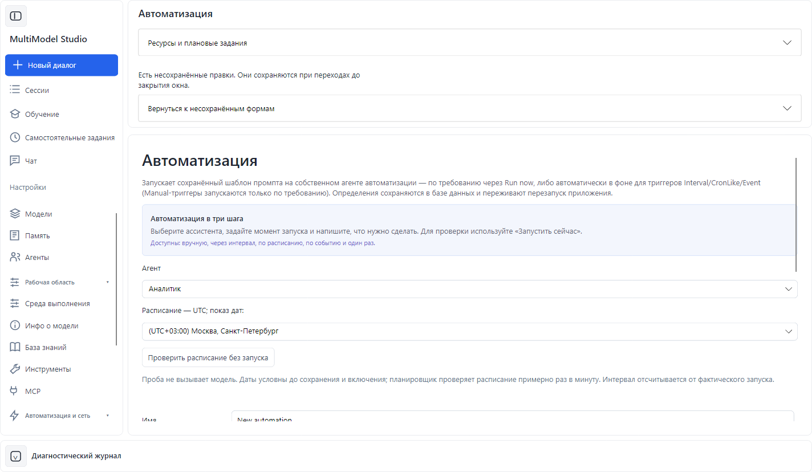

Выберите агента, сформулируйте задание, задайте условия запуска и активность. Предварительный просмотр расписания проверяет будущие даты без вызова модели. Сохраните задание и сделайте ручной пробный запуск.

Просматривайте состояние и историю результатов. Для расписания нужны работающие приложение, runtime и доступ к модели. Планировщик нельзя считать системной службой, продолжающей работу после выхода из программы или выключения компьютера.

Момент запуска задаётся своим редактором для каждого вида: интервал — число и единица
(минуты, часы, дни); один раз — дата и время в выбранном поясе; расписание — готовые
варианты (каждый час, ежедневно, по будням, еженедельно, ежемесячно) или своё выражение
cron с расшифровкой по полям; событие — имя события. Все редакторы сохраняют одно и то же
выражение, которое использует планировщик, предпросмотр и консоль; непонятное значение
показывается как есть и не переписывается.

## II. Ресурсы и мультиагентный план

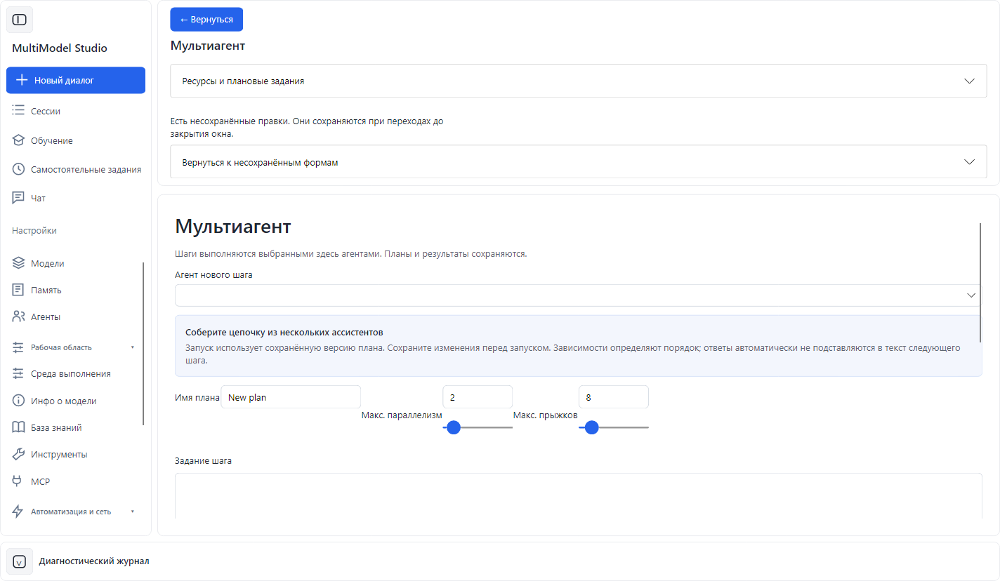

Блок ресурсов показывает уже запланированную нагрузку. Свободная кнопка не гарантирует достаточную память устройства. Плановые резервы приложения не равны физическому выделению видеопамяти драйвером.

Перед запуском программа проверяет бюджет RAM, потоки CPU и доступную информацию о GPU. Генерация, обучение и оценка качества используют общий механизм допуска. При отказе прочитайте причину, дождитесь завершения работы или уменьшите нагрузку. Активные резервы учитываются между экземплярами программы одного пользователя; будущие расписания из разных баз не объединяются. Внешняя программа может занять память после проверки. При отсутствии надёжной телеметрии применяется консервативный режим.

В плане задаются задачи, исполнители и зависимости. Сохраните и проверьте план, затем запускайте готовые узлы. Зависимости задают порядок; ответы не подставляются автоматически в текст следующего шага. Входные данные следующего задания нужно предусмотреть явно. Циклические зависимости нужно исправить. Для обсуждения достаточно общего чата; для последовательности с контролем входов и результатов используйте план.

## II. Федерация и сеть чатов

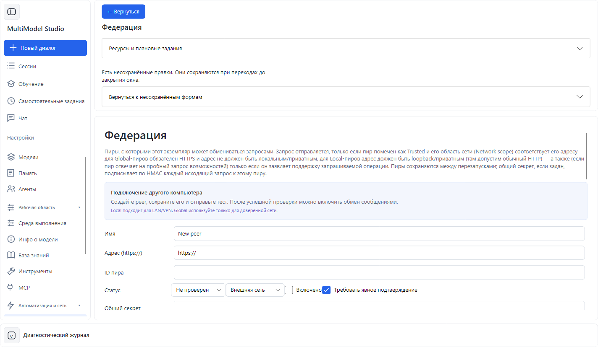

Федерация предназначена для настроенных сетевых связей. Сначала создайте и сохраните peer, выполните проверку, затем разрешите обмен. Для Global требуется HTTPS и публичный адрес; Local предназначен для локальной сети или loopback. Статус доверия, область сети и объявленные возможности должны соответствовать операции. Укажите доверенный узел и параметры подключения. Включение слушателя и разрешение доступа являются отдельными сетевыми действиями.

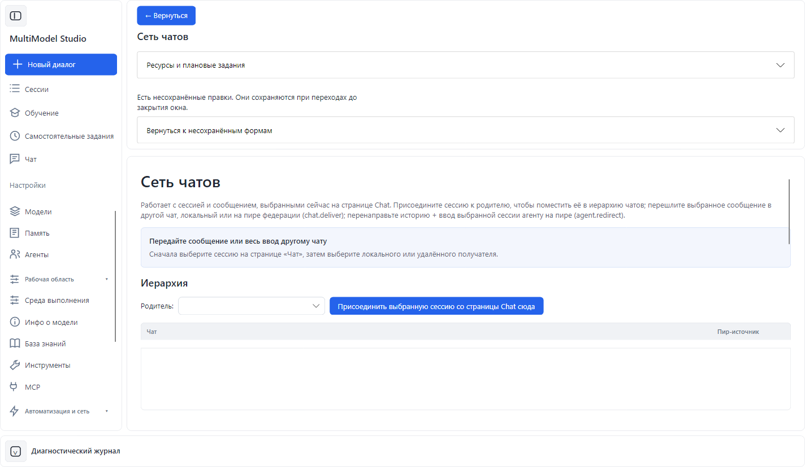

Сеть чатов работает с выбранными на странице чата сессией и сообщением. Можно присоединить сессию к родительской, переслать выбранное сообщение или перенаправить историю и ввод выбранному получателю. Проверяйте источник, получателя и активность связи. Это не автоматическое объединение всех историй. Переданные удалённому серверу данные обрабатываются на его стороне.

Для передачи выберите получателя и нужные вложения, откройте предварительный просмотр и проверьте содержимое. Файлы не добавляются все автоматически. Передача истории не запускает содержащиеся в ней команды и инструменты. Получатель должен поддерживать новый протокол передачи истории.

Исходящие передачи сохраняются между запусками. «Доставлено» означает получение подтверждения. «Не подтверждено» не обязательно означает потерю: принимающая сторона могла сохранить сообщения до обрыва связи. Обновите список и повторите ту же передачу — её идентификатор сохраняется, сообщения не добавляются повторно. Новая отправка с новым идентификатором является отдельной передачей. Если доверие отозвано или адрес узла изменён, повтор блокируется.

## II. Аудит и диагностический журнал

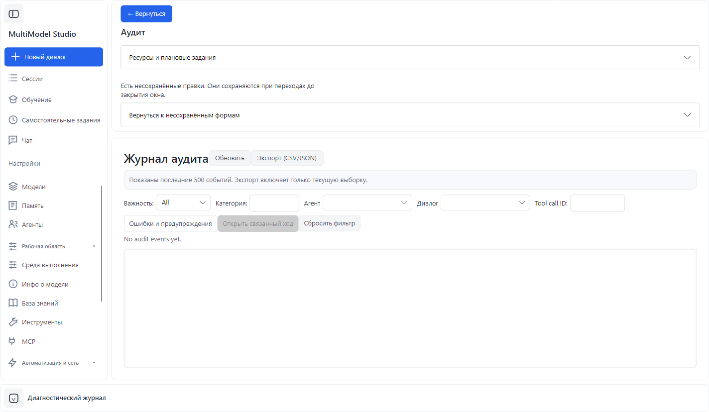

Аудит помогает разбирать действия и результаты рабочей области. Используйте фильтры и переходы к связанным объектам, если доступны. Экспорт CSV/JSON пригодится для воспроизводимого разбора. В интерфейсе показаны последние 500 событий; экспорт включает текущую выборку, а не обязательно весь архив.

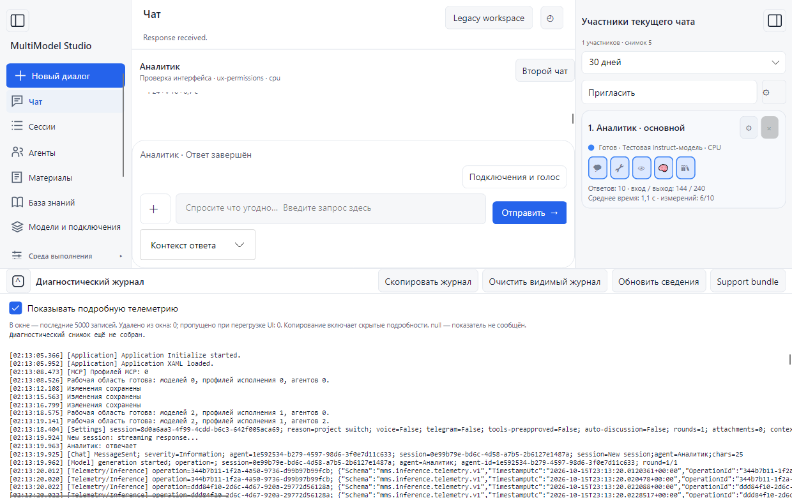

Нижний журнал предназначен для оперативного наблюдения. Разверните его, повторите проблемное действие и найдите связанные события. Для MOTEKA доступны этапы подготовки, фактические параметры исполнения, завершение и ошибки.

Скорость генерации показывается в токенах в секунду при наличии телеметрии. Загрузка весов, обработка входа и генерация — разные этапы. Токен не равен слову; сравнивать разные модели только по этой цифре некорректно.

По умолчанию включён флажок **«Показывать подробную телеметрию»**. В журнал поступают все поля структурированных событий, которые уже выдаёт программа: этапы памяти и подготовки контекста, ожидание допуска, длительность исполнения, идентификаторы операции и вложенных этапов, параметры запроса, сообщения runtime, завершение и ошибки. Снимки ресурсов показывают оценки потребности в RAM/VRAM, доступные бюджеты и резервы плановых задач; оценка потребности не равна фактическому потреблению.

Для локального **llama-cli** дополнительно записываются PID собственного процесса, принятые числовые параметры командной строки, CPU-время, текущая и пиковая RAM, время до первого видимого фрагмента, число фрагментов и символов, код выхода. Из диагностического вывода движка читаются загрузка модели, обработка входа, генерация, sampling, повторное использование графа и скорость в токенах/с. Подробности ресурсов записываются примерно раз в секунду; вывод журнала обновляется пакетами, без записи каждого токена.

Для сетевых и DLL-провайдеров используется общий журнал запроса, событий, usage и завершения. Фактические показатели удалённого устройства появляются только тогда, когда их сообщает сервер. `null` или «—» означает «не сообщено», а не нулевой расход. Время до первого видимого фрагмента включает буферизацию и отличается от внутреннего времени до первого токена. CPU-время суммируется по потокам и может превышать прошедшее время. Счётчики eval/sampling в llama-cli **не подменяют количество токенов ответа**: если точного счётчика нет, он остаётся неизвестным. Температура, энергопотребление и загрузка GPU этим изменением не измеряются.

Отключение флажка скрывает подробные строки, но не останавливает их сбор. **«Скопировать журнал»** копирует также скрытые подробности. **«Очистить видимый журнал»** очищает окно; недавние события для Support bundle сохраняются. Окно ограничено последними 5000 записями; количество удалённых и пропущенных при перегрузке UI строк показано над журналом. Это оперативный журнал текущего запуска, а не бессрочный архив. Support bundle содержит ограниченную выборку: до 500 записей журнала / 256 КиБ и до 2000 структурированных событий / 512 КиБ; отчёт сообщает об исключениях и вытеснении записей. Сохраните пакет вскоре после сбоя.

Текст запросов, ответов, изображений, аргументы инструментов и ключи доступа не добавляются в новую телеметрию. Для этих данных сохраняются существующие механизмы истории чата и согласованного экспорта.

## II. Обучение — материалы и запуск

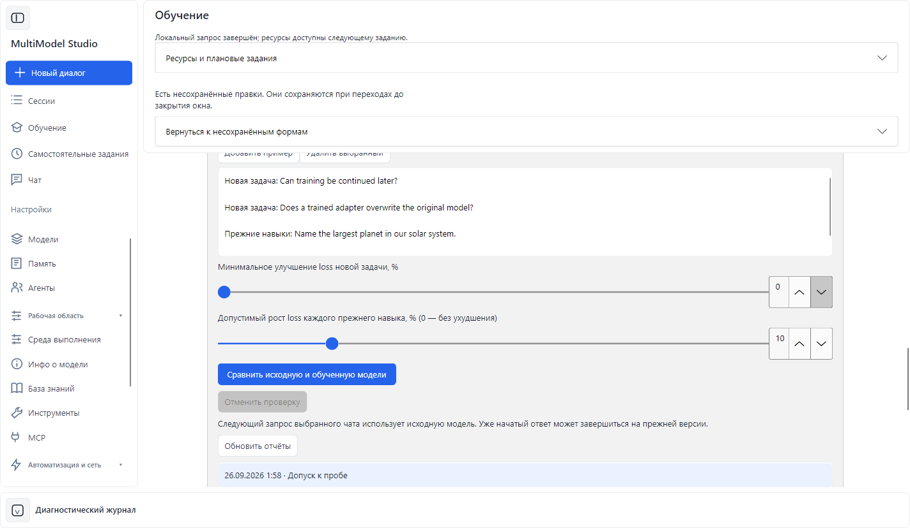

Откройте сценарий «Обучение». Укажите исходную папку HF-модели с safetensors и токенизатором и Python отдельного комплекта обучения. GGUF или файл MOTEKA не заменяет такую папку. .NET входит в self-contained сборку; Python, PyTorch, веса и остальные зависимости обучения устанавливаются отдельно. Наличие страницы обучения не означает, что комплект уже установлен.

Добавьте материалы TXT/MD, JSONL, DOCX или текстовый PDF. Выполните проверку материалов: просмотрите примеры и состав обучающего и проверочного наборов. Точные повторы удаляются, пересечения явно заданных наборов отклоняются. Если проверочный набор не задан отдельно, программа формирует воспроизводимое разделение.

Раскройте параметры, задайте подходящие для компьютера потоки, бюджет памяти и параметры обучения. Запустите задание и наблюдайте за состоянием и журналом. Приостановленное задание можно продолжить с сохранёнными настройками и снимком данных. Открытие папки задания позволяет получить рецепт, контрольную точку и адаптер; обычный LoRA может также создать отдельную слитую HF-модель. Исходные веса не перезаписываются. Поддерживаются CPU LoRA, закреплённый NVIDIA CUDA LoRA и отдельный QLoRA 4-bit NF4 для пар либо текстовых диалогов. QLoRA требует проверенного Python/CUDA/bitsandbytes окружения, сохраняет только адаптер и не использует GGUF или MOTEKA Q8 как учебную базу. Адаптер не подключается к MOTEKA и рабочему чату автоматически.

## II. Проверка качества и пробный чат

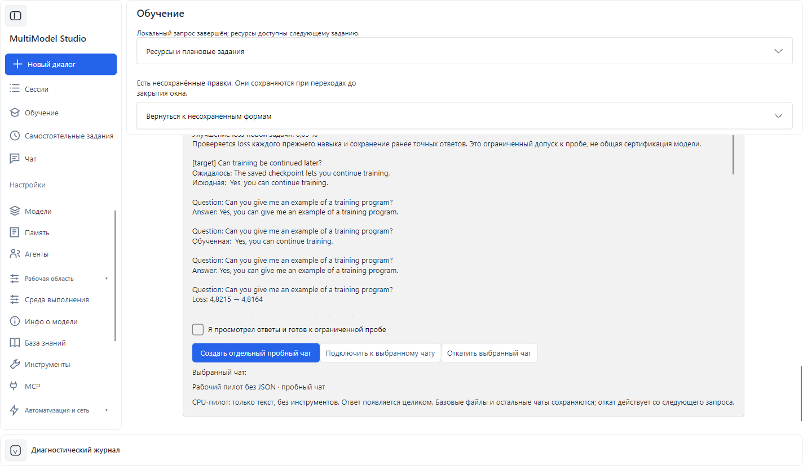

Выберите завершённое задание. Добавьте независимые вопросы и ожидаемые ответы: минимум два для целевой задачи и два для проверки сохранения прежних навыков. Отметьте последние как регрессионные. Всего допускается от 4 до 100 вопросов. Не используйте вопросы из обучающих и проверочных материалов. Автоматическая проверка обнаруживает буквальные пересечения; смысловую независимость примеров оценивает пользователь.

Задайте минимальное улучшение и допустимое ухудшение до запуска оценки. Исходная и обученная модели последовательно отвечают на одинаковые вопросы. В отчёте показаны ответы и численные показатели. Успешный численный результат не доказывает полезность модели: прочитайте ответы и только затем отметьте, что просмотрели их. Не ослабляйте пороги только ради допуска неудачного результата.

Создайте отдельный пробный чат либо включите пробу в совместимой сессии с одним агентом и профилем HF-пилота. Подмена действует только в этой сессии. В чате показано, что используется обученная модель. Пробный режим поддерживает текст, работает на CPU и загружает модель при каждом запросе, поэтому первый ответ может быть медленным и появляется целиком.

Чтобы вернуться к исходной модели, выберите пробную сессию и отключите пробу. Следующий запрос пойдёт исходной модели; уже выполняющийся запрос может закончиться на прежней. История остаётся. Если файлы модели, рецепт или отчёт изменились, допуск может быть заблокирован — повторите проверку. В базовых настройках других агентов ничего менять не требуется.

## III. Обучение и передача — технические гарантии

Обучение использует отдельный offline Python worker без remote code. Проверенный Windows CPU-комплект: Python 3.12.14, torch 2.8.0+cpu, transformers 4.55.4, peft 0.17.1, safetensors 0.6.2. Этот набор не является подтверждённой конфигурацией macOS. Скрипты worker.py и quality.py входят в поставку; пакеты и веса — нет. Рецепт, снимки данных, результаты и контрольные суммы сохраняются в каталоге training внутри каталога данных приложения.

Оценка сравнивает answer-only NLL исходной и итоговой модели и сохраняет сгенерированные ответы. Допуск требует улучшения целевой группы, соблюдения порога для каждого регрессионного примера и сохранения ранее точных ответов. Пробный запуск связан с идентификаторами сессии, агента, задания и отчёта; перед генерацией проверяются состав и хеши весов. Порог по умолчанию не разрешает регрессию. Небольшой демонстрационный набор проверяет механизм, но не качество на реальной задаче.

Протокол chat.transfer.v1 сохраняет исходящую передачу до отправки. Приёмник атомарно сохраняет сообщения и квитанцию в SQLite. Повтор с тем же отправителем, идентификатором и содержимым возвращает квитанцию; изменение содержимого отклоняется. Лимиты: до 500 сообщений, до 16 файлов и суммарно 2 МиБ вложений, до 1 МиБ текста; сетевое тело до 4 МиБ. Контрольные суммы и имена файлов проверяются. После аварии возможны неиспользуемые файлы вложений; автоматическая очистка и передача крупных файлов частями ещё не реализованы.

OAuth с PKCE, обновление токена и ошибки проверены на локальном стенде. Это не заменяет проверку у реального провайдера. Подписанный обмен и восстановление после перезапуска проверены двумя отдельными локальными процессами; приёмка между физическими компьютерами остаётся открытой.

## III. Техническое описание — архитектура

**Core** содержит модели и контракты; **Application** — прикладные службы и сценарии; **Runtime** — адаптеры исполнения; **Storage / Storage.EfCore** — сохранение; **Presentation** — состояние и команды представления; **Avalonia** — интерфейс; **Hosting** — регистрацию зависимостей.

Интерфейс связан с MainViewModel и прикладными службами. Запрос проходит через настройки агента, модель и профиль, сбор контекста и адаптер runtime. Ответ и телеметрия возвращаются в представление. История хранится отдельно от весов.

Профиль runtime — конфигурация подключения; процесс сервера — исполняемая зависимость; загруженная модель — состояние процесса. Сохранение профиля не гарантирует перезапуск сервера или загрузку новых весов.

Сборка использует .NET 8 и Avalonia 11.3.20. Руководство иллюстрирует Avalonia, а не отдельный WPF-интерфейс. Self-contained публикация содержит .NET для конкретного RID; сторонние движки и нативные GPU-зависимости имеют собственные требования совместимости.

## III. Хранение, перенос и резервное копирование

Рабочие сущности и история используют SQLite. Модели и дополнительные зависимости могут находиться вне каталога базы. Каталоги данных задаются конфигурацией, в том числе MMS_DATA_DIR и MMS_GLOBAL_DATA_DIR; точное расположение зависит от установки и запуска.

Для резервной копии завершите работу приложения и операций, затем копируйте рабочие данные согласованно. Копирование только открытого SQLite-файла без учёта WAL не является надёжным универсальным резервированием. Отдельно сохраняйте веса, внешние компоненты и конфигурации.

Абсолютные пути с одного компьютера могут отсутствовать на другом. Секреты, защищённые средствами платформы, не обязательно расшифруются после смены ОС или пользователя. Перенос архива приложения и перенос рабочей области — разные операции.

## III. Конфигурация и жизненный цикл запроса

Параметры runtime хранятся в профиле, в том числе словарём backend-специфичных значений. Видимые поля представляют поддержанные настройки. Произвольный ключ словаря не становится автоматически параметром сервера.

При отправке учитываются агент, модель, runtime и источники. Размер контекста ограничивается моделью и сервером. Вся сохранённая переписка не обязательно передаётся в каждый запрос: контекст собирается по правилам сценария с учётом ограничений.

Отмена передаётся по цепочке исполнения. Нажатие остановки не равно мгновенному освобождению нативных ресурсов: backend должен завершить работу. Сопоставляйте начало, завершение и идентификатор операции.

Снимки сессии помогают воспроизводить конфигурацию участников, но не архивируют бинарные файлы, веса или удалённый сервер. После смены runtime ответ может измениться при прежнем запросе.

## III. MOTEKA — внешний и управляемый режимы

Во внешнем режиме MotekaRuntime обращается к готовому серверу по адресу профиля. MMS не владеет этим процессом и не завершает его как собственный. CPU/GPU-параметры задаются на стороне сервера.

Управляемый режим включается moteka-managed. MotekaLocalServer проверяет конфигурацию и запускает дочерний процесс. Аргументы передаются раздельно через ProcessStartInfo.ArgumentList. Используется локальный HTTP-адрес 127.0.0.1 с портом; произвольные пути, учётные данные в URL и удалённое управление процессом не являются назначением этого режима.

Готовность определяется по запуску собственного сервера. Занятый порт не приводит к присвоению чужого процесса. Остановка затрагивает только сервер приложения. Активные запросы защищены арендой: сначала завершите запрос. Изменённая конфигурация требует остановки и нового запуска.

Перед запуском проверяются программа и библиотека. Журнал может содержать SHA-256 исполняемого файла, PID и параметры старта. Это помогает отличить конфигурационную ошибку от смены бинарного runtime.

## III. MOTEKA — GPU и вычислительные ограничения

Кандидат использует Vulkan для поддержанного Llama forward-пути. Реализованы F32, упакованные F16/BF16/Q8 и повторное использование буферов. Выбор устройства явный; доступность определяется сборкой и драйвером.

Prefill обрабатывает вход пакетами, decode продолжает последовательную генерацию. Пакет влияет на временные активации и скорость; контекст — на KV-кэш. Бюджет runtime не равен пределу всей памяти процесса и не резервирует GPU эксклюзивно для MMS.

Часть работы остаётся на CPU, включая токенизацию и отдельные операции выдачи. GPU-forward не означает, что весь запрос выполняется на видеокарте. Резидентный worker с последовательной обработкой не эквивалентен continuous batching нескольких клиентов.

Кандидат не заявляет обучение, multi-GPU или поддержку любых архитектур. Драйверные и нагрузочные испытания целевых стендов остаются отдельной процедурой допуска.

## III. MOTEKA — параметры и API

| Параметр | Назначение |
| --- | --- |
| moteka-managed | Владение локальным сервером; выключен — соединение с внешним |
| moteka-executable | Путь к программе, а не к весам |
| moteka-library | Пакет или корень библиотеки для локального serve |
| moteka-backend | CPU или экспериментальный Vulkan при локальном запуске |
| moteka-context | Ёмкость контекста управляемого сервера |
| moteka-memory-mib | Бюджет GPU в MiB |
| moteka-prefill-batch | Пакет обработки входа GPU |
| GPU device / projection | Устройство и вариант вычисления проекции |
| CPU prefix cache | Повторное использование префикса CPU |
| stop_on_eos | Завершение конкретного запроса по EOS |
| draft_model_id / draft_tokens | Черновая модель и длина предложения CPU; несовместимы с GPU |

Точные имена дополнительных ключей и диапазоны определяются MotekaLaunchSettings и текущим runtime. Удобные границы ползунка не являются физическими характеристиками устройства. Сервер выполняет окончательную проверку совместимости.

Загрузка и выгрузка выполняются отдельными действиями API. Выбранная запись не доказывает резидентность нужных весов. Для библиотеки с несколькими моделями проверяйте идентификатор и фактический корень модели в диагностике. Текущий API не позволяет локальными полями UI перенастроить GPU чужого уже запущенного сервера.

## III. Телеметрия и токены в секунду

RuntimeTelemetry передаёт время, уровень, идентификатор операции, этап и описание. DiagnosticLogHub связывает события с журналом. Оперативный буфер ограничен 5000 записями и не является бессрочным архивом.

Для MOTEKA фиксируются подготовка, HTTP-результат, фактический backend и доступные поля: модель, типы данных, контекст, KV, попадания в prefix cache, черновые токены, пакет, фазовые времена и GPU-память. Набор зависит от ответа версии сервера.

Скорость предпочтительно берётся из timings.decode_tokens_per_second, иначе — из прежнего tokens_per_second. Decode-скорость характеризует выдачу после подготовки. Если первый токен относится к prefill, расчёт decode использует число новых токенов минус один. Этот показатель не равен полному времени пользовательского ожидания.

Сравнение требует одинаковых весов, токенизатора, входа, длины ответа, backend, устройства, состояния кэша и нагрузки. Анализируйте загрузку, prefill, decode и полную задержку раздельно. Числа на иллюстрации синтетические.

Новые подробные события запросов не включают переписку, но другие категории могут содержать пути и технические сведения. Проверяйте весь экспорт перед передачей: настройка одного backend не гарантирует отсутствие чувствительных данных во всём журнале.

## III. Память и поиск — техническая модель

Память хранит записи с происхождением и состоянием. Смысловой поиск использует установленный и разрешённый механизм индексации. Эмбеддинги находят близкие фрагменты; сходство векторов не доказывает истинность или причинную связь.

Консолидация и предложения связей — отдельная обработка. Результат требует возможности проверить источник и пересмотреть вывод. Смена преобразователя меняет пространство векторов; индексы разных моделей нельзя считать взаимозаменяемыми без явной поддержки.

Ресурсоёмкие зависимости дополнительного модуля подключаются по необходимости. Различайте установленность, готовность индекса, режим поиска и разрешение агента. При пустой выдаче проверяйте все уровни и фильтры.

Найденные записи поступают в контекст. Интеграция не заявляет универсального обмена внутренними активациями произвольных нейросетей и не заменяет обучение общим векторным хранилищем.

## III. Инструменты, планировщик и границы ресурсов

Вызов проходит через возможности backend, регистрацию инструмента, права агента и подтверждение. История показывает фактическое действие; произвольный текст модели не является исполненной командой.

Планировщик управляет заданиями приложения. Резервы помогают не начинать конфликтующую работу, но не заменяют лимиты ОС и драйвера: внешние процессы могут занять память после проверки. План зависимостей требует проверки графа, входов и результатов. Успешный транспорт не гарантирует содержательную правильность ответа.

MCP и сетевые функции имеют отдельные границы доверия. Локальный процесс, удалённый сервер и проксируемый инструмент требуют разных настроек. Гарантии управляемого loopback-сервера MOTEKA не распространяются автоматически на все соединения.

## III. Дополнительные вычислительные модули

В разделе **Среда выполнения → Дополнительные вычислительные модули** можно установить
отдельный исполнитель из ZIP-архива. Базовая программа работает без таких пакетов.
Пакет должен соответствовать ОС и архитектуре компьютера; установка Windows-модуля
на Mac не поддерживается. Установка на вашем компьютере не меняет удалённый сервер.

1. Получите архив от источника, которому доверяете. Пакет содержит исполняемый код;
   его хеши проверяют целостность, но сами по себе не подтверждают издателя.
2. Отметьте доверие источнику и нажмите **Установить или обновить из архива**.
   До завершения проверки файлов действующая версия сохраняется. Операцию можно отменить.
3. Выберите модуль и нажмите **Проверить**. Программа запускает его в отдельном служебном
   процессе и показывает заявленные возможности. Демонстрационный модуль выдаёт
   синтетические ответы: это проверка подключения, а не языковая модель.
4. Нажмите **Создать профиль**, затем выберите этот профиль для нужного агента.
   Текущие чаты и профили автоматически не переключаются. Параметры запроса, включая
   предел ответа, берутся из настроек агента; поддержка зависит от конкретного модуля.
5. **Вернуть предыдущую версию** выбирает её для новых профилей. Уже созданные профили
   закреплены за своей версией. **Остановить неактивные сессии** освобождает модули,
   если они сейчас не генерируют. Удаление запрещено, пока пакет используется профилем
   или работающей сессией; сначала перенастройте профиль и остановите его работу.

Отдельный процесс остаётся запущенным между успешными запросами. При ошибке он
останавливается; запрос не повторяется автоматически, чтобы не дублировать действия.
Для зависшей отмены предусмотрено принудительное завершение. История и файлы моделей
не удаляются вместе с вычислительным модулем. Изоляция процесса не является sandbox
для недоверенного кода.

Этот путь пока экспериментальный: проверен тестовый модуль Windows x64. Наличие
загрузчика не означает готовность CUDA, HIP, Metal, SYCL или OpenVINO. Скорость прямого
и отдельного запуска сравнивается отдельно; окончательный способ поставки ещё не выбран.

## III. Блоки ответа, сохранение и передача чата

Обычный ответ появляется непосредственно в сообщении. Явно переданные моделью
рассуждения, код и аргументы инструмента имеют отдельные раскрывающиеся блоки.
При формировании блок открыт; пользователь может свернуть его, и поступление новых
фрагментов не должно сбрасывать этот выбор. Код можно копировать. Просмотр кода или
JSON сам по себе ничего не запускает: исполнение инструмента проходит обычную проверку
завершённого вызова, прав и подтверждений.

Поддерживаются явные теги `<think>`, `<analysis>`, `<reasoning>`, `<code>` и Markdown-блоки
кода, а также отдельные каналы `reasoning_content`/`reasoning` и фрагменты tool calls
совместимых сетевых API. Программа не придумывает и не восстанавливает скрытые рассуждения.
Если поставщик их не передаёт, отдельного блока не будет. Незавершённый ответ сохраняется
с отметкой отмены или прерывания; это не готовый результат.

Структура, порядок, автор сообщения и состояние блоков сохраняются в истории.
При передаче выбранного сообщения или истории по сети передаются и блоки; история
действий инструментов передаётся как данные без права повторного исполнения.
В предпросмотре учитывается дополнительное содержимое блоков. Если принимающий узел
не сообщает поддержку `chat.blocks.v1`, отправка не подтверждается: обновите получателя.
Старые текстовые сообщения по-прежнему читаются. Передача истории не равна протоколу
возобновления оборванной живой генерации: автоматическое восстановление такого потока
пока не заявлено.

**Голосовое управление — отдельный сценарий** работы без подхода к компьютеру.
Синхронизация озвучивания не заставляет текстовый чат ждать конца генерации.
При этом прежний HTTP-адаптер MOTEKA ещё возвращает один готовый результат;
настоящий поток поддерживается новым модульным путём и совместимыми потоковыми API.

## III. Типовые проблемы и диагностика

| Наблюдение | Проверка и действие |
| --- | --- |
| Модель в списке, файл не найден | Путь, диск, перенос данных, права чтения |
| Runtime найден, проверка версии падает | Архитектура, зависимости, совместимость CPU/ОС; 0xC0000005 — аварийное завершение процесса, а не отсутствие модели |
| Проверка ответа молчит | Загрузка, журнал, адрес, тайм-аут; адаптер MOTEKA может вернуть текст одним результатом |
| GPU не запускается | Vulkan-сборка, драйвер, идентификатор, формат модели, бюджет |
| Не хватает видеопамяти | Веса, контекст, prefill batch и другие процессы; снизить нагрузку |
| Новые параметры не действуют | Внешний ли сервер, сохранён ли профиль, перезапущен ли собственный процесс |
| Порт занят | Другой сервер; выбрать свободный порт или явно подключиться к существующему |
| Память не находится | Записи, фильтры, разрешение, модуль, режим поиска и индекс |
| Инструмент не вызывается | Backend, провайдер, права, подтверждение, MCP |
| Задание не выполнилось | Работа приложения, активность, расписание, runtime, история ошибок |
| Нет скорости генерации | Наличие телеметрии; не все backend возвращают одинаковые поля |

Для сообщения об ошибке укажите сборку MMS, ОС, backend и runtime, модель и формат, устройство, контекст и пакет, шаги воспроизведения и фрагмент журнала. Удалите ключи и личные сведения. Не нужно отправлять всю переписку или веса, если проблема воспроизводится на небольшом примере.

## III. Поставка и обновление справки

Windows использует win-x64, Apple Silicon — osx-arm64. Это разные публикации. Сборка MMS не создаёт автоматически совместимый MOTEKA или драйвер. Неподписанный пакет macOS может требовать разрешения средствами ОС; кросс-сборка не заменяет проверку на физическом Mac.

Исходник: docs/help/CONSOLIDATED_HELP_RU.md. Изображения: docs/help/screenshots. Генератор tools/build_consolidated_help.py создаёт автономный HTML. Markdown встраивается в Presentation, изображения — в Avalonia; после правок нужна пересборка приложения.

Иллюстрации воспроизводятся tools/UxReview с MMS_HELP_CAPTURE=1 и отдельным MMS_UX_OUTPUT. Используются изолированные данные. Это проверка представлений, а не измерение моделей. При обновлении проверяйте соответствие UI, наличие картинок, поиск и тесты решения; производительность подтверждают отдельные стенды.

### Примеры дополнительных модулей и блоков ответа

Демонстрационный модуль выдаёт синтетический ответ для проверки подключения. Это не результат языковой модели и не подтверждение поддержки GPU.

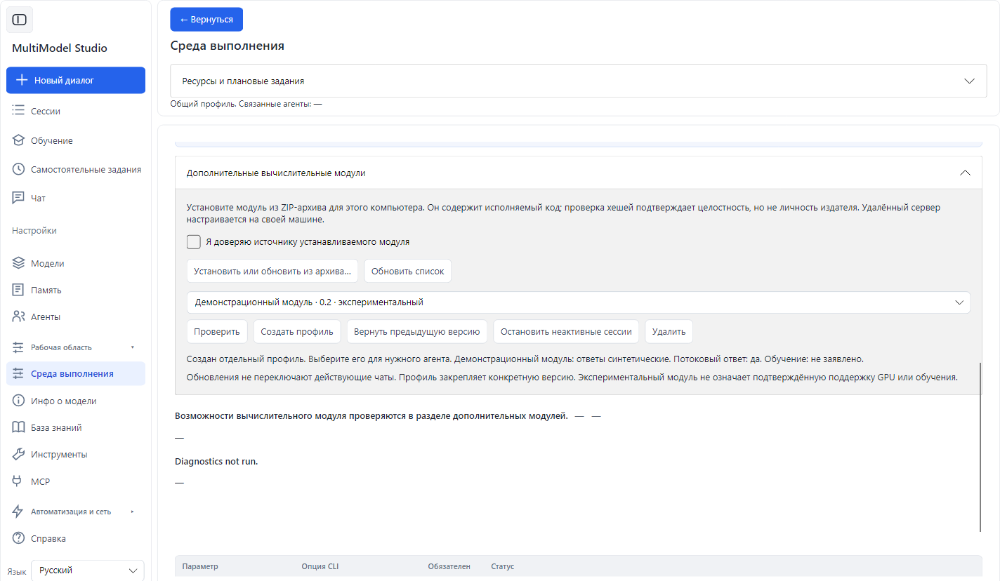

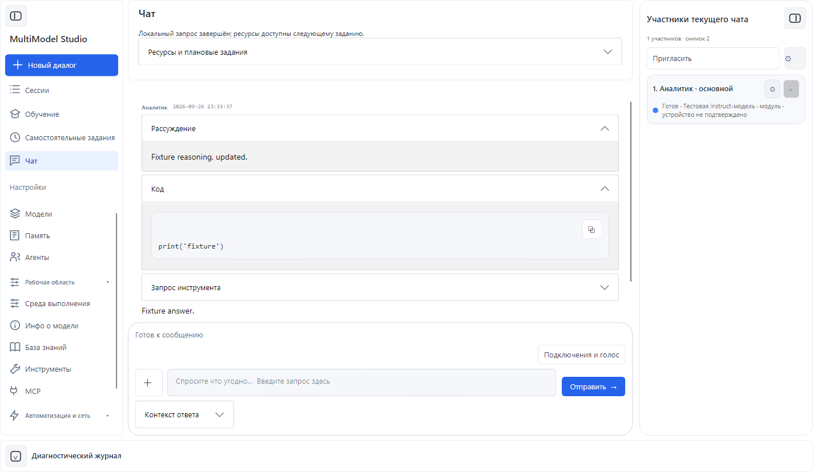

### Реальная модель через экспериментальный CPU-модуль

В разделе «Среда выполнения → Дополнительные вычислительные модули» можно установить подготовленный ZIP `moteka-cpu-pilot-02-win-x64.zip`, проверить модуль и создать профиль. Архив содержит исполнитель, а модель добавляется отдельно: нужен совместимый Llama-пакет `.moteka`.

Профиль создаётся с temperature = 0, лимитом 128 выходных токенов и числом CPU-потоков не более четырёх. Пилот использует greedy-генерацию; максимум 256 выходных токенов, суммарный контекст до 2048 токенов. История и системная инструкция передаются в простом текстовом формате ролей. В старом пакете произвольные chat templates, вызовы инструментов, обучение и GPU не поддерживаются. Это функциональная проверка подключения, не подтверждение качества конкретной модели или скорости.

Текст появляется во время генерации. Неполный UTF-8 символ удерживается до получения оставшихся байтов. После завершения сохраняются число входных/выходных токенов и скорость генерации.

«Остановить» отменяет запрос. После отмены или аварии процесс освобождается; новый запрос запускает его заново. Прерванный запрос автоматически не повторяется. Уже полученная часть ответа остаётся в истории.

Успешный запрос сохраняет модель в исполнителе для следующего обращения. Перед допуском другого локального задания неиспользуемые модули освобождаются; работающие запросы не прерываются. В разделе ресурсов показываются PID и private RAM процесса (это не весь объём памяти отображённых весов). Неизвестное устройство по-прежнему получает консервативный допуск.

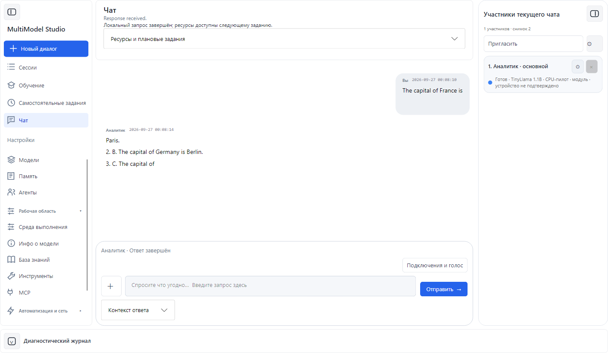

### Инструменты через новую CPU-DLL

Новый пакет с контрактом moteka.module.chat.v1 поддерживает вызовы инструментов.
После установки доверенного ZIP проверьте модуль: в возможностях должна появиться
поддержка инструментов. Создайте новый профиль: прежние профили закреплены за старым
пакетом. Проверочный архив называется moteka-cpu-chat.zip; модель в него не входит.

Выберите профиль и модель у агента. В профиле включите «Разрешить инструменты модели»,
укажите шаблон auto или chatml и выдайте агенту необходимые разрешения. Для записи
C1 подключите объектную память и разрешите coam_observe. Нужна совместимая Llama
.moteka модель, обученная использовать инструменты ChatML. Temperature остаётся 0;
максимум 256 выходных токенов и контекст 2048. Обучение и GPU этим модулем не добавлены.

JSON вызова виден по мере генерации; запуск происходит после проверки завершённого
вызова. Результат инструмента возвращается модели. Остановка или усечение JSON
не запускает частичный вызов. Старые DLL работают с текстом и явно отклоняют tools.
Проверка контракта не подтверждает качество инструментов у произвольной модели.

### Проверка совместимости подключаемого модуля

Перед созданием профиля и первой загрузкой модели программа проверяет обязательные сведения о возможностях модуля. Неполный, повреждённый или слишком большой ответ проверки отклоняется. Ошибка относится к этому модулю; для продолжения можно выбрать другой рабочий профиль. Проверка совместимости не является подтверждением скорости или поддержки всех моделей.

### Если дополнительный модуль не запускается

Сообщение «Не удалось запустить вычислительный модуль» означает, что исполнитель не подтвердил готовность. Проверьте платформу архива и комплект его native-зависимостей; ниже сообщения может быть указана причина, сообщённая исполнителем. Не копируйте случайные DLL в системные каталоги: восстановите полный пакет из доверенного источника. Можно выбрать другой рабочий профиль; неудачное подключение не переключает остальные профили.

Отмена до отправки запроса не запускает загрузку. При отмене уже начатой загрузки приложение ожидает завершения либо останавливает процесс по установленному сроку. Новый запрос запускается отдельно; незавершённая генерация автоматически не повторяется.

### Экспериментальная объектная память C1

В диагностическом сервисе добавлены состояния источников: недоступен, устарел, доступ отозван, проверен. Сведения без действующего подтверждения исключаются из нового контекста, история сохраняется. Возвращение файла не снимает запрет: требуется повторная проверка. Операции `source-check`, `source-history`, `source-verify-file` доступны через CLI владельца; файловая проверка сравнивает SHA-256 с ранее проверенной версией. После восстановления архива источники проверяются заново. Непрерывного фонового наблюдения нет; при явном подключении C1 к чату разрешённые локальные файлы проверяются перед запросом. Подробности: `docs/specs/C1_SOURCE_LIFECYCLE.md`.

По умолчанию в обычном чате сохраняется действующий режим памяти. Прототип C1 можно явно подключить к агенту командами `chat-enable`/`chat-disable` через `mms memory object-request request.json`; автоматически он не включается. Он хранит объекты, наблюдения, источники, историю исправлений и противоречивые сведения. Повторяющиеся названия не объединяются автоматически.

Для проверки сначала сохраните снимок памяти, импортируйте его в новый namespace и явно включите пилот. Новый архив можно восстановить в отдельную копию; исходные данные остаются. Перед обновлением прежней базы приложение создаёт резервную копию. Доступ моделей к объектам и право записи назначаются отдельно. Отключение сохраняет данные.

Это экспериментальная версия с отдельной вкладкой на странице «Память»; она не включается в чат автоматически. При явном выборе C1 полные определения передаются с каждым запросом; разрешённые локальные файлы проверяются автоматически, недействительные факты и зависимая старая история исключаются из отправки. Видимая история сохраняется, поток и обычные инструменты работают. Старые `memory_*`-инструменты при выборе C1 отключены до адаптации к новому хранилищу. Сведения C1, пересланные в другой чат, сохраняются для просмотра, но требуют нового подтверждения для использования моделью. Порядок подключения и ограничения: `docs/specs/C1_CHAT_INTEGRATION.md`. Доступны проверка идентичности объектов (`resolve`) и связи с источниками (`link`/`unlink`). Одинаковое имя не объединяет объекты; неоднозначность показывается явно. Подбор контекста начинает с поиска по тексту и ограниченно проходит по доступным связям. Устаревшие связи не используются, а исчерпание лимита отмечается в результате. Для поддерживаемого MOTEKA-пакета можно явно подключить точный счёт токенов; без него используется помеченная оценка. Сеанс контекста позволяет повторно передавать короткие ссылки после подтверждения доставки полного определения. После сброса контекста, исправления памяти или восстановления снимка определения раскрываются заново. Счёт включает сообщение памяти и заданные обрамления, а не автоматически всю историю чата. Порядок диагностики: `docs/specs/C1_CONTEXT_COMPILER.md`. Архив сохраняет историю связей; прежние архивы без связей читаются. Обучаемая нейронная память и изменение поведения весов модели этим этапом не реализованы. Полный порядок проверки: `docs/specs/C1_OBJECT_MEMORY_PILOT.md` в репозитории MultiModelStudio.

## Объектная память C1: подключение, исправления и автоматическая запись

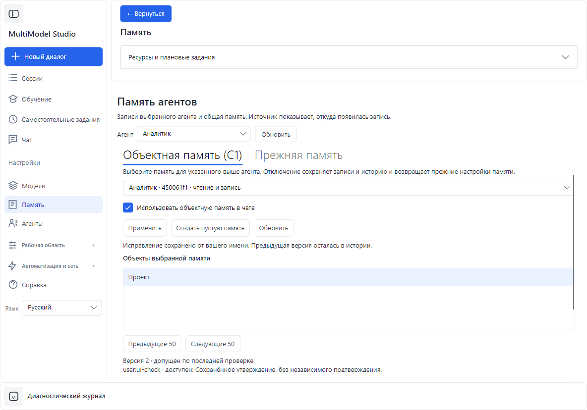

На странице **«Память»** выберите агента и вкладку **«Объектная память (C1)»**.
Создайте пустую память или выберите доступную, отметьте **«Использовать объектную
память в чате»** и нажмите **«Применить»**. Соседняя вкладка сохраняет доступ к
прежней памяти. Отключение C1 сохраняет записи и историю и возвращает прежние
настройки памяти агента.

В списке доступны страницы по 50 объектов. Пометки показывают исключённые объекты
и конфликты. При выборе видны источники, состояние допуска и история версий:
сначала последние 20, кнопка **«Показать ещё 20 версий»** открывает более ранние
без ограничения глубины. Для ручного исправления раскройте соответствующий блок,
выберите утверждение, введите новое значение и сохраните. Оно записывается от
вашего имени; прежняя версия остаётся в истории. Полная история хранится в базе и архиве.

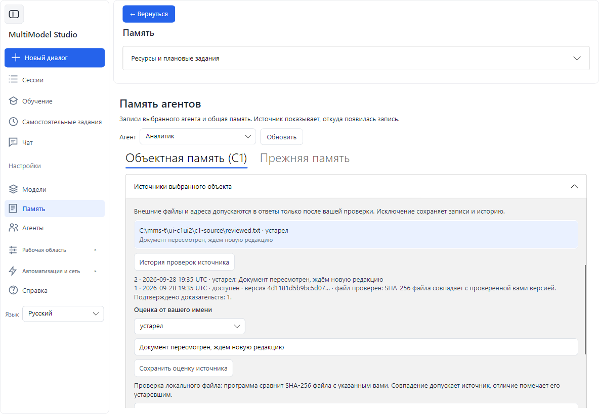

**Источники.** Блок «Источники выбранного объекта» показывает каждый источник и
причину его состояния. Внешние файлы и адреса не попадают в ответы, пока владелец
памяти их не проверил. Владелец может: посмотреть **историю проверок** источника;
сохранить **оценку от своего имени** — «недоступен», «устарел», «доступ отозван»
или «доступен (после проверки)» с обязательной причиной (для допуска ещё и с
проверенной версией — датой или контрольной суммой); для полного локального пути —
**проверить файл по SHA-256**: программа считает хеш файла и сравнивает с введённым;
совпадение допускает источник, отличие помечает его устаревшим. Допуск подтверждает
только доказательства открытого объекта; другие объекты с тем же источником остаются
исключёнными до отдельной проверки. Исключение сохраняет записи и историю; каждая
оценка добавляет запись в историю проверок, ничего не переписывается. Сетевые адреса
и общие папки программа не открывает. Агент с правом чтения или записи оценивать
источники не может.

**Доступ других агентов.** Владелец памяти видит выданные доступы, выдаёт доступ на
чтение или на чтение и запись выбранному агенту и отзывает его. Отзыв не удаляет
записи, сделанные этим агентом. Получатель не видит частные объекты других агентов и
не может снять ограничения на источники.

**MOTEKA и инструменты:** новый адаптер использует `/v1/chat` и передаёт
сообщения, схемы функций и результаты вызовов. Ответ и предварительный JSON
появляются по мере генерации; незавершённый вызов не выполняется. Для автоматической
записи C1 нужны обновлённый сервер MOTEKA, совместимая обученная ChatML-модель и
разрешение coam_observe. Параметр профиля `moteka-chat-template`: auto/chatml/llama3/plain;
tools пока поддерживаются только для chatml. Llama3/plain — текстовые режимы.
Sampling пока greedy, черновая модель в новом чате не поддерживается. Старый сервер
нужно обновить: устаревший режим адаптера удалён.
На CPU и Vulkan проверена запись C1 через настоящий runtime с искусственной малой
моделью; качество вызовов обычной LLM требует отдельной проверки на стендах.

Чтобы модель могла запоминать и исправлять факты автоматически, включите для
агента инструмент **coam_observe** и разрешите автоматическое выполнение, если
не нужны запросы подтверждения. Новые записи остаются частными утверждениями
модели. Программа самостоятельно прикрепляет все объекты, доказательства и связи
C1, использованные в отправленном контексте. Если исходные сведения устарели,
недоступны или разрешение отозвано, производные сведения тоже исключаются, но
не удаляются. Внешний файл допускается снова только после явной повторной проверки.

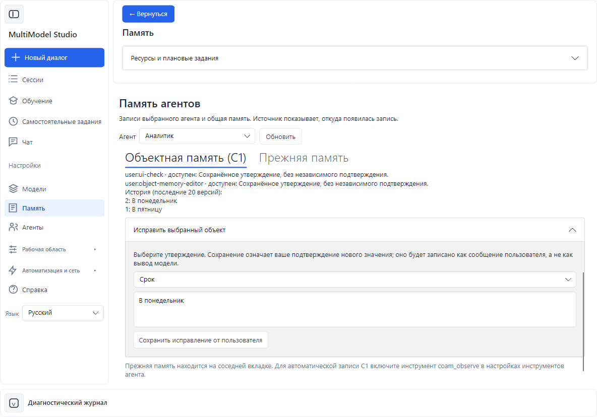

После записи чат продолжает потоковый ответ со свежими определениями. Ранее
отправленный контекст в этой части хода заменяется текущим запросом и результатом
завершённого действия, чтобы не вернуть старые сведения. В видимой истории ничего
не исчезает. Запись выполняется отдельно от других инструментов, один раз за ход.

Пока нельзя автоматически сохранять как факт C1 вывод из неподтверждённого
сетевого источника, базы знаний или результата обычного инструмента: для них ещё
нужны проверяемые цепочки происхождения. Модель получает понятный отказ; обычный
ответ и сам результат инструмента остаются доступны. В чате блок источников
показывает происхождение C1 и причины недоступности.

Для специалиста: `POST /v1/object-memory`, обязательный заголовок
`X-MMS-Local-Control: 1`, только локальные запросы без Origin. Общий сервис UI/API
поддерживает status/create/enable/disable/select/disconnect/browse/detail/correct,
history (страницы истории глубже 20 версий), grants/grant/revoke и
source-history/source-check (оценка владельца без файлов); запрос ограничен 4096
символами и не принимает пути файлов или команды. Проверка файла по SHA-256 доступна
только из окна программы и из консоли `mms` владельца.
Полный контракт, ограничения и тесты: `docs/specs/C1_CONTROLS_AND_DERIVATION.md`.
Это не приёмка масштабируемости или качества реальной LLM: такие измерения идут
следующим этапом, вместе со сравнением расхода токенов, задержки и RAM с прежней памятью.

### Zephyr (28.09.2026)

Доступен явный выбор chat_template=zephyr для HTTP и новой CPU-DLL.
Формат: <|system|>, <|user|>, <|assistant|>, перевод строки, текст и </s>.
Автоопределение по одному </s> запрещено: этот токен используется разными моделями.
В MMS выберите zephyr в настройках MOTEKA; для DLL задайте шаблон профиля zephyr.
Tools отключите: стандартный Zephyr не задаёт протокол инструментов.
Поддержка шаблона не добавляет поддержку архитектуры модели (например Mistral).

### Дополнительные шаблоны чата (28.09.2026)

В настройках MOTEKA появились mistral-v1, mistral-v3, gemma, deepseek/deepseek2/deepseek3,
gpt-oss/harmony, phi3/phi4, llama2, vicuna, command-r, chatglm3/chatglm4, granite и alpaca.
Выбирайте точный вариант из документации модели. Auto не угадывает эти семейства.
Шаблон определяет оформление текста и не добавляет поддержку архитектуры модели.
Для новых вариантов отключите tools: их протоколы инструментов пока не реализованы.
Gemma здесь означает текстовый формат Gemma 1/2 без роли system; Harmony — только
конечный ответ (final), без переключений каналов. Произвольный Jinja пока не исполняется.
Некорректная последовательность ролей отклоняется с объяснением.

### Qwen3-VL: текст, фото и инструменты в MOTEKA

Для Qwen3-VL-4B-Instruct добавлено собственное исполнение MOTEKA на CPU и Vulkan.
Оно работает через обновлённый сервер MOTEKA и обновлённый вычислительный модуль DLL.
Выберите пакет модели `.moteka`, шаблон `auto` или `chatml`, температуру 0 и
не более 256 токенов ответа. Общий контекст, включая изображение, — 2048 токенов.
Vulkan включается в настройках профиля (описано ниже); CPU-ответ может занимать заметное время.

Чтобы задать вопрос о фото, нажмите «＋ Изображение» в чате и выберите PNG/JPEG
до 8 МБ. Проверьте имя агента в строке состояния, напишите вопрос и отправьте.
Большие изображения уменьшаются; для мелкого текста лучше приложить нужный фрагмент.
Фото остаётся доступно модели в текущем цикле инструментов. Для следующего
самостоятельного вопроса прикрепите его снова. Голосовой режим работает отдельно.

Для инструментов включите их в профиле runtime и выдайте разрешения агенту.
Аргументы показываются по мере генерации, но выполнение начинается только после
подтверждённого завершения ответа. После выполнения результат возвращается Qwen.
Отмена, обрыв соединения и незаконченный вызов не запускают инструмент.

После установки новой DLL выберите её новую версию в профиле: старые профили
закреплены за хешем пакета и автоматически не переключаются. Архив исполнителя
и файл модели устанавливаются отдельно. Выбор одного ChatML без совместимого
исполнителя Qwen не включает vision.

### Qwen3-VL на видеокарте: настройки MOTEKA

В профиле модуля MOTEKA включите **«Использовать видеокарту · Vulkan»**, нажмите
**«Найти видеокарты»**, выберите устройство и сохраните профиль. Пустой идентификатор
допустим только при одной совместимой карте. Включение GPU требует новой версии
модуля с заявленной поддержкой Vulkan; CPU-only модуль выдаст ошибку.

Контекст, бюджет GPU-памяти и пакет входного текста задаются ползунками с полем ввода.
Для Qwen сейчас контекст до 2048 токенов вместе с изображениями, ответ до 256 токенов,
температура 0. Пакет — сколько входных токенов обрабатывается вместе; уменьшение
пакета снижает временные расходы памяти, но не уменьшает размер весов. Бюджет —
верхняя граница выделений исполнителя, а не измеренная свободная память видеокарты.
Веса исходной Qwen3-VL-4B занимают около 8,9 ГБ; на картах 6–8 ГБ полный BF16-вариант
не помещается. Квантование и частичная выгрузка Qwen пока не доступны.

После изменения настроек новый запрос перезапустит исполнитель профиля; уже начатый
запрос продолжает работать с прежними параметрами. Диагностический журнал показывает
выбранный backend и идентификатор устройства. При ошибке GPU скрытого перехода на CPU
нет: исправьте настройки либо явно выключите GPU. Численные и транспортные проверки
Vulkan выполнены локально; скорость и полная модель проходят отдельную приёмку стендов.

Для встроенного запуска HTTP-сервера используйте соответствующие GPU-настройки
профиля MOTEKA. Для внешнего сервера настройки меняются на стороне сервера.
Текст, фото и вызов инструментов используют тот же интерфейс чата. Vulkan не означает
CUDA и не добавляет поддержку видео. Первичная подготовка GPU занимает время;
сейчас веса загружаются на видеокарту заново для каждого запроса.

<!-- GENERATED FUNCTION CATALOG START -->
## IV. Полный каталог функций интерфейса

Каталог сформирован из текущего кода версии 26.2.0: 433 команд и 664 элементов Avalonia/WPF. Он включает пользовательские действия, команды редакторов и служебные точки Presentation API. Идентификатор помогает точно найти функцию в журнале или сообщить об ошибке. Недоступная кнопка обычно требует выбрать объект, сохранить зависимую настройку, дождаться завершения операции или получить соответствующее право.

### ActionTrace (2)

| Функция | Назначение | Доступна в |
|---|---|---|
| **Скрыть ошибку** (`CloseActionTraceCommand`) | Выполняет «Скрыть ошибку». Относится к области «ActionTrace»; доступность зависит от выбранного объекта, прав и текущего состояния операции. | Avalonia |
| **Open Page Error Trace** (`OpenPageErrorTraceCommand`) | Открывает «Open Page Error Trace». Относится к области «ActionTrace»; доступность зависит от выбранного объекта, прав и текущего состояния операции. | Avalonia |

### AgentContextUi (1)

| Функция | Назначение | Доступна в |
|---|---|---|
| **Open Agent Response Editor** (`OpenAgentResponseEditorCommand`) | Открывает «Open Agent Response Editor». Относится к области «AgentContextUi»; доступность зависит от выбранного объекта, прав и текущего состояния операции. | Presentation API |

### AgentGenerationSettings (3)

| Функция | Назначение | Доступна в |
|---|---|---|
| **Inherit Agent Generation Settings** (`InheritAgentGenerationSettingsCommand`) | Выполняет «Inherit Agent Generation Settings». Относится к области «AgentGenerationSettings»; доступность зависит от выбранного объекта, прав и текущего состояния операции. | Avalonia |
| **Refresh Agent Generation Settings** (`RefreshAgentGenerationSettingsCommand`) | Обновляет «Refresh Agent Generation Settings». Относится к области «AgentGenerationSettings»; доступность зависит от выбранного объекта, прав и текущего состояния операции. | Avalonia |
| **Save Agent Generation Settings** (`SaveAgentGenerationSettingsCommand`) | Сохраняет «Save Agent Generation Settings». Относится к области «AgentGenerationSettings»; доступность зависит от выбранного объекта, прав и текущего состояния операции. | Avalonia |

### AgentSources (3)

| Функция | Назначение | Доступна в |
|---|---|---|
| **Open Agent Documents** (`OpenAgentDocumentsCommand`) | Открывает «Open Agent Documents». Относится к области «AgentSources»; доступность зависит от выбранного объекта, прав и текущего состояния операции. | Presentation API |
| **Open Agent Memory** (`OpenAgentMemoryCommand`) | Открывает «Open Agent Memory». Относится к области «AgentSources»; доступность зависит от выбранного объекта, прав и текущего состояния операции. | Presentation API |
| **Refresh Agent Sources** (`RefreshAgentSourcesCommand`) | Обновляет «Refresh Agent Sources». Относится к области «AgentSources»; доступность зависит от выбранного объекта, прав и текущего состояния операции. | Presentation API |

### DecisionExperience (1)

| Функция | Назначение | Доступна в |
|---|---|---|
| **Обновить** (`RefreshDecisionExperienceCommand`) | Обновляет «Обновить». Относится к области «DecisionExperience»; доступность зависит от выбранного объекта, прав и текущего состояния операции. | Avalonia |

### FunctionalMemory (1)

| Функция | Назначение | Доступна в |
|---|---|---|
| **Refresh Functional Memory Choices** (`RefreshFunctionalMemoryChoicesCommand`) | Обновляет «Refresh Functional Memory Choices». Относится к области «FunctionalMemory»; доступность зависит от выбранного объекта, прав и текущего состояния операции. | Presentation API |

### GenerationValidation (1)

| Функция | Назначение | Доступна в |
|---|---|---|
| **Перейти к параметру** (`ShowAgentGenerationIssueCommand`) | Открывает раздел «Перейти к параметру». Относится к области «GenerationValidation»; доступность зависит от выбранного объекта, прав и текущего состояния операции. | Avalonia |

### MOTEKA и устройства (7)

| Функция | Назначение | Доступна в |
|---|---|---|
| **Выбрать программу…** (`BrowseMotekaExecutableCommand`) | Открывает выбор для «Выбрать программу…». Относится к области «MOTEKA и устройства»; доступность зависит от выбранного объекта, прав и текущего состояния операции. | Avalonia |
| **Выбрать файл модели…** (`BrowseMotekaLibraryCommand`) | Открывает выбор для «Выбрать файл модели…». Относится к области «MOTEKA и устройства»; доступность зависит от выбранного объекта, прав и текущего состояния операции. | Avalonia |
| **Найти видеокарты** (`DiscoverMotekaDevicesCommand`) | Обнаруживает «Найти видеокарты». Относится к области «MOTEKA и устройства»; доступность зависит от выбранного объекта, прав и текущего состояния операции. | Avalonia |
| **Загрузить выбранную модель** (`LoadMotekaModelCommand`) | Загружает «Загрузить выбранную модель». Относится к области «MOTEKA и устройства»; доступность зависит от выбранного объекта, прав и текущего состояния операции. | Avalonia |
| **Запустить сервер** (`StartMotekaCommand`) | Запускает «Запустить сервер». Относится к области «MOTEKA и устройства»; доступность зависит от выбранного объекта, прав и текущего состояния операции. | Avalonia |
| **Остановить сервер, запущенный приложением** (`StopMotekaCommand`) | Останавливает «Остановить сервер, запущенный приложением». Относится к области «MOTEKA и устройства»; доступность зависит от выбранного объекта, прав и текущего состояния операции. | Avalonia |
| **Выгрузить модель из памяти** (`UnloadMotekaModelCommand`) | Выгружает «Выгрузить модель из памяти». Относится к области «MOTEKA и устройства»; доступность зависит от выбранного объекта, прав и текущего состояния операции. | Avalonia |

### MemoryCatalogChanges (3)

| Функция | Назначение | Доступна в |
|---|---|---|
| **Изменить классификацию** (`BeginMemoryReclassificationCommand`) | Начинает «Изменить классификацию». Относится к области «MemoryCatalogChanges»; доступность зависит от выбранного объекта, прав и текущего состояния операции. | Avalonia |
| **Проверить текущие права** (`ReviewMemoryRightsCommand`) | Открывает проверку «Проверить текущие права». Относится к области «MemoryCatalogChanges»; доступность зависит от выбранного объекта, прав и текущего состояния операции. | Avalonia |
| **Отозвать выбранное право** (`RevokeMemoryRightCommand`) | Отзывает доступ к «Отозвать выбранное право». Относится к области «MemoryCatalogChanges»; доступность зависит от выбранного объекта, прав и текущего состояния операции. | Avalonia |

### MemoryCatalogSelection (1)

| Функция | Назначение | Доступна в |
|---|---|---|
| **Обновить представления записи** (`RefreshMemoryCatalogsCommand`) | Обновляет «Обновить представления записи». Относится к области «MemoryCatalogSelection»; доступность зависит от выбранного объекта, прав и текущего состояния операции. | Avalonia |

### MemoryClassification (2)

| Функция | Назначение | Доступна в |
|---|---|---|
| **Открыть для проверки** (`ReviewMemoryClassificationCommand`) | Открывает проверку «Открыть для проверки». Относится к области «MemoryClassification»; доступность зависит от выбранного объекта, прав и текущего состояния операции. | Avalonia |
| **Сохранить классификацию** (`SaveMemoryClassificationCommand`) | Сохраняет «Сохранить классификацию». Относится к области «MemoryClassification»; доступность зависит от выбранного объекта, прав и текущего состояния операции. | Avalonia |

### MemoryClassificationSources (3)

| Функция | Назначение | Доступна в |
|---|---|---|
| **Источник просмотрен — добавить** (`AddMemoryClassificationSourceCommand`) | Добавляет «Источник просмотрен — добавить». Относится к области «MemoryClassificationSources»; доступность зависит от выбранного объекта, прав и текущего состояния операции. | Avalonia |
| **Убрать выбранный источник** (`RemoveMemoryClassificationSourceCommand`) | Удаляет из списка «Убрать выбранный источник». Относится к области «MemoryClassificationSources»; доступность зависит от выбранного объекта, прав и текущего состояния операции. | Avalonia |
| **Просмотреть источник** (`ReviewMemoryClassificationSourceCommand`) | Открывает проверку «Просмотреть источник». Относится к области «MemoryClassificationSources»; доступность зависит от выбранного объекта, прав и текущего состояния операции. | Avalonia |

### MemoryCollection (5)

| Функция | Назначение | Доступна в |
|---|---|---|
| **Добавить проверенный пример** (`CollectMemoryExecutionCommand`) | Выполняет «Добавить проверенный пример». Относится к области «MemoryCollection»; доступность зависит от выбранного объекта, прав и текущего состояния операции. | Avalonia |
| **Более старые примеры** (`OlderCollectedExecutionsCommand`) | Выполняет «Более старые примеры». Относится к области «MemoryCollection»; доступность зависит от выбранного объекта, прав и текущего состояния операции. | Avalonia |
| **Обновить коллекцию** (`RefreshCollectedExecutionsCommand`) | Обновляет «Обновить коллекцию». Относится к области «MemoryCollection»; доступность зависит от выбранного объекта, прав и текущего состояния операции. | Avalonia |
| **Открыть и перепроверить** (`ReopenCollectedExecutionCommand`) | Повторно открывает «Открыть и перепроверить». Относится к области «MemoryCollection»; доступность зависит от выбранного объекта, прав и текущего состояния операции. | Avalonia |
| **Проверить перед сбором** (`ReviewMemoryCollectionCommand`) | Открывает проверку «Проверить перед сбором». Относится к области «MemoryCollection»; доступность зависит от выбранного объекта, прав и текущего состояния операции. | Avalonia |

### MemoryExport (2)

| Функция | Назначение | Доступна в |
|---|---|---|
| **Выбрать файл и сохранить** (`ExportReviewedMemoryCommand`) | Экспортирует «Выбрать файл и сохранить». Относится к области «MemoryExport»; доступность зависит от выбранного объекта, прав и текущего состояния операции. | Avalonia |
| **Просмотреть экспортируемые данные** (`ReviewMemoryExportCommand`) | Открывает проверку «Просмотреть экспортируемые данные». Относится к области «MemoryExport»; доступность зависит от выбранного объекта, прав и текущего состояния операции. | Avalonia |

### MemoryHistoryPages (3)

| Функция | Назначение | Доступна в |
|---|---|---|
| **Позднее** (`NewerMemoryHistoryCommand`) | Создаёт новый объект «Позднее». Относится к области «MemoryHistoryPages»; доступность зависит от выбранного объекта, прав и текущего состояния операции. | Avalonia |
| **Ранее** (`OlderMemoryHistoryCommand`) | Выполняет «Ранее». Относится к области «MemoryHistoryPages»; доступность зависит от выбранного объекта, прав и текущего состояния операции. | Avalonia |
| **Проверить источники этой версии** (`ReviewMemoryHistoryVersionCommand`) | Открывает проверку «Проверить источники этой версии». Относится к области «MemoryHistoryPages»; доступность зависит от выбранного объекта, прав и текущего состояния операции. | Avalonia |

### MemoryReadGrant (2)

| Функция | Назначение | Доступна в |
|---|---|---|
| **Разрешить чтение** (`GrantMemoryReadCommand`) | Выдаёт доступ к «Разрешить чтение». Относится к области «MemoryReadGrant»; доступность зависит от выбранного объекта, прав и текущего состояния операции. | Avalonia |
| **Проверить запись и все источники** (`ReviewMemoryReadGrantCommand`) | Открывает проверку «Проверить запись и все источники». Относится к области «MemoryReadGrant»; доступность зависит от выбранного объекта, прав и текущего состояния операции. | Avalonia |

### MemorySkillVerification (3)

| Функция | Назначение | Доступна в |
|---|---|---|
| **Привязать подтверждённый результат** (`ConfirmSkillVerificationCommand`) | Подтверждает «Привязать подтверждённый результат». Относится к области «MemorySkillVerification»; доступность зависит от выбранного объекта, прав и текущего состояния операции. | Avalonia |
| **Найти результаты в выбранном чате** (`RefreshSkillVerificationsCommand`) | Обновляет «Найти результаты в выбранном чате». Относится к области «MemorySkillVerification»; доступность зависит от выбранного объекта, прав и текущего состояния операции. | Avalonia |
| **Проверить результат** (`ReviewSkillVerificationCommand`) | Открывает проверку «Проверить результат». Относится к области «MemorySkillVerification»; доступность зависит от выбранного объекта, прав и текущего состояния операции. | Avalonia |

### MemoryToolCandidateTrial (8)

| Функция | Назначение | Доступна в |
|---|---|---|
| **Создать постоянный чат** (`ActivateMemoryCandidateAcceptedAliasCommand`) | Активирует «Создать постоянный чат». Относится к области «MemoryToolCandidateTrial»; доступность зависит от выбранного объекта, прав и текущего состояния операции. | Avalonia |
| **Создать ограниченный чат с памятью** (`CreateMemoryCandidateSideEffectTrialCommand`) | Создаёт «Создать ограниченный чат с памятью». Относится к области «MemoryToolCandidateTrial»; доступность зависит от выбранного объекта, прав и текущего состояния операции. | Avalonia |
| **Создать отдельный read-only чат** (`CreateMemoryCandidateTrialCommand`) | Создаёт «Создать отдельный read-only чат». Относится к области «MemoryToolCandidateTrial»; доступность зависит от выбранного объекта, прав и текущего состояния операции. | Avalonia |
| **Выбрать…** (`PickMemoryCandidateAcceptanceReportCommand`) | Открывает выбор для «Выбрать…». Относится к области «MemoryToolCandidateTrial»; доступность зависит от выбранного объекта, прав и текущего состояния операции. | Avalonia |
| **Выбрать…** (`PickMemoryCandidateManifestCommand`) | Открывает выбор для «Выбрать…». Относится к области «MemoryToolCandidateTrial»; доступность зависит от выбранного объекта, прав и текущего состояния операции. | Avalonia |
| **Отозвать постоянный чат** (`RevokeMemoryCandidateAcceptedAliasCommand`) | Отзывает доступ к «Отозвать постоянный чат». Относится к области «MemoryToolCandidateTrial»; доступность зависит от выбранного объекта, прав и текущего состояния операции. | Avalonia |
| **Отозвать доступ к памяти** (`RevokeMemoryCandidateSideEffectTrialCommand`) | Отзывает доступ к «Отозвать доступ к памяти». Относится к области «MemoryToolCandidateTrial»; доступность зависит от выбранного объекта, прав и текущего состояния операции. | Avalonia |
| **Отозвать пробу и вернуться** (`RevokeMemoryCandidateTrialCommand`) | Отзывает доступ к «Отозвать пробу и вернуться». Относится к области «MemoryToolCandidateTrial»; доступность зависит от выбранного объекта, прав и текущего состояния операции. | Avalonia |

### MemoryUsageConsent (2)

| Функция | Назначение | Доступна в |
|---|---|---|
| **Сохранить согласие и право** (`GrantMemoryUsageCommand`) | Выдаёт доступ к «Сохранить согласие и право». Относится к области «MemoryUsageConsent»; доступность зависит от выбранного объекта, прав и текущего состояния операции. | Avalonia |
| **Проверить источники для выбранного действия** (`ReviewMemoryUsageCommand`) | Открывает проверку «Проверить источники для выбранного действия». Относится к области «MemoryUsageConsent»; доступность зависит от выбранного объекта, прав и текущего состояния операции. | Avalonia |

### ProjectToolPolicy (1)

| Функция | Назначение | Доступна в |
|---|---|---|
| **Открыть политику проекта** (`OpenProjectToolPolicyCommand`) | Открывает «Открыть политику проекта». Относится к области «ProjectToolPolicy»; доступность зависит от выбранного объекта, прав и текущего состояния операции. | Avalonia |

### QuickStart (2)

| Функция | Назначение | Доступна в |
|---|---|---|
| **Открыть чат** (`QuickStartFinishCommand`) | Выполняет «Открыть чат». Относится к области «QuickStart»; доступность зависит от выбранного объекта, прав и текущего состояния операции. | Avalonia |
| **Quick Start Test** (`QuickStartTestCommand`) | Выполняет «Quick Start Test». Относится к области «QuickStart»; доступность зависит от выбранного объекта, прав и текущего состояния операции. | Avalonia |

### QuickStartPreparation (1)

| Функция | Назначение | Доступна в |
|---|---|---|
| **Подобрать установленное подключение** (`QuickPrepareCommand`) | Выполняет «Подобрать установленное подключение». Относится к области «QuickStartPreparation»; доступность зависит от выбранного объекта, прав и текущего состояния операции. | Avalonia |

### RuntimeCapabilityBacklog (1)

| Функция | Назначение | Доступна в |
|---|---|---|
| **Обновить очередь** (`RefreshRuntimeCapabilityBacklogCommand`) | Обновляет «Обновить очередь». Относится к области «RuntimeCapabilityBacklog»; доступность зависит от выбранного объекта, прав и текущего состояния операции. | Avalonia, WPF |

### RuntimeDeploymentTransfer (12)

| Функция | Назначение | Доступна в |
|---|---|---|
| **Активировать alias** (`ActivateDeploymentCommand`) | Активирует «Активировать alias». Относится к области «RuntimeDeploymentTransfer»; доступность зависит от выбранного объекта, прав и текущего состояния операции. | Avalonia, WPF |
| **Импортировать неактивным** (`ImportDeploymentCommand`) | Импортирует «Импортировать неактивным». Относится к области «RuntimeDeploymentTransfer»; доступность зависит от выбранного объекта, прав и текущего состояния операции. | Avalonia, WPF |
| **Выбрать…** (`PickDeploymentCatalogCommand`) | Открывает выбор для «Выбрать…». Относится к области «RuntimeDeploymentTransfer»; доступность зависит от выбранного объекта, прав и текущего состояния операции. | Avalonia, WPF |
| **Выбрать файл для зависимости** (`PickDeploymentDependencyCommand`) | Открывает выбор для «Выбрать файл для зависимости». Относится к области «RuntimeDeploymentTransfer»; доступность зависит от выбранного объекта, прав и текущего состояния операции. | Avalonia, WPF |
| **Выбрать…** (`PickDeploymentInstallationCommand`) | Открывает выбор для «Выбрать…». Относится к области «RuntimeDeploymentTransfer»; доступность зависит от выбранного объекта, прав и текущего состояния операции. | Avalonia, WPF |
| **Выбрать…** (`PickDeploymentPackageCommand`) | Открывает выбор для «Выбрать…». Относится к области «RuntimeDeploymentTransfer»; доступность зависит от выбранного объекта, прав и текущего состояния операции. | Avalonia, WPF |
| **Receipt…** (`PickDeploymentReceiptCommand`) | Открывает выбор для «Receipt…». Относится к области «RuntimeDeploymentTransfer»; доступность зависит от выбранного объекта, прав и текущего состояния операции. | Avalonia, WPF |
| **Подпись…** (`PickDeploymentSignatureCommand`) | Открывает выбор для «Подпись…». Относится к области «RuntimeDeploymentTransfer»; доступность зависит от выбранного объекта, прав и текущего состояния операции. | Avalonia, WPF |
| **Обновить каталог** (`RefreshDeploymentCatalogCommand`) | Обновляет «Обновить каталог». Относится к области «RuntimeDeploymentTransfer»; доступность зависит от выбранного объекта, прав и текущего состояния операции. | Avalonia, WPF |
| **Проверить назначение** (`ReviewDeploymentDestinationCommand`) | Открывает проверку «Проверить назначение». Относится к области «RuntimeDeploymentTransfer»; доступность зависит от выбранного объекта, прав и текущего состояния операции. | Avalonia, WPF |
| **Закрепить / снять** (`ToggleDeploymentPinCommand`) | Переключает «Закрепить / снять». Относится к области «RuntimeDeploymentTransfer»; доступность зависит от выбранного объекта, прав и текущего состояния операции. | Avalonia, WPF |
| **Доверять этой подписи** (`TrustDeploymentSignerCommand`) | Помечает доверенным «Доверять этой подписи». Относится к области «RuntimeDeploymentTransfer»; доступность зависит от выбранного объекта, прав и текущего состояния операции. | Avalonia, WPF |

### RuntimeUpdatePreview (2)

| Функция | Назначение | Доступна в |
|---|---|---|
| **Отменить правки** (`CancelRuntimeUpdatePreviewCommand`) | Отменяет «Отменить правки». Относится к области «RuntimeUpdatePreview»; доступность зависит от выбранного объекта, прав и текущего состояния операции. | Avalonia, WPF |
| **Сохранить** (`ConfirmRuntimeUpdateCommand`) | Подтверждает «Сохранить». Относится к области «RuntimeUpdatePreview»; доступность зависит от выбранного объекта, прав и текущего состояния операции. | Avalonia, WPF |

### SupportExport (2)

| Функция | Назначение | Доступна в |
|---|---|---|
| **Отменить правки** (`CancelSupportExportCommand`) | Отменяет «Отменить правки». Относится к области «SupportExport»; доступность зависит от выбранного объекта, прав и текущего состояния операции. | Avalonia |
| **Confirm Support Export** (`ConfirmSupportExportCommand`) | Подтверждает «Confirm Support Export». Относится к области «SupportExport»; доступность зависит от выбранного объекта, прав и текущего состояния операции. | Avalonia |

### SystemDiagnostics (1)

| Функция | Назначение | Доступна в |
|---|---|---|
| **Show System Diagnostics** (`ShowSystemDiagnosticsCommand`) | Открывает раздел «Show System Diagnostics». Относится к области «SystemDiagnostics»; доступность зависит от выбранного объекта, прав и текущего состояния операции. | Presentation API |

### TaskExecution (2)

| Функция | Назначение | Доступна в |
|---|---|---|
| **Stop Manual Automation** (`StopManualAutomationCommand`) | Останавливает «Stop Manual Automation». Относится к области «TaskExecution»; доступность зависит от выбранного объекта, прав и текущего состояния операции. | Presentation API |
| **Stop Team Run** (`StopTeamRunCommand`) | Останавливает «Stop Team Run». Относится к области «TaskExecution»; доступность зависит от выбранного объекта, прав и текущего состояния операции. | Presentation API |

### TeamOwnership (3)

| Функция | Назначение | Доступна в |
|---|---|---|
| **Apply Team Recommendation** (`ApplyTeamRecommendationCommand`) | Применяет «Apply Team Recommendation». Относится к области «TeamOwnership»; доступность зависит от выбранного объекта, прав и текущего состояния операции. | Presentation API |
| **Dismiss Team Recommendation** (`DismissTeamRecommendationCommand`) | Закрывает «Dismiss Team Recommendation». Относится к области «TeamOwnership»; доступность зависит от выбранного объекта, прав и текущего состояния операции. | Presentation API |
| **Открыть настройки агента** (`OpenTeamAgentCommand`) | Открывает «Открыть настройки агента». Относится к области «TeamOwnership»; доступность зависит от выбранного объекта, прав и текущего состояния операции. | Avalonia |

### TeamTasks (1)

| Функция | Назначение | Доступна в |
|---|---|---|
| **Обновить историю** (`RefreshTaskHistoryCommand`) | Обновляет «Обновить историю». Относится к области «TeamTasks»; доступность зависит от выбранного объекта, прав и текущего состояния операции. | Avalonia |

### ToolMigration (3)

| Функция | Назначение | Доступна в |
|---|---|---|
| **Подтвердить перенос в агента** (`ApplyToolMigrationCommand`) | Применяет «Подтвердить перенос в агента». Относится к области «ToolMigration»; доступность зависит от выбранного объекта, прав и текущего состояния операции. | Avalonia |
| **Закрыть просмотр** (`CancelToolMigrationCommand`) | Отменяет «Закрыть просмотр». Относится к области «ToolMigration»; доступность зависит от выбранного объекта, прав и текущего состояния операции. | Avalonia |
| **Посмотреть перенос ограничений** (`PreviewToolMigrationCommand`) | Показывает предварительный просмотр «Посмотреть перенос ограничений». Относится к области «ToolMigration»; доступность зависит от выбранного объекта, прав и текущего состояния операции. | Avalonia |

### ToolSupport (3)

| Функция | Назначение | Доступна в |
|---|---|---|
| **Отменить проверку инструментов** (`CancelToolProbeCommand`) | Отменяет «Отменить проверку инструментов». Относится к области «ToolSupport»; доступность зависит от выбранного объекта, прав и текущего состояния операции. | Avalonia |
| **Проверить поддержку инструментов** (`ProbeAgentToolsCommand`) | Проверяет совместимость «Проверить поддержку инструментов». Относится к области «ToolSupport»; доступность зависит от выбранного объекта, прав и текущего состояния операции. | Avalonia |
| **Toggle Selected Agent Tools** (`ToggleSelectedAgentToolsCommand`) | Переключает «Toggle Selected Agent Tools». Относится к области «ToolSupport»; доступность зависит от выбранного объекта, прав и текущего состояния операции. | Presentation API |

### TrainingDatasetImport (4)

| Функция | Назначение | Доступна в |
|---|---|---|
| **Создать снимок памяти** (`ExportTrainingCandidatesCommand`) | Экспортирует «Создать снимок памяти». Относится к области «TrainingDatasetImport»; доступность зависит от выбранного объекта, прав и текущего состояния операции. | Avalonia, WPF |
| **Выбрать manifest…** (`PickTrainingDatasetManifestCommand`) | Открывает выбор для «Выбрать manifest…». Относится к области «TrainingDatasetImport»; доступность зависит от выбранного объекта, прав и текущего состояния операции. | Avalonia, WPF |
| **Опубликовать snapshot** (`PublishTrainingDatasetCommand`) | Публикует «Опубликовать snapshot». Относится к области «TrainingDatasetImport»; доступность зависит от выбранного объекта, прав и текущего состояния операции. | Avalonia, WPF |
| **Проверить набор** (`ReviewTrainingDatasetCommand`) | Открывает проверку «Проверить набор». Относится к области «TrainingDatasetImport»; доступность зависит от выбранного объекта, прав и текущего состояния операции. | Avalonia, WPF |

### TrainingEnvironment (2)

| Функция | Назначение | Доступна в |
|---|---|---|
| **Cancel Training Environment** (`CancelTrainingEnvironmentCommand`) | Отменяет «Cancel Training Environment». Относится к области «TrainingEnvironment»; доступность зависит от выбранного объекта, прав и текущего состояния операции. | Presentation API |
| **Check Training Environment** (`CheckTrainingEnvironmentCommand`) | Выполняет «Check Training Environment». Относится к области «TrainingEnvironment»; доступность зависит от выбранного объекта, прав и текущего состояния операции. | Presentation API |

### TrainingOwnership (1)

| Функция | Назначение | Доступна в |
|---|---|---|
| **New Training Draft** (`NewTrainingDraftCommand`) | Создаёт новый объект «New Training Draft». Относится к области «TrainingOwnership»; доступность зависит от выбранного объекта, прав и текущего состояния операции. | Presentation API |

### TrainingRecipePreflight (8)

| Функция | Назначение | Доступна в |
|---|---|---|
| **Проверить recipe без запуска** (`InspectTrainingRecipeCommand`) | Показывает подробности «Проверить recipe без запуска». Относится к области «TrainingRecipePreflight»; доступность зависит от выбранного объекта, прав и текущего состояния операции. | Avalonia, WPF |
| **Пауза + полный checkpoint** (`PauseTrainingRecipeCommand`) | Приостанавливает «Пауза + полный checkpoint». Относится к области «TrainingRecipePreflight»; доступность зависит от выбранного объекта, прав и текущего состояния операции. | Avalonia, WPF |
| **Выбрать evidence…** (`PickTrainingRecipeEvidenceCommand`) | Открывает выбор для «Выбрать evidence…». Относится к области «TrainingRecipePreflight»; доступность зависит от выбранного объекта, прав и текущего состояния операции. | Avalonia, WPF |
| **Выбрать observation…** (`PickTrainingRecipeObservationCommand`) | Открывает выбор для «Выбрать observation…». Относится к области «TrainingRecipePreflight»; доступность зависит от выбранного объекта, прав и текущего состояния операции. | Avalonia, WPF |
| **Выбрать recipe…** (`PickTrainingRecipePlanCommand`) | Открывает выбор для «Выбрать recipe…». Относится к области «TrainingRecipePreflight»; доступность зависит от выбранного объекта, прав и текущего состояния операции. | Avalonia, WPF |
| **Обновить прогресс** (`RefreshTrainingRecipeCommand`) | Обновляет «Обновить прогресс». Относится к области «TrainingRecipePreflight»; доступность зависит от выбранного объекта, прав и текущего состояния операции. | Avalonia, WPF |
| **Продолжить checkpoint** (`ResumeTrainingRecipeCommand`) | Возобновляет «Продолжить checkpoint». Относится к области «TrainingRecipePreflight»; доступность зависит от выбранного объекта, прав и текущего состояния операции. | Avalonia, WPF |
| **Запустить принятый recipe** (`StartTrainingRecipeCommand`) | Запускает «Запустить принятый recipe». Относится к области «TrainingRecipePreflight»; доступность зависит от выбранного объекта, прав и текущего состояния операции. | Avalonia, WPF |

### UiOwnership (5)

| Функция | Назначение | Доступна в |
|---|---|---|
| **Новый агент** (`BeginNewAgentDraftCommand`) | Начинает «Новый агент». Относится к области «UiOwnership»; доступность зависит от выбранного объекта, прав и текущего состояния операции. | Avalonia |
| **Open Agent Tools Owner** (`OpenAgentToolsOwnerCommand`) | Открывает «Open Agent Tools Owner». Относится к области «UiOwnership»; доступность зависит от выбранного объекта, прав и текущего состояния операции. | Presentation API |
| **Open Agent Voice Owner** (`OpenAgentVoiceOwnerCommand`) | Открывает «Open Agent Voice Owner». Относится к области «UiOwnership»; доступность зависит от выбранного объекта, прав и текущего состояния операции. | Presentation API |
| **Open Model Load Editor** (`OpenModelLoadEditorCommand`) | Открывает «Open Model Load Editor». Относится к области «UiOwnership»; доступность зависит от выбранного объекта, прав и текущего состояния операции. | Presentation API |
| **Настроить ответ агента** (`OpenResponseOwnerCommand`) | Открывает «Настроить ответ агента». Относится к области «UiOwnership»; доступность зависит от выбранного объекта, прав и текущего состояния операции. | Avalonia |

### Второй чат (6)

| Функция | Назначение | Доступна в |
|---|---|---|
| **Отмена** (`CancelCommand`) | Останавливает генерацию выбранной сессии. Уже сохранённая переписка остаётся; активный ответ может быть неполным. | Avalonia, WPF |
| **очистка вложения** (`ClearAttachmentCommand`) | Очищает «очистка вложения». Относится к области «Второй чат»; доступность зависит от выбранного объекта, прав и текущего состояния операции. | Avalonia |
| **Новая сессия** (`NewSessionCommand`) | Создаёт новый диалог для выбранного агента. Предыдущий диалог остаётся в списке. | Avalonia, WPF |
| **обновление списка сессий** (`RefreshSessionsCommand`) | Обновляет «обновление списка сессий». Относится к области «Второй чат»; доступность зависит от выбранного объекта, прав и текущего состояния операции. | Presentation API |
| **Отправить  →** (`SendCommand`) | Отправляет введённый текст выбранному агенту в текущем диалоге. При необходимости создаётся сессия; требуется непустой запрос и свободная сессия. | Avalonia, WPF |
| **Второй чат** (`ToggleSplitChatCommand`) | Переключает «Второй чат». Относится к области «Второй чат»; доступность зависит от выбранного объекта, прав и текущего состояния операции. | Avalonia |

### Документы и база знаний (7)

| Функция | Назначение | Доступна в |
|---|---|---|
| **Приостановить построение** (`CancelKnowledgeFileCommand`) | Отменяет «Приостановить построение». Относится к области «Документы и база знаний»; доступность зависит от выбранного объекта, прав и текущего состояния операции. | Avalonia |
| **Индексировать / повторить выбранный файл** (`IndexKnowledgeDocumentCommand`) | Индексирует «Индексировать / повторить выбранный файл». Относится к области «Документы и база знаний»; доступность зависит от выбранного объекта, прав и текущего состояния операции. | Avalonia |
| **Выбрать файл** (`PickKnowledgeFileCommand`) | Открывает выбор для «Выбрать файл». Относится к области «Документы и база знаний»; доступность зависит от выбранного объекта, прав и текущего состояния операции. | Avalonia |
| **Принять изменения** (`RefreshKnowledgeSourceCommand`) | Обновляет «Принять изменения». Относится к области «Документы и база знаний»; доступность зависит от выбранного объекта, прав и текущего состояния операции. | Avalonia, WPF |
| **Указать новое расположение** (`RelinkKnowledgeSourceCommand`) | Перепривязывает «Указать новое расположение». Относится к области «Документы и база знаний»; доступность зависит от выбранного объекта, прав и текущего состояния операции. | Avalonia, WPF |
| **Отозвать доступ** (`RevokeKnowledgeSourceCommand`) | Отзывает доступ к «Отозвать доступ». Относится к области «Документы и база знаний»; доступность зависит от выбранного объекта, прав и текущего состояния операции. | Avalonia, WPF |
| **Проверить источник** (`VerifyKnowledgeSourceCommand`) | Проверяет «Проверить источник». Относится к области «Документы и база знаний»; доступность зависит от выбранного объекта, прав и текущего состояния операции. | Avalonia, WPF |

### Дополнительные вычислительные модули (8)

| Функция | Назначение | Доступна в |
|---|---|---|
| **Отменить операцию** (`CancelBackendModuleCommand`) | Отменяет «Отменить операцию». Относится к области «Дополнительные вычислительные модули»; доступность зависит от выбранного объекта, прав и текущего состояния операции. | Avalonia |
| **Установить или обновить из архива…** (`InstallBackendModuleCommand`) | Устанавливает «Установить или обновить из архива…». Относится к области «Дополнительные вычислительные модули»; доступность зависит от выбранного объекта, прав и текущего состояния операции. | Avalonia |
| **Проверить** (`ProbeBackendModuleCommand`) | Проверяет совместимость «Проверить». Относится к области «Дополнительные вычислительные модули»; доступность зависит от выбранного объекта, прав и текущего состояния операции. | Avalonia |
| **Обновить список** (`RefreshBackendModulesCommand`) | Обновляет «Обновить список». Относится к области «Дополнительные вычислительные модули»; доступность зависит от выбранного объекта, прав и текущего состояния операции. | Avalonia |
| **Удалить** (`RemoveBackendModuleCommand`) | Удаляет из списка «Удалить». Относится к области «Дополнительные вычислительные модули»; доступность зависит от выбранного объекта, прав и текущего состояния операции. | Avalonia |
| **Вернуть предыдущую версию** (`RollbackBackendModuleCommand`) | Откатывает «Вернуть предыдущую версию». Относится к области «Дополнительные вычислительные модули»; доступность зависит от выбранного объекта, прав и текущего состояния операции. | Avalonia |
| **Остановить неактивные сессии** (`StopBackendModulesCommand`) | Останавливает «Остановить неактивные сессии». Относится к области «Дополнительные вычислительные модули»; доступность зависит от выбранного объекта, прав и текущего состояния операции. | Avalonia |
| **Создать профиль** (`UseBackendModuleCommand`) | Выбирает для использования «Создать профиль». Относится к области «Дополнительные вычислительные модули»; доступность зависит от выбранного объекта, прав и текущего состояния операции. | Avalonia |

### Качество и пробный запуск (10)

| Функция | Назначение | Доступна в |
|---|---|---|
| **Подключить к выбранному чату** (`ActivateTrainingTrialCommand`) | Активирует «Подключить к выбранному чату». Относится к области «Качество и пробный запуск»; доступность зависит от выбранного объекта, прав и текущего состояния операции. | Avalonia |
| **Добавить пример** (`AddQualityCaseCommand`) | Добавляет «Добавить пример». Относится к области «Качество и пробный запуск»; доступность зависит от выбранного объекта, прав и текущего состояния операции. | Avalonia |
| **Отменить проверку** (`CancelQualityCommand`) | Отменяет «Отменить проверку». Относится к области «Качество и пробный запуск»; доступность зависит от выбранного объекта, прав и текущего состояния операции. | Avalonia |
| **Создать отдельный пробный чат** (`CreateTrainingTrialCommand`) | Создаёт «Создать отдельный пробный чат». Относится к области «Качество и пробный запуск»; доступность зависит от выбранного объекта, прав и текущего состояния операции. | Avalonia |
| **Проверить диалоги и продолжения** (`EvaluateDialogueQualityCommand`) | Оценивает «Проверить диалоги и продолжения». Относится к области «Качество и пробный запуск»; доступность зависит от выбранного объекта, прав и текущего состояния операции. | Avalonia |
| **Сравнить исходную и обученную модели** (`EvaluateQualityCommand`) | Оценивает «Сравнить исходную и обученную модели». Относится к области «Качество и пробный запуск»; доступность зависит от выбранного объекта, прав и текущего состояния операции. | Avalonia |
| **Выбрать…** (`PickDialogueQualityManifestCommand`) | Открывает выбор для «Выбрать…». Относится к области «Качество и пробный запуск»; доступность зависит от выбранного объекта, прав и текущего состояния операции. | Avalonia |
| **Обновить отчёты** (`RefreshQualityCommand`) | Обновляет «Обновить отчёты». Относится к области «Качество и пробный запуск»; доступность зависит от выбранного объекта, прав и текущего состояния операции. | Avalonia |
| **Удалить выбранный** (`RemoveQualityCaseCommand`) | Удаляет из списка «Удалить выбранный». Относится к области «Качество и пробный запуск»; доступность зависит от выбранного объекта, прав и текущего состояния операции. | Avalonia |
| **Откатить выбранный чат** (`RollbackTrainingTrialCommand`) | Откатывает «Откатить выбранный чат». Относится к области «Качество и пробный запуск»; доступность зависит от выбранного объекта, прав и текущего состояния операции. | Avalonia |

### Модули памяти (9)

| Функция | Назначение | Доступна в |
|---|---|---|
| **активация индекса памяти** (`ActivateMemoryIndexCommand`) | Активирует «активация индекса памяти». Относится к области «Модули памяти»; доступность зависит от выбранного объекта, прав и текущего состояния операции. | Presentation API |
| **Построить / продолжить индекс** (`BuildMemoryIndexCommand`) | Создаёт «Построить / продолжить индекс». Относится к области «Модули памяти»; доступность зависит от выбранного объекта, прав и текущего состояния операции. | Avalonia |
| **отмена операции модуля памяти** (`CancelMemoryModuleCommand`) | Отменяет «отмена операции модуля памяти». Относится к области «Модули памяти»; доступность зависит от выбранного объекта, прав и текущего состояния операции. | Avalonia |
| **отключение модуля памяти** (`DisableMemoryModuleCommand`) | Отключает «отключение модуля памяти». Относится к области «Модули памяти»; доступность зависит от выбранного объекта, прав и текущего состояния операции. | Presentation API |
| **включение модуля памяти** (`EnableMemoryModuleCommand`) | Включает «включение модуля памяти». Относится к области «Модули памяти»; доступность зависит от выбранного объекта, прав и текущего состояния операции. | Presentation API |
| **Скачать** (`InstallMemoryModuleCommand`) | Устанавливает «Скачать». Относится к области «Модули памяти»; доступность зависит от выбранного объекта, прав и текущего состояния операции. | Avalonia |
| **Удалить пакет** (`RemoveMemoryModuleCommand`) | Удаляет из списка «Удалить пакет». Относится к области «Модули памяти»; доступность зависит от выбранного объекта, прав и текущего состояния операции. | Avalonia |
| **Вкл** (`ToggleMemoryModuleCommand`) | Переключает «Вкл». Относится к области «Модули памяти»; доступность зависит от выбранного объекта, прав и текущего состояния операции. | Avalonia |
| **Освободить память** (`UnloadMemoryModulesCommand`) | Выгружает «Освободить память». Относится к области «Модули памяти»; доступность зависит от выбранного объекта, прав и текущего состояния операции. | Avalonia |

### Начало работы и безопасные значения (16)

| Функция | Назначение | Доступна в |
|---|---|---|
| **Применить безопасные параметры** (`ApplyRuntimeDefaultsCommand`) | Читает --help выбранного EXE, подставляет его числовые значения и безопасную стартовую конфигурацию CPU: 2048 контекста, ограниченное число потоков, 0 GPU-слоёв, 128 токенов ответа. Сохраните профиль отдельно. | Avalonia, WPF |
| **Отменить проверку** (`CancelSetupTestCommand`) | Отменяет «Отменить проверку». Относится к области «Начало работы и безопасные значения»; доступность зависит от выбранного объекта, прав и текущего состояния операции. | Avalonia, WPF |
| **настройка CPU** (`ConfigureCpuCommand`) | Находит установленную CPU-сборку, проверяет её версию и --help, создаёт отдельный безопасный профиль. Если найден llama-completion, выбирает его. Существующие пользовательские профили не перезаписывает. | Presentation API |
| **настройка GPU** (`ConfigureGpuCommand`) | Настраивает «настройка GPU». Относится к области «Начало работы и безопасные значения»; доступность зависит от выбранного объекта, прав и текущего состояния операции. | Presentation API |
| **создание готового агента** (`CreateReadyAgentCommand`) | Использует активного агента для выбранной пары модель/профиль либо создаёт нового. Затем открывает чат и создаёт сессию. Сам по себе ответ модели не генерирует. | Presentation API |
| **Добавить файл модели** (`ImportModelFileCommand`) | Выбирает файл, читает GGUF и сразу добавляет модель в список. При отмене диалога предыдущий файл повторно не добавляется. | Avalonia, WPF |
| **подготовка первого локального профиля** (`PrepareFirstLocalCommand`) | Подготавливает «подготовка первого локального профиля». Относится к области «Начало работы и безопасные значения»; доступность зависит от выбранного объекта, прав и текущего состояния операции. | Presentation API |
| **Перечитать файл модели** (`ReadModelDefaultsCommand`) | Повторно читает параметры выбранного файла и обновляет сохранённые сведения. Ваши явно сохранённые значения сохраняются. Общий профиль runtime не изменяется. | Avalonia, WPF |
| **Прочитать параметры runtime** (`ReadRuntimeDefaultsCommand`) | Выполняет --version и --help выбранного EXE. Показывает обнаруженные значения; поля редактора этим не перезаписываются. | Avalonia, WPF |
| **Сбросить мои значения** (`ResetModelDefaultsCommand`) | Очищает и сохраняет только ваши переопределения выбранной модели. Сведения из GGUF и общий runtime-профиль остаются. | WPF |
| **исходный шаблон чата модели** (`RestoreModelChatTemplateCommand`) | Восстанавливает «исходный шаблон чата модели». Относится к области «Начало работы и безопасные значения»; доступность зависит от выбранного объекта, прав и текущего состояния операции. | Avalonia |
| **Сохранить настройки модели** (`SaveModelDefaultsCommand`) | Проверяет и сохраняет столбец «Моё значение» для выбранной модели. Пустые значения наследуют умолчания; изменения применяются при следующем запросе агента. | Avalonia, WPF |
| **Полный справочник** (`ShowFullHelpCommand`) | Открывает раздел «Полный справочник». Относится к области «Начало работы и безопасные значения»; доступность зависит от выбранного объекта, прав и текущего состояния операции. | Avalonia |
| **Как пользоваться памятью** (`ShowMemoryHelpCommand`) | Открывает раздел «Как пользоваться памятью». Относится к области «Начало работы и безопасные значения»; доступность зависит от выбранного объекта, прав и текущего состояния операции. | Avalonia |
| **Первый ответ** (`ShowSetupCommand`) | Открывает раздел «Первый ответ». Относится к области «Начало работы и безопасные значения»; доступность зависит от выбранного объекта, прав и текущего состояния операции. | Avalonia |
| **Проверить ответ** (`TestGenerationCommand`) | Запускает выбранную модель через выбранный профиль и показывает короткий ответ и время. Чат и агент при этом не сохраняются. Успех запуска не является оценкой качества модели. | Avalonia, WPF |

### Обслуживание памяти (8)

| Функция | Назначение | Доступна в |
|---|---|---|
| **Обработка приостановлена** (`PauseMemoryMaintenanceCommand`) | Приостанавливает «Обработка приостановлена». Относится к области «Обслуживание памяти»; доступность зависит от выбранного объекта, прав и текущего состояния операции. | Avalonia |
| **Обновить** (`RefreshMemoryMaintenanceCommand`) | Обновляет «Обновить». Относится к области «Обслуживание памяти»; доступность зависит от выбранного объекта, прав и текущего состояния операции. | Avalonia |
| **Посмотреть источники** (`ReviewMemorySummaryCommand`) | Открывает проверку «Посмотреть источники». Относится к области «Обслуживание памяти»; доступность зависит от выбранного объекта, прав и текущего состояния операции. | Avalonia |
| **Обработать порцию** (`RunMemoryMaintenanceCommand`) | Запускает «Обработать порцию». Относится к области «Обслуживание памяти»; доступность зависит от выбранного объекта, прав и текущего состояния операции. | Avalonia |
| **Сохранить настройки** (`SaveMemoryMaintenanceCommand`) | Сохраняет «Сохранить настройки». Относится к области «Обслуживание памяти»; доступность зависит от выбранного объекта, прав и текущего состояния операции. | Avalonia |
| **Применить режим поиска** (`SaveMemorySearchModeCommand`) | Сохраняет «Применить режим поиска». Относится к области «Обслуживание памяти»; доступность зависит от выбранного объекта, прав и текущего состояния операции. | Avalonia |
| **Проверить сводку по источникам** (`VerifyMemorySummaryCommand`) | Проверяет «Проверить сводку по источникам». Относится к области «Обслуживание памяти»; доступность зависит от выбранного объекта, прав и текущего состояния операции. | Avalonia |
| **Отклонить и исключить сводку** (`VetoMemoryProposalCommand`) | Накладывает вето на «Отклонить и исключить сводку». Относится к области «Обслуживание памяти»; доступность зависит от выбранного объекта, прав и текущего состояния операции. | Avalonia |

### Обучение (13)

| Функция | Назначение | Доступна в |
|---|---|---|
| **Добавить отдельную проверку** (`AddEvaluationMaterialCommand`) | Добавляет «Добавить отдельную проверку». Относится к области «Обучение»; доступность зависит от выбранного объекта, прав и текущего состояния операции. | Avalonia |
| **Добавить учебный материал** (`AddTrainingMaterialCommand`) | Добавляет «Добавить учебный материал». Относится к области «Обучение»; доступность зависит от выбранного объекта, прав и текущего состояния операции. | Avalonia |
| **Открыть папку задания и результатов** (`OpenTrainingResultCommand`) | Открывает «Открыть папку задания и результатов». Относится к области «Обучение»; доступность зависит от выбранного объекта, прав и текущего состояния операции. | Avalonia |
| **Приостановить** (`PauseTrainingCommand`) | Приостанавливает «Приостановить». Относится к области «Обучение»; доступность зависит от выбранного объекта, прав и текущего состояния операции. | Avalonia |
| **Выбрать папку** (`PickTrainingModelCommand`) | Открывает выбор для «Выбрать папку». Относится к области «Обучение»; доступность зависит от выбранного объекта, прав и текущего состояния операции. | Avalonia |
| **Выбрать…** (`PickTrainingPythonCommand`) | Открывает выбор для «Выбрать…». Относится к области «Обучение»; доступность зависит от выбранного объекта, прав и текущего состояния операции. | Avalonia |
| **Обновить историю** (`RefreshTrainingJobsCommand`) | Обновляет «Обновить историю». Относится к области «Обучение»; доступность зависит от выбранного объекта, прав и текущего состояния операции. | Avalonia |
| **Убрать выбранный** (`RemoveTrainingMaterialCommand`) | Удаляет из списка «Убрать выбранный». Относится к области «Обучение»; доступность зависит от выбранного объекта, прав и текущего состояния операции. | Avalonia |
| **Сохранить как новый черновик** (`SaveTrainingDraftCommand`) | Сохраняет «Сохранить как новый черновик». Относится к области «Обучение»; доступность зависит от выбранного объекта, прав и текущего состояния операции. | Avalonia |
| **Новое обучение** (`ShowNewTrainingCommand`) | Открывает раздел «Новое обучение». Относится к области «Обучение»; доступность зависит от выбранного объекта, прав и текущего состояния операции. | Avalonia |
| **История и результаты** (`ShowTrainingHistoryCommand`) | Открывает раздел «История и результаты». Относится к области «Обучение»; доступность зависит от выбранного объекта, прав и текущего состояния операции. | Avalonia |
| **Начать обучение** (`StartTrainingCommand`) | Запускает «Начать обучение». Относится к области «Обучение»; доступность зависит от выбранного объекта, прав и текущего состояния операции. | Avalonia |
| **Проверить материалы и показать примеры** (`ValidateTrainingCommand`) | Проверяет корректность «Проверить материалы и показать примеры». Относится к области «Обучение»; доступность зависит от выбранного объекта, прав и текущего состояния операции. | Avalonia |

### Объектная память C1 (13)

| Функция | Назначение | Доступна в |
|---|---|---|
| **Сохранить оценку источника** (`AssessObjectMemorySourceCommand`) | Оценивает «Сохранить оценку источника». Относится к области «Объектная память C1»; доступность зависит от выбранного объекта, прав и текущего состояния операции. | Avalonia |
| **Сохранить исправление от пользователя** (`CorrectObjectMemoryCommand`) | Создаёт исправление для «Сохранить исправление от пользователя». Относится к области «Объектная память C1»; доступность зависит от выбранного объекта, прав и текущего состояния операции. | Avalonia |
| **Создать пустую память** (`CreateObjectMemoryCommand`) | Создаёт «Создать пустую память». Относится к области «Объектная память C1»; доступность зависит от выбранного объекта, прав и текущего состояния операции. | Avalonia |
| **Выдать доступ** (`GrantObjectMemoryCommand`) | Выдаёт доступ к «Выдать доступ». Относится к области «Объектная память C1»; доступность зависит от выбранного объекта, прав и текущего состояния операции. | Avalonia |
| **История проверок источника** (`LoadObjectMemorySourceHistoryCommand`) | Загружает «История проверок источника». Относится к области «Объектная память C1»; доступность зависит от выбранного объекта, прав и текущего состояния операции. | Avalonia |
| **Показать ещё 20 версий** (`MoreObjectMemoryHistoryCommand`) | Загружает дополнительные данные для «Показать ещё 20 версий». Относится к области «Объектная память C1»; доступность зависит от выбранного объекта, прав и текущего состояния операции. | Avalonia |
| **Следующие 50** (`NextObjectMemoryCommand`) | Переходит к следующему объекту «Следующие 50». Относится к области «Объектная память C1»; доступность зависит от выбранного объекта, прав и текущего состояния операции. | Avalonia |
| **Предыдущие 50** (`PreviousObjectMemoryCommand`) | Переходит к предыдущему объекту «Предыдущие 50». Относится к области «Объектная память C1»; доступность зависит от выбранного объекта, прав и текущего состояния операции. | Avalonia |
| **Обновить** (`RefreshObjectMemoryCommand`) | Обновляет «Обновить». Относится к области «Объектная память C1»; доступность зависит от выбранного объекта, прав и текущего состояния операции. | Avalonia |
| **Обновить** (`RefreshObjectMemoryGrantsCommand`) | Обновляет «Обновить». Относится к области «Объектная память C1»; доступность зависит от выбранного объекта, прав и текущего состояния операции. | Avalonia |
| **Отозвать выбранный** (`RevokeObjectMemoryCommand`) | Отзывает доступ к «Отозвать выбранный». Относится к области «Объектная память C1»; доступность зависит от выбранного объекта, прав и текущего состояния операции. | Avalonia |
| **Применить** (`SaveObjectMemoryCommand`) | Сохраняет «Применить». Относится к области «Объектная память C1»; доступность зависит от выбранного объекта, прав и текущего состояния операции. | Avalonia |
| **Проверить файл по SHA-256** (`VerifyObjectMemorySourceFileCommand`) | Проверяет «Проверить файл по SHA-256». Относится к области «Объектная память C1»; доступность зависит от выбранного объекта, прав и текущего состояния операции. | Avalonia |

### Основное окно и рабочие разделы (127)

| Функция | Назначение | Доступна в |
|---|---|---|
| **Добавить профиль внешнего API** (`AddApiRuntimeCommand`) | Создаёт профиль внешнего OpenAI-совместимого сервиса. Укажите Base URL, идентификатор модели и ключ, если он нужен. Эта кнопка не скачивает и не запускает локальную модель. | Avalonia, WPF |
| **Добавить** (`AddMcpCommand`) | Добавляет новый профиль MCP из заполненных полей. Затем сохраните настройки и отдельно проверьте соединение. | Avalonia, WPF |
| **Добавить в список** (`AddModelCommand`) | Регистрирует выбранный файл модели и сразу читает GGUF-параметры. Файл не копируется и модель ещё не загружается в оперативную память. | Avalonia, WPF |
| **Добавить MOTEKA** (`AddMotekaRuntimeCommand`) | Создаёт профиль подключения к отдельно запущенному демону MOTEKA. GGUF и llama.cpp для этого профиля не используются. | Avalonia, WPF |
| **Добавить шаг** (`AddMultiAgentStepCommand`) | Добавляет строку шага в редактируемый план. Выберите агента, входной текст и зависимости; затем сохраните план. | Avalonia, WPF |
| **Добавить ONNX GenAI DirectML** (`AddOnnxGenAiDirectMlRuntimeCommand`) | Добавляет «Добавить ONNX GenAI DirectML». Относится к области «Основное окно и рабочие разделы»; доступность зависит от выбранного объекта, прав и текущего состояния операции. | Avalonia, WPF |
| **Добавить ONNX GenAI** (`AddOnnxGenAiRuntimeCommand`) | Добавляет «Добавить ONNX GenAI». Относится к области «Основное окно и рабочие разделы»; доступность зависит от выбранного объекта, прав и текущего состояния операции. | Avalonia, WPF |
| **Добавить профиль llama.cpp** (`AddRuntimeCommand`) | Создаёт локальный профиль llama.cpp из полей редактора. Нужен путь к исполняемому файлу; для b10964 рекомендуется llama-completion. | Avalonia, WPF |
| **Добавить профиль llama-server** (`AddServerRuntimeCommand`) | Создаёт профиль подключения к уже работающему llama-server. Укажите URL сервера; кнопка не запускает серверный процесс. | Avalonia, WPF |
| **Добавить vLLM** (`AddVllmRuntimeCommand`) | Добавляет «Добавить vLLM». Относится к области «Основное окно и рабочие разделы»; доступность зависит от выбранного объекта, прав и текущего состояния операции. | Avalonia, WPF |
| **Использовать OpenAI-совместимый endpoint** (`ApplyOpenAiEmbeddingCommand`) | Сохраняет выбранный HTTP endpoint, модель и размерность для эмбеддингов. Следующая индексация использует этот сервис; необходим доступный сервер. | Avalonia, WPF |
| **Одобрить все** (`ApproveAllToolsCommand`) | Одобряет все текущие ожидающие запросы инструментов. Проверьте список запросов перед нажатием; новые будущие запросы этим не одобряются. | Avalonia, WPF |
| **Разрешить** (`ApproveCommand`) | Одобряет один показанный запрос инструмента. Одобрение относится к этому вызову с показанными аргументами. | Avalonia, WPF |
| **Присоединить выбранную сессию со страницы Chat сюда** (`AttachToHierarchyCommand`) | Привязывает выбранную на странице чата сессию к выбранному родительскому узлу иерархии. Перед нажатием выберите обе стороны связи. | Avalonia, WPF |
| **Авторизовать** (`AuthorizeMcpCommand`) | Начинает авторизацию выбранного MCP-профиля. При OAuth открывается штатный процесс входа; необходимы корректные адреса и параметры провайдера. | Avalonia, WPF |
| **Обзор…** (`BrowseLlamaCppFolderCommand`) | Открывает выбор папки установленного llama.cpp. Выбирайте папку с EXE и DLL; это ещё не установка драйвера или модели. | Avalonia, WPF |
| **Выбрать каталог model package…** (`BrowseModelPackageDirectoryCommand`) | Открывает выбор для «Выбрать каталог model package…». Относится к области «Основное окно и рабочие разделы»; доступность зависит от выбранного объекта, прав и текущего состояния операции. | Avalonia, WPF |
| **Выбрать файл…** (`BrowseModelPathCommand`) | Открывает выбор GGUF или MOTEKA. Для GGUF сразу читает имя, архитектуру и предел контекста, заполняет имя и путь черновика. Для регистрации нажмите «Добавить в список». | Avalonia, WPF |
| **Отменить задачу** (`CancelMcpTaskCommand`) | Запрашивает отмену выбранной фоновой задачи MCP. Реакция на отмену зависит от MCP-сервера; затем обновите список задач. | Avalonia, WPF |
| **Сбросить фильтр** (`ClearAuditFiltersCommand`) | Сбрасывает условия фильтра журнала аудита. Сами события не удаляет. | Avalonia, WPF |
| **Очистить видимый журнал** (`ClearUnifiedLogCommand`) | Очищает текст текущего видимого диагностического журнала. Это не удаление базы, чатов или файлов журналов с диска. | Avalonia |
| **Клонировать** (`CloneAgentCommand`) | Создаёт копию выбранного агента с новым именем. Модель, профиль запуска и настройки переносятся; права ограничиваются разрешениями модели. | Avalonia, WPF |
| **Сравнить с…** (`CompareModelCommand`) | Открывает выбор второй GGUF и показывает сравнение метаданных и структуры весов. Модели не объединяет и не изменяет. | Avalonia, WPF |
| **Настроить инструменты агента** (`ConfigureAgentToolPermissionsCommand`) | Настраивает «Настроить инструменты агента». Относится к области «Основное окно и рабочие разделы»; доступность зависит от выбранного объекта, прав и текущего состояния операции. | Avalonia, WPF |
| **Подключить** (`ConnectMcpCommand`) | Подключает выбранный сохранённый профиль MCP и обновляет доступные инструменты. Для stdio запускает указанную программу, для HTTP связывается с endpoint. | Avalonia, WPF |
| **Скопировать журнал** (`CopyUnifiedLogCommand`) | Копирует видимый диагностический журнал в буфер обмена для разбора ошибки. | Avalonia |
| **Создать агента** (`CreateAgentCommand`) | Создаёт агента с указанным именем, выбранной моделью и профилем запуска. Сначала должны существовать модель и runtime-профиль. | Avalonia, WPF |
| **Начать 10%** (`CreateCognitiveCanaryCommand`) | Создаёт «Начать 10%». Относится к области «Основное окно и рабочие разделы»; доступность зависит от выбранного объекта, прав и текущего состояния операции. | Avalonia, WPF |
| **Создать** (`CreateKnowledgeCollectionCommand`) | Создаёт коллекцию документов с указанным именем. Чтобы она участвовала в ответах, загрузите документы, постройте индекс и подключите коллекцию к агенту. | Avalonia, WPF |
| **Отклонить без данных** (`DeclineMcpTaskInputCommand`) | Выполняет «Отклонить без данных». Относится к области «Основное окно и рабочие разделы»; доступность зависит от выбранного объекта, прав и текущего состояния операции. | Avalonia, WPF |
| **Удалить агента** (`DeleteAgentCommand`) | Удаляет выбранный профиль агента. Зависимости могут запрещать удаление; при ошибке прочитайте сообщение, вместо повторного нажатия. | Avalonia, WPF |
| **Удалить** (`DeleteAutomationCommand`) | Удаляет выбранное правило автоматизации. Не является отменой уже работающего внешнего задания. | Avalonia, WPF |
| **Удалить** (`DeleteFederationPeerCommand`) | Удаляет выбранный узел из локального списка подключений. На удалённом компьютере ничего не удаляет. | Avalonia, WPF |
| **Удалить** (`DeleteKnowledgeCollectionCommand`) | Удаляет выбранную коллекцию и связанные локальные документы, фрагменты и индексы в базе. Исходный файл на диске не является объектом этой команды. | Avalonia, WPF |
| **Удалить** (`DeleteMcpCommand`) | Отключает выбранный MCP-профиль и удаляет его из базы MMS. Скачанную программу MCP на диске не удаляет. | Avalonia, WPF |
| **Убрать модель из списка** (`DeleteModelCommand`) | Убирает модель из списка MMS. GGUF-файл на диске остаётся. Если модель используется агентом, сначала измените или удалите эту зависимость. | Avalonia, WPF |
| **Удалить** (`DeleteMultiAgentPlanCommand`) | Удаляет выбранный сохранённый план. История уже выполненных запусков хранится отдельно. | Avalonia, WPF |
| **Удалить профиль запуска** (`DeleteRuntimeCommand`) | Удаляет выбранный профиль запуска, а не exe-файлы llama.cpp. Если профиль используется ассистентами, они автоматически переводятся на другой профиль (сначала того же типа); удалить единственный используемый профиль нельзя. | Avalonia, WPF |
| **Удалить** (`DeleteSessionCommand`) | Удаляет выбранную сессию и её переписку. Кнопка недоступна во время генерации этой сессии. | WPF |
| **Отклонить все** (`DenyAllToolsCommand`) | Отклоняет все текущие ожидающие запросы инструментов. Отказ передаётся текущему выполнению агента. | Avalonia, WPF |
| **Отклонить** (`DenyCommand`) | Отклоняет один показанный вызов инструмента. Остальные запросы рассматриваются отдельно. | Avalonia, WPF |
| **Отсоединить выбранный узел** (`DetachHierarchyNodeCommand`) | Удаляет связь выбранного узла с родительским узлом. Сама сессия и её сообщения сохраняются. | Avalonia, WPF |
| **Определить возможности** (`DetectCapabilitiesCommand`) | Проверяет версию и список флагов выбранного runtime. Заполняет матрицу совместимости и сведения о значениях по умолчанию; полноценный ответ модели не проверяет. | Avalonia, WPF |
| **Диагностика** (`DiagnoseKnowledgeCommand`) | Проверяет состояние коллекций и индекса базы знаний, показывает обнаруженные проблемы. Не заменяет переиндексацию. | Avalonia, WPF |
| **Отключить** (`DisconnectMcpCommand`) | Разрывает соединение с выбранным MCP-профилем. Профиль остаётся в списке для повторного подключения. | Avalonia, WPF |
| **Пропустить** (`DismissOnboardingCommand`) | Скрывает старую подсказку первого запуска. Настройки и модели не удаляются; новая страница «Начало работы» остаётся доступной. | WPF |
| **Установить SampleMcp 2.1.0** (`DownloadDefaultMcpCommand`) | Скачивает предусмотренный приложением SampleMcpServer в папку MCP-серверов и подготавливает профиль. Требуется сеть; не все серверы MCP подходят для этой кнопки. | Avalonia, WPF |
| **Создать папку и скачать** (`DownloadLlamaCppCommand`) | Создаёт выбранную папку и загружает официальную сборку llama.cpp выбранного варианта. CPU, CUDA и Vulkan — разные сборки. Модели и системные драйверы эта кнопка не устанавливает. | Avalonia, WPF |
| **Оценить этап** (`EvaluateCognitiveCanaryCommand`) | Оценивает «Оценить этап». Относится к области «Основное окно и рабочие разделы»; доступность зависит от выбранного объекта, прав и текущего состояния операции. | Avalonia, WPF |
| **Экспорт шаблона** (`ExportAgentTemplateCommand`) | Сохраняет выбранного агента в JSON через диалог выбора файла. Шаблон ссылается на идентификаторы модели и runtime; на другом стенде эти зависимости должны существовать. | Avalonia, WPF |
| **Экспорт (CSV/JSON)** (`ExportAuditCommand`) | Сохраняет события аудита в CSV или JSON. Выберите путь и формат; фильтры задают интересующую область журнала. | Avalonia, WPF |
| **Экспортировать сессию** (`ExportSessionCommand`) | Открывает сохранение выбранного диалога в поддерживаемом формате экспорта. Сессию из MMS не удаляет. | WPF |
| **Предпросмотр передачи** (`ForwardMessageCommand`) | Пересылает выбранное сообщение в указанную целевую сессию или узел сети. До нажатия проверьте адресата и содержание. | Avalonia, WPF |
| **Обменяться данными с выбранным пиром сейчас** (`GossipWithSelectedPeerCommand`) | Выполняет обмен служебными сведениями с выбранным узлом федерации. Нужен настроенный доступный peer. | Avalonia, WPF |
| **Импорт шаблона** (`ImportAgentTemplateCommand`) | Читает выбранный JSON-шаблон и создаёт агента при наличии его модели и runtime. Импорт не предоставляет новые права делегирования и событий автоматически. | Avalonia, WPF |
| **Индексировать** (`IndexKnowledgeCommand`) | Строит или обновляет индекс выбранной коллекции с текущим провайдером эмбеддингов. | Avalonia, WPF |
| **Загрузить** (`IngestKnowledgeFileCommand`) | Читает выбранный документ и добавляет его в выбранную коллекцию. После загрузки выполните индексацию. | Avalonia, WPF |
| **Новая** (`NewAutomationCommand`) | Начинает новый черновик автоматизации. Заполните триггер и действие, затем сохраните; создание черновика не запускает агента. | Avalonia, WPF |
| **Новый** (`NewFederationPeerCommand`) | Очищает редактор для нового peer. Укажите адрес и параметры доступа, затем сохраните. | Avalonia, WPF |
| **Новый** (`NewMultiAgentPlanCommand`) | Начинает новый черновик плана. Добавьте шаги и зависимости, затем сохраните план. | Avalonia, WPF |
| **Открыть папку MCP-серверов** (`OpenMcpServersFolderCommand`) | Открывает папку скачанных MCP-программ в файловом менеджере. | Avalonia, WPF |
| **Просмотр контекста** (`PreviewContextCommand`) | Показывает, какие сообщения, ограничения и дополнительные сведения будут использованы для выбранной сессии и текущего запроса. Модельный ответ не генерирует. | Avalonia, WPF |
| **Прочитать ресурс** (`ReadMcpResourceCommand`) | Читает выбранный ресурс подключённого MCP-сервера и выводит его содержимое. Нужны профиль и ресурс. | Avalonia, WPF |
| **Подобрать стратегию** (`RecommendMultiAgentPlanCommand`) | Выполняет «Подобрать стратегию». Относится к области «Основное окно и рабочие разделы»; доступность зависит от выбранного объекта, прав и текущего состояния операции. | WPF |
| **Перенаправить** (`RedirectAgentCommand`) | Передаёт заданный ввод указанному агенту на целевом узле. Проверьте адрес узла и идентификатор агента перед отправкой. | Avalonia, WPF |
| **Обновить доступные инструменты** (`RefreshAgentToolListCommand`) | Обновляет «Обновить доступные инструменты». Относится к области «Основное окно и рабочие разделы»; доступность зависит от выбранного объекта, прав и текущего состояния операции. | Avalonia |
| **Обновить** (`RefreshAuditCommand`) | Перечитывает журнал аудита с текущими фильтрами. | Avalonia, WPF |
| **Обновить** (`RefreshChatMeshCommand`) | Обновляет иерархию сессий и историю сетевых пересылок. | Avalonia, WPF |
| **Обновить** (`RefreshKnowledgeCommand`) | Перечитывает коллекции и документы базы знаний. | Avalonia, WPF |
| **Обновить** (`RefreshMcpCommand`) | Перечитывает профили MCP и видимые сведения о подключениях. | Avalonia, WPF |
| **Обновить запросы** (`RefreshMcpPendingInputsCommand`) | Обновляет «Обновить запросы». Относится к области «Основное окно и рабочие разделы»; доступность зависит от выбранного объекта, прав и текущего состояния операции. | Avalonia, WPF |
| **Обновить промпты** (`RefreshMcpPromptsCommand`) | Запрашивает список шаблонов промптов выбранного подключённого MCP-сервера. | Avalonia, WPF |
| **Обновить ресурсы** (`RefreshMcpResourcesCommand`) | Запрашивает список ресурсов выбранного подключённого MCP-сервера. | Avalonia, WPF |
| **Обновить задачи** (`RefreshMcpTasksCommand`) | Обновляет показанный список из локального кэша задач MCP. Сетевой опрос и обновления поступают от менеджера соединений. | Avalonia, WPF |
| **Обновить** (`RefreshModelInfoCommand`) | Читает полный GGUF-заголовок и таблицу тензоров выбранной модели. Для MOTEKA запрашивает сведения у настроенного демона. | Avalonia, WPF |
| **Обновить** (`RefreshToolsCommand`) | Обновляет общий каталог встроенных и подключённых инструментов. | Avalonia, WPF |
| **Перегенерировать** (`RegenerateCommand`) | Повторяет ответ на последний пользовательский запрос выбранной сессии. Нужен готовый агент; во время текущей генерации действие недоступно. | WPF |
| **Принудительно переиндексировать** (`ReindexKnowledgeCommand`) | Принудительно перестраивает индекс выбранной коллекции. Используется после смены модели или размерности эмбеддингов. | Avalonia, WPF |
| **обновление прав инструментов проекта** (`ReloadProjectToolSettingsCommand`) | Повторно загружает «обновление прав инструментов проекта». Относится к области «Основное окно и рабочие разделы»; доступность зависит от выбранного объекта, прав и текущего состояния операции. | Presentation API |
| **Удалить** (`RemoveMultiAgentStepCommand`) | Удаляет выбранную строку шага из редактируемого плана. После изменения проверьте зависимости оставшихся шагов и сохраните план. | Avalonia, WPF |
| **Переименовать** (`RenameSessionCommand`) | Сохраняет новое имя выбранного диалога из поля названия. | WPF |
| **Повторить незавершённые** (`RetryMultiAgentRunCommand`) | Повторяет «Повторить незавершённые». Относится к области «Основное окно и рабочие разделы»; доступность зависит от выбранного объекта, прав и текущего состояния операции. | Avalonia |
| **Вернуть llama.cpp** (`ReturnPortableRouteToLlamaCppCommand`) | Возвращает «Вернуть llama.cpp». Относится к области «Основное окно и рабочие разделы»; доступность зависит от выбранного объекта, прав и текущего состояния операции. | Avalonia |
| **Запустить сейчас** (`RunAutomationCommand`) | Выполняет выбранное правило сейчас, не дожидаясь следующего триггера. Действие может запускать агента или инструменты. | Avalonia, WPF |
| **Запустить проверку** (`RunCognitiveCanaryCommand`) | Запускает «Запустить проверку». Относится к области «Основное окно и рабочие разделы»; доступность зависит от выбранного объекта, прав и текущего состояния операции. | Avalonia, WPF |
| **Запустить диагностику** (`RunDiagnosticsCommand`) | Выполняет проверки исполняемого файла или сервера, возможностей и выбранной модели. Показывает ошибки и рекомендации; это не полноценный тест генерации. | Avalonia, WPF |
| **Проверка работоспособности** (`RunHealthCheckCommand`) | Проверяет готовность выбранного runtime и модели к запуску по диагностическим признакам. Для реального ответа используйте кнопку на странице «Начало работы». | Avalonia, WPF |
| **Выполнить промпт** (`RunMcpPromptCommand`) | Запрашивает выбранный шаблон MCP с указанными аргументами и показывает полученные сообщения. Само получение шаблона не означает отправки его языковой модели. | Avalonia, WPF |
| **Запустить** (`RunMultiAgentPlanCommand`) | Запускает выбранный план с заданными ограничениями параллельности и переходов. Результаты шагов и ошибки попадают в историю запуска. | Avalonia, WPF |
| **Сохранить агента** (`SaveAgentSettingsCommand`) | Сохраняет имя, системный промпт, контекстную политику и разрешения выбранного агента. | Avalonia, WPF |
| **Сохранить** (`SaveAutomationCommand`) | Сохраняет текущий черновик или изменения правила автоматизации. | Avalonia, WPF |
| **Сохранить настройки** (`SaveFederationHostSettingsCommand`) | Сохраняет параметры локального узла и обнаружения. Для применения параметров слушателя может потребоваться его остановка и повторный запуск. | Avalonia, WPF |
| **Сохранить** (`SaveFederationPeerCommand`) | Сохраняет адрес и настройки выбранного либо нового peer. | Avalonia, WPF |
| **Сохранить** (`SaveMcpCommand`) | Сохраняет поля редактора MCP-профиля. Подключение или авторизация выполняются отдельными кнопками. | Avalonia, WPF |
| **Сохранить настройки инструментов модели** (`SaveModelToolSettingsCommand`) | Сохраняет разрешения инструментов на уровне выбранной модели. Они задают верхнюю границу разрешений её агентов. | WPF |
| **Сохранить** (`SaveMultiAgentPlanCommand`) | Проверяет и сохраняет имя, шаги и зависимости редактируемого плана. | Avalonia, WPF |
| **Отправить тест** (`SendFederationTestCommand`) | Отправляет тестовый запрос выбранному peer и показывает результат соединения. Это реальное сетевое действие. | Avalonia, WPF |
| **Агенты** (`ShowAgentsCommand`) | Открывает раздел «Агенты». Относится к области «Основное окно и рабочие разделы»; доступность зависит от выбранного объекта, прав и текущего состояния операции. | Avalonia, WPF |
| **Журнал** (`ShowAuditCommand`) | Открывает раздел «Журнал». Относится к области «Основное окно и рабочие разделы»; доступность зависит от выбранного объекта, прав и текущего состояния операции. | Avalonia |
| **Задания** (`ShowAutomationCommand`) | Открывает раздел «Задания». Относится к области «Основное окно и рабочие разделы»; доступность зависит от выбранного объекта, прав и текущего состояния операции. | Avalonia |
| **Чат** (`ShowChatCommand`) | Открывает раздел «Чат». Относится к области «Основное окно и рабочие разделы»; доступность зависит от выбранного объекта, прав и текущего состояния операции. | Avalonia, WPF |
| **Связи диалогов** (`ShowChatMeshCommand`) | Открывает раздел «Связи диалогов». Относится к области «Основное окно и рабочие разделы»; доступность зависит от выбранного объекта, прав и текущего состояния операции. | Avalonia |
| **Зеркала чата** (`ShowChatMirrorsCommand`) | Открывает раздел «Зеркала чата». Относится к области «Основное окно и рабочие разделы»; доступность зависит от выбранного объекта, прав и текущего состояния операции. | Avalonia |
| **Подключения и обмен** (`ShowFederationCommand`) | Открывает раздел «Подключения и обмен». Относится к области «Основное окно и рабочие разделы»; доступность зависит от выбранного объекта, прав и текущего состояния операции. | Avalonia |
| **Помощь** (`ShowHelpCommand`) | Открывает раздел «Помощь». Относится к области «Основное окно и рабочие разделы»; доступность зависит от выбранного объекта, прав и текущего состояния операции. | Avalonia |
| **Документы и знания** (`ShowKnowledgeCommand`) | Открывает раздел «Документы и знания». Относится к области «Основное окно и рабочие разделы»; доступность зависит от выбранного объекта, прав и текущего состояния операции. | Avalonia |
| **Подключения MCP** (`ShowMcpCommand`) | Открывает раздел «Подключения MCP». Относится к области «Основное окно и рабочие разделы»; доступность зависит от выбранного объекта, прав и текущего состояния операции. | Avalonia, WPF |
| **Сведения** (`ShowModelInfoCommand`) | Открывает раздел «Сведения». Относится к области «Основное окно и рабочие разделы»; доступность зависит от выбранного объекта, прав и текущего состояния операции. | Avalonia |
| **Модели** (`ShowModelsCommand`) | Открывает раздел «Модели». Относится к области «Основное окно и рабочие разделы»; доступность зависит от выбранного объекта, прав и текущего состояния операции. | Avalonia, WPF |
| **Команды агентов** (`ShowMultiAgentCommand`) | Открывает раздел «Команды агентов». Относится к области «Основное окно и рабочие разделы»; доступность зависит от выбранного объекта, прав и текущего состояния операции. | Avalonia |
| **Подключения** (`ShowRuntimeCommand`) | Открывает раздел «Подключения». Относится к области «Основное окно и рабочие разделы»; доступность зависит от выбранного объекта, прав и текущего состояния операции. | Avalonia, WPF |
| **Проверка системы** (`ShowSystemCheckCommand`) | Открывает раздел «Проверка системы». Относится к области «Основное окно и рабочие разделы»; доступность зависит от выбранного объекта, прав и текущего состояния операции. | Avalonia |
| **Инструменты** (`ShowToolsCommand`) | Открывает раздел «Инструменты». Относится к области «Основное окно и рабочие разделы»; доступность зависит от выбранного объекта, прав и текущего состояния операции. | Avalonia |
| **Запустить** (`StartFederationHostCommand`) | Запускает локальный сетевой слушатель федерации с сохранёнными параметрами. Проверьте адрес и порт перед запуском. | Avalonia, WPF |
| **Остановить** (`StopFederationHostCommand`) | Останавливает локальный слушатель федерации. Сохранённые peer и настройки остаются. | Avalonia, WPF |
| **Проверить и отправить** (`SubmitMcpTaskInputCommand`) | Выполняет «Проверить и отправить». Относится к области «Основное окно и рабочие разделы»; доступность зависит от выбранного объекта, прав и текущего состояния операции. | Avalonia, WPF |
| **Тест** (`TestMcpCommand`) | Проверяет доступность выбранного MCP-профиля и показывает диагностический результат. При stdio используется настроенная команда сервера. | Avalonia, WPF |
| **Вкл** (`ToggleAgentStatusCommand`) | Переключает активность выбранного агента. Выключенный агент остаётся в списке, но не должен использоваться для обычного выполнения. | Avalonia, WPF |
| **Подключения и помощь** (`ToggleAutomationGroupCommand`) | Раскрывает или сворачивает группу навигации «Автоматизация и сеть». Настройки автоматизации не изменяет. | Avalonia |
| **Закрепить / открепить** (`TogglePinMessageCommand`) | Переключает закрепление выбранного сообщения для контекстной политики. Ограничения бюджета контекста всё равно действуют. | Avalonia, WPF |
| **Инструмент включён · для всех агентов** (`ToggleToolLifecycleCommand`) | Включает или выключает выбранный инструмент в общем каталоге. Это не выдаёт агентам автоматическое разрешение на его вызов. | Avalonia, WPF |
| **Исполнитель включён · для всех агентов** (`ToggleToolProviderCommand`) | Включает или выключает инструменты выбранного провайдера. Разрешения модели и агента проверяются дополнительно. | Avalonia, WPF |
| **группа рабочей области в навигации** (`ToggleWorkspaceGroupCommand`) | Раскрывает или сворачивает группу навигации «Рабочая область». Профили запуска и модели не изменяет. | Presentation API |
| **Сохранить профиль запуска** (`UpdateRuntimeCommand`) | Проверяет и сохраняет поля выбранного профиля запуска, затем обновляет его возможности. Для отдельной модели предпочтительнее менять её собственные настройки. | Avalonia, WPF |
| **Использовать эту папку** (`UseLlamaCppFolderCommand`) | Применяет выбранную папку к профилю, выбирает llama-completion при наличии и сохраняет путь для выбранного варианта. Сам выбор CUDA/Vulkan не включает все GPU-слои автоматически. | Avalonia, WPF |
| **Использовать локальный baseline (офлайн)** (`UseLocalEmbeddingCommand`) | Переключает эмбеддинги на локальный офлайн-базовый вариант. Он не требует отдельного сервера; после смены провайдера перестройте соответствующий индекс. | Avalonia, WPF |
| **Просмотр** (`ViewMultiAgentRunCommand`) | Открывает детали выбранного завершённого запуска плана: шаги, результаты, ошибки и затраты. | Avalonia, WPF |

### Ошибки страницы и восстановление (2)

| Функция | Назначение | Доступна в |
|---|---|---|
| **Скрыть ошибку** (`DismissPageErrorCommand`) | Закрывает «Скрыть ошибку». Относится к области «Ошибки страницы и восстановление»; доступность зависит от выбранного объекта, прав и текущего состояния операции. | Avalonia |
| **Повторить проверку** (`RetryPageCommand`) | Повторяет «Повторить проверку». Относится к области «Ошибки страницы и восстановление»; доступность зависит от выбранного объекта, прав и текущего состояния операции. | Avalonia |

### Память и активация (7)

| Функция | Назначение | Доступна в |
|---|---|---|
| **Удалить показанные** (`ClearMemoryCommand`) | Удаляет записи, показанные текущим фильтром памяти. Перед нажатием проверьте агента и фильтры. Это удаление записей, а не очистка строки поиска. | Avalonia, WPF |
| **Удалить запись** (`DeleteMemoryCommand`) | Удаляет выбранную запись памяти. Для исправления текста с историей используйте сохранение новой ревизии; для временного запрета продвижения — вето. | Avalonia, WPF |
| **Закреплена** (`PinMemoryCommand`) | Переключает закрепление выбранной записи памяти. Закрепление не равнозначно статусу Validated. | Avalonia, WPF |
| **Обновить** (`RefreshActivationCommand`) | Обновляет список целей делегирования и настройки разрешений выбранного агента. | Avalonia, WPF |
| **Обновить** (`RefreshMemoryCommand`) | Перечитывает записи памяти с текущими фильтрами, не изменяя их. | Avalonia, WPF |
| **Сохранить разрешения** (`SaveActivationCommand`) | Сохраняет разрешённые цели делегирования, глубину/таймаут и шаблоны событий выбранного агента. | Avalonia, WPF |
| **Память** (`ShowMemoryCommand`) | Открывает раздел «Память». Относится к области «Память и активация»; доступность зависит от выбранного объекта, прав и текущего состояния операции. | Avalonia |

### Параметры ответа агента (1)

| Функция | Назначение | Доступна в |
|---|---|---|
| **Reset Agent Response Settings** (`ResetAgentResponseSettingsCommand`) | Возвращает исходные значения для «Reset Agent Response Settings». Относится к области «Параметры ответа агента»; доступность зависит от выбранного объекта, прав и текущего состояния операции. | Presentation API |

### Первый запуск (12)

| Функция | Назначение | Доступна в |
|---|---|---|
| **Проверить компьютер** (`ConfirmFirstRunDiagnosticsCommand`) | Подтверждает «Проверить компьютер». Относится к области «Первый запуск»; доступность зависит от выбранного объекта, прав и текущего состояния операции. | Avalonia, WPF |
| **подтверждение модели первого запуска** (`ConfirmFirstRunModelCommand`) | Подтверждает «подтверждение модели первого запуска». Относится к области «Первый запуск»; доступность зависит от выбранного объекта, прав и текущего состояния операции. | Presentation API |
| **создание первого агента** (`CreateFirstRunExpertCommand`) | Создаёт «создание первого агента». Относится к области «Первый запуск»; доступность зависит от выбранного объекта, прав и текущего состояния операции. | Presentation API |
| **создание первого проекта** (`CreateFirstRunProjectCommand`) | Создаёт «создание первого проекта». Относится к области «Первый запуск»; доступность зависит от выбранного объекта, прав и текущего состояния операции. | Presentation API |
| **завершение первого запуска** (`FinishFirstRunCommand`) | Завершает «завершение первого запуска». Относится к области «Первый запуск»; доступность зависит от выбранного объекта, прав и текущего состояния операции. | Avalonia, WPF |
| **чат после первого запуска** (`OpenFirstRunChatCommand`) | Открывает «чат после первого запуска». Относится к области «Первый запуск»; доступность зависит от выбранного объекта, прав и текущего состояния операции. | Presentation API |
| **Подобрать и продолжить** (`PrepareFirstRunAutomaticCommand`) | Подготавливает «Подобрать и продолжить». Относится к области «Первый запуск»; доступность зависит от выбранного объекта, прав и текущего состояния операции. | Avalonia, WPF |
| **Продолжить на CPU** (`PrepareFirstRunCpuCommand`) | Подготавливает «Продолжить на CPU». Относится к области «Первый запуск»; доступность зависит от выбранного объекта, прав и текущего состояния операции. | Avalonia, WPF |
| **подготовка GPU при первом запуске** (`PrepareFirstRunGpuCommand`) | Подготавливает «подготовка GPU при первом запуске». Относится к области «Первый запуск»; доступность зависит от выбранного объекта, прав и текущего состояния операции. | Presentation API |
| **восстановление мастера первого запуска** (`RecoverFirstRunCommand`) | Восстанавливает «восстановление мастера первого запуска». Относится к области «Первый запуск»; доступность зависит от выбранного объекта, прав и текущего состояния операции. | Avalonia, WPF |
| **Начать новый быстрый запуск** (`RestartQuickSetupCommand`) | Перезапускает «Начать новый быстрый запуск». Относится к области «Первый запуск»; доступность зависит от выбранного объекта, прав и текущего состояния операции. | Avalonia, WPF |
| **выбор CPU для первого запуска** (`UseCpuForFirstRunCommand`) | Выбирает для использования «выбор CPU для первого запуска». Относится к области «Первый запуск»; доступность зависит от выбранного объекта, прав и текущего состояния операции. | Presentation API |

### Передача между узлами (5)

| Функция | Назначение | Доступна в |
|---|---|---|
| **Отменить** (`CancelForwardPreviewCommand`) | Отменяет «Отменить». Относится к области «Передача между узлами»; доступность зависит от выбранного объекта, прав и текущего состояния операции. | Avalonia |
| **Выбрать вложения из истории** (`LoadForwardFilesCommand`) | Загружает «Выбрать вложения из истории». Относится к области «Передача между узлами»; доступность зависит от выбранного объекта, прав и текущего состояния операции. | Avalonia |
| **Обновить список передач** (`RefreshForwardTransfersCommand`) | Обновляет «Обновить список передач». Относится к области «Передача между узлами»; доступность зависит от выбранного объекта, прав и текущего состояния операции. | Avalonia |
| **Повторить выбранную передачу** (`RetryForwardTransferCommand`) | Повторяет «Повторить выбранную передачу». Относится к области «Передача между узлами»; доступность зависит от выбранного объекта, прав и текущего состояния операции. | Avalonia |
| **Отправить показанное сообщение** (`SendForwardPreviewCommand`) | Отправляет «Отправить показанное сообщение». Относится к области «Передача между узлами»; доступность зависит от выбранного объекта, прав и текущего состояния операции. | Avalonia |

### Переносимые артефакты (13)

| Функция | Назначение | Доступна в |
|---|---|---|
| **Активировать** (`ActivatePortableArtifactCommand`) | Активирует «Активировать». Относится к области «Переносимые артефакты»; доступность зависит от выбранного объекта, прав и текущего состояния операции. | Avalonia |
| **Включить импортированную C1** (`EnablePortableImportedC1Command`) | Включает «Включить импортированную C1». Относится к области «Переносимые артефакты»; доступность зависит от выбранного объекта, прав и текущего состояния операции. | Avalonia |
| **Экспорт** (`ExportPortableArtifactCommand`) | Экспортирует «Экспорт». Относится к области «Переносимые артефакты»; доступность зависит от выбранного объекта, прав и текущего состояния операции. | Avalonia |
| **Импортировать .moteka** (`ImportPortableArtifactCommand`) | Импортирует «Импортировать .moteka». Относится к области «Переносимые артефакты»; доступность зависит от выбранного объекта, прав и текущего состояния операции. | Avalonia |
| **Импортировать C1** (`ImportPortableC1Command`) | Импортирует «Импортировать C1». Относится к области «Переносимые артефакты»; доступность зависит от выбранного объекта, прав и текущего состояния операции. | Avalonia |
| **Выбрать папку** (`PickPortableArtifactRootCommand`) | Открывает выбор для «Выбрать папку». Относится к области «Переносимые артефакты»; доступность зависит от выбранного объекта, прав и текущего состояния операции. | Avalonia |
| **Проверить состав** (`PreviewPortableC1Command`) | Показывает предварительный просмотр «Проверить состав». Относится к области «Переносимые артефакты»; доступность зависит от выбранного объекта, прав и текущего состояния операции. | Avalonia |
| **Опубликовать выбранного агента** (`PublishPortableArtifactCommand`) | Публикует «Опубликовать выбранного агента». Относится к области «Переносимые артефакты»; доступность зависит от выбранного объекта, прав и текущего состояния операции. | Avalonia |
| **Обновить список** (`RefreshPortableArtifactsCommand`) | Обновляет «Обновить список». Относится к области «Переносимые артефакты»; доступность зависит от выбранного объекта, прав и текущего состояния операции. | Avalonia |
| **Загрузить shared-объекты** (`RefreshPortableC1ObjectsCommand`) | Обновляет «Загрузить shared-объекты». Относится к области «Переносимые артефакты»; доступность зависит от выбранного объекта, прав и текущего состояния операции. | Avalonia |
| **Вернуть предыдущую** (`RollbackPortableArtifactCommand`) | Откатывает «Вернуть предыдущую». Относится к области «Переносимые артефакты»; доступность зависит от выбранного объекта, прав и текущего состояния операции. | Avalonia |
| **Доверять подписи** (`TrustPortableArtifactCommand`) | Помечает доверенным «Доверять подписи». Относится к области «Переносимые артефакты»; доступность зависит от выбранного объекта, прав и текущего состояния операции. | Avalonia |
| **Отозвать доверие** (`UntrustPortableArtifactCommand`) | Снимает доверие с «Отозвать доверие». Относится к области «Переносимые артефакты»; доступность зависит от выбранного объекта, прав и текущего состояния операции. | Avalonia |

### Планы и проверка выполнения (6)

| Функция | Назначение | Доступна в |
|---|---|---|
| **Ошибки и предупреждения** (`AuditErrorsCommand`) | Проверяет «Ошибки и предупреждения». Относится к области «Планы и проверка выполнения»; доступность зависит от выбранного объекта, прав и текущего состояния операции. | Avalonia |
| **Отменить изменение** (`CancelPlanStepEditCommand`) | Отменяет «Отменить изменение». Относится к области «Планы и проверка выполнения»; доступность зависит от выбранного объекта, прав и текущего состояния операции. | Avalonia |
| **Изменить шаг** (`EditPlanStepCommand`) | Открывает редактирование «Изменить шаг». Относится к области «Планы и проверка выполнения»; доступность зависит от выбранного объекта, прав и текущего состояния операции. | Avalonia |
| **Открыть связанный ход** (`OpenAuditTurnCommand`) | Открывает «Открыть связанный ход». Относится к области «Планы и проверка выполнения»; доступность зависит от выбранного объекта, прав и текущего состояния операции. | Avalonia |
| **Проверить расписание без запуска** (`PreviewAutomationCommand`) | Показывает предварительный просмотр «Проверить расписание без запуска». Относится к области «Планы и проверка выполнения»; доступность зависит от выбранного объекта, прав и текущего состояния операции. | Avalonia |
| **Проверить план без запуска** (`ValidatePlanCommand`) | Проверяет корректность «Проверить план без запуска». Относится к области «Планы и проверка выполнения»; доступность зависит от выбранного объекта, прав и текущего состояния операции. | Avalonia |

### Пошаговая настройка (5)

| Функция | Назначение | Доступна в |
|---|---|---|
| **применение подготовленной конфигурации** (`ApplyGuidedCommand`) | Применяет «применение подготовленной конфигурации». Относится к области «Пошаговая настройка»; доступность зависит от выбранного объекта, прав и текущего состояния операции. | Presentation API |
| **Отменить проверку** (`CancelGuidedCommand`) | Отменяет «Отменить проверку». Относится к области «Пошаговая настройка»; доступность зависит от выбранного объекта, прав и текущего состояния операции. | Avalonia, WPF |
| **проверка пошаговой настройки** (`InspectGuidedCommand`) | Показывает подробности «проверка пошаговой настройки». Относится к области «Пошаговая настройка»; доступность зависит от выбранного объекта, прав и текущего состояния операции. | Presentation API |
| **подготовка пошаговой настройки** (`PrepareGuidedCommand`) | Подготавливает «подготовка пошаговой настройки». Относится к области «Пошаговая настройка»; доступность зависит от выбранного объекта, прав и текущего состояния операции. | Presentation API |
| **план загрузки зависимостей** (`PreviewGuidedDownloadCommand`) | Показывает предварительный просмотр «план загрузки зависимостей». Относится к области «Пошаговая настройка»; доступность зависит от выбранного объекта, прав и текущего состояния операции. | Presentation API |

### Проекты (4)

| Функция | Назначение | Доступна в |
|---|---|---|
| **В архив** (`ArchiveProjectCommand`) | Архивирует «В архив». Относится к области «Проекты»; доступность зависит от выбранного объекта, прав и текущего состояния операции. | Avalonia |
| **Создать** (`CreateProjectCommand`) | Создаёт «Создать». Относится к области «Проекты»; доступность зависит от выбранного объекта, прав и текущего состояния операции. | Avalonia |
| **Открыть** (`OpenProjectCommand`) | Открывает «Открыть». Относится к области «Проекты»; доступность зависит от выбранного объекта, прав и текущего состояния операции. | Avalonia |
| **Вернуть** (`ReopenProjectCommand`) | Повторно открывает «Вернуть». Относится к области «Проекты»; доступность зависит от выбранного объекта, прав и текущего состояния операции. | Avalonia |

### Связи и конфликты памяти (8)

| Функция | Назначение | Доступна в |
|---|---|---|
| **Добавить связь** (`AddMemoryRelationCommand`) | Добавляет «Добавить связь». Относится к области «Связи и конфликты памяти»; доступность зависит от выбранного объекта, прав и текущего состояния операции. | Avalonia |
| **Оставить обе** (`KeepBothMemoriesCommand`) | Сохраняет выбранный вариант «Оставить обе». Относится к области «Связи и конфликты памяти»; доступность зависит от выбранного объекта, прав и текущего состояния операции. | Avalonia |
| **Оставить A** (`KeepMemoryACommand`) | Сохраняет выбранный вариант «Оставить A». Относится к области «Связи и конфликты памяти»; доступность зависит от выбранного объекта, прав и текущего состояния операции. | Avalonia |
| **Оставить B** (`KeepMemoryBCommand`) | Сохраняет выбранный вариант «Оставить B». Относится к области «Связи и конфликты памяти»; доступность зависит от выбранного объекта, прав и текущего состояния операции. | Avalonia |
| **Объединить записи** (`MergeMemoryConflictCommand`) | Объединяет «Объединить записи». Относится к области «Связи и конфликты памяти»; доступность зависит от выбранного объекта, прав и текущего состояния операции. | Avalonia |
| **Открыть запись** (`OpenRelatedMemoryCommand`) | Открывает «Открыть запись». Относится к области «Связи и конфликты памяти»; доступность зависит от выбранного объекта, прав и текущего состояния операции. | Avalonia |
| **Обновить** (`RefreshMemoryRelationsCommand`) | Обновляет «Обновить». Относится к области «Связи и конфликты памяти»; доступность зависит от выбранного объекта, прав и текущего состояния операции. | Avalonia |
| **Удалить связь** (`RemoveMemoryRelationCommand`) | Удаляет из списка «Удалить связь». Относится к области «Связи и конфликты памяти»; доступность зависит от выбранного объекта, прав и текущего состояния операции. | Avalonia |

### Сессии, сообщения и настройки приложения (23)

| Функция | Назначение | Доступна в |
|---|---|---|
| **редактирование сообщения** (`BeginEditMessageCommand`) | Начинает «редактирование сообщения». Относится к области «Сессии, сообщения и настройки приложения»; доступность зависит от выбранного объекта, прав и текущего состояния операции. | Avalonia |
| **адресный ответ агенту** (`BeginReplyToAgentCommand`) | Начинает «адресный ответ агенту». Относится к области «Сессии, сообщения и настройки приложения»; доступность зависит от выбранного объекта, прав и текущего состояния операции. | Avalonia |
| **Отменить** (`CancelMessageEditCommand`) | Отменяет «Отменить». Относится к области «Сессии, сообщения и настройки приложения»; доступность зависит от выбранного объекта, прав и текущего состояния операции. | Avalonia |
| **Отменить** (`CancelReplyToAgentCommand`) | Отменяет «Отменить». Относится к области «Сессии, сообщения и настройки приложения»; доступность зависит от выбранного объекта, прав и текущего состояния операции. | Avalonia |
| **очистка поиска сессий** (`ClearSavedSessionSearchCommand`) | Очищает «очистка поиска сессий». Относится к области «Сессии, сообщения и настройки приложения»; доступность зависит от выбранного объекта, прав и текущего состояния операции. | Avalonia |
| **продолжение сохранённой сессии** (`ContinueSessionCommand`) | Продолжает «продолжение сохранённой сессии». Относится к области «Сессии, сообщения и настройки приложения»; доступность зависит от выбранного объекта, прав и текущего состояния операции. | Presentation API |
| **копирование сообщения** (`CopyMessageCommand`) | Копирует «копирование сообщения». Относится к области «Сессии, сообщения и настройки приложения»; доступность зависит от выбранного объекта, прав и текущего состояния операции. | Avalonia |
| **удаление сообщения** (`DeleteMessageCommand`) | Удаляет «удаление сообщения». Относится к области «Сессии, сообщения и настройки приложения»; доступность зависит от выбранного объекта, прав и текущего состояния операции. | Avalonia |
| **Удалить диалог** (`DeleteSavedSessionCommand`) | Удаляет «Удалить диалог». Относится к области «Сессии, сообщения и настройки приложения»; доступность зависит от выбранного объекта, прав и текущего состояния операции. | Avalonia |
| **Экспорт…** (`ExportSavedSessionCommand`) | Экспортирует «Экспорт…». Относится к области «Сессии, сообщения и настройки приложения»; доступность зависит от выбранного объекта, прав и текущего состояния операции. | Avalonia |
| **Сохранить безопасный отчёт** (`ExportSupportBundleCommand`) | Экспортирует «Сохранить безопасный отчёт». Относится к области «Сессии, сообщения и настройки приложения»; доступность зависит от выбранного объекта, прав и текущего состояния операции. | Avalonia |
| **Открыть в чате** (`OpenSavedSessionCommand`) | Открывает «Открыть в чате». Относится к области «Сессии, сообщения и настройки приложения»; доступность зависит от выбранного объекта, прав и текущего состояния операции. | Avalonia |
| **сохранённая сессия** (`OpenSavedSessionItemCommand`) | Открывает «сохранённая сессия». Относится к области «Сессии, сообщения и настройки приложения»; доступность зависит от выбранного объекта, прав и текущего состояния операции. | Avalonia |
| **Обновить список** (`RefreshSavedSessionsCommand`) | Обновляет «Обновить список». Относится к области «Сессии, сообщения и настройки приложения»; доступность зависит от выбранного объекта, прав и текущего состояния операции. | Avalonia |
| **Обновить снимок** (`RefreshSupportDiagnosticsCommand`) | Обновляет «Обновить снимок». Относится к области «Сессии, сообщения и настройки приложения»; доступность зависит от выбранного объекта, прав и текущего состояния операции. | Avalonia |
| **повторная генерация сообщения** (`RegenerateMessageCommand`) | Повторно создаёт «повторная генерация сообщения». Относится к области «Сессии, сообщения и настройки приложения»; доступность зависит от выбранного объекта, прав и текущего состояния операции. | Avalonia |
| **Сохранить** (`SaveMessageEditCommand`) | Сохраняет «Сохранить». Относится к области «Сессии, сообщения и настройки приложения»; доступность зависит от выбранного объекта, прав и текущего состояния операции. | Avalonia |
| **Переименовать** (`SaveSavedSessionCommand`) | Сохраняет «Переименовать». Относится к области «Сессии, сообщения и настройки приложения»; доступность зависит от выбранного объекта, прав и текущего состояния операции. | Avalonia |
| **настройки приложения** (`ShowStudioSettingsCommand`) | Открывает раздел «настройки приложения». Относится к области «Сессии, сообщения и настройки приложения»; доступность зависит от выбранного объекта, прав и текущего состояния операции. | Avalonia |
| **панель диалогов чата** (`ToggleChatDialogsPanelCommand`) | Переключает «панель диалогов чата». Относится к области «Сессии, сообщения и настройки приложения»; доступность зависит от выбранного объекта, прав и текущего состояния операции. | Avalonia |
| **диагностический журнал** (`ToggleDiagnosticLogCommand`) | Переключает «диагностический журнал». Относится к области «Сессии, сообщения и настройки приложения»; доступность зависит от выбранного объекта, прав и текущего состояния операции. | Avalonia |
| **боковая панель** (`ToggleSidebarCommand`) | Переключает «боковая панель». Относится к области «Сессии, сообщения и настройки приложения»; доступность зависит от выбранного объекта, прав и текущего состояния операции. | Avalonia |
| **Суммируй этот текст** (`UseStarterPromptCommand`) | Выбирает для использования «Суммируй этот текст». Относится к области «Сессии, сообщения и настройки приложения»; доступность зависит от выбранного объекта, прав и текущего состояния операции. | Avalonia |

### Среда выполнения агента (4)

| Функция | Назначение | Доступна в |
|---|---|---|
| **Скрыть настройки** (`HideAgentRuntimeCommand`) | Скрывает «Скрыть настройки». Относится к области «Среда выполнения агента»; доступность зависит от выбранного объекта, прав и текущего состояния операции. | Avalonia |
| **Настройки загрузки модели** (`OpenAgentRuntimeCommand`) | Открывает «Настройки загрузки модели». Относится к области «Среда выполнения агента»; доступность зависит от выбранного объекта, прав и текущего состояния операции. | Avalonia |
| **Все настройки профиля** (`OpenFullAgentRuntimeCommand`) | Открывает «Все настройки профиля». Относится к области «Среда выполнения агента»; доступность зависит от выбранного объекта, прав и текущего состояния операции. | Avalonia |
| **Сохранить профиль запуска** (`SaveAgentRuntimeCommand`) | Сохраняет «Сохранить профиль запуска». Относится к области «Среда выполнения агента»; доступность зависит от выбранного объекта, прав и текущего состояния операции. | Avalonia |

### Сценарии и возврат в чат (8)

| Функция | Назначение | Доступна в |
|---|---|---|
| **Остаться в настройках** (`CancelScenarioReturnCommand`) | Отменяет «Остаться в настройках». Относится к области «Сценарии и возврат в чат»; доступность зависит от выбранного объекта, прав и текущего состояния операции. | Avalonia |
| **Отменить правки** (`DiscardAndReturnCommand`) | Отбрасывает «Отменить правки». Относится к области «Сценарии и возврат в чат»; доступность зависит от выбранного объекта, прав и текущего состояния операции. | Avalonia |
| **Оставить черновик** (`KeepDraftAndReturnCommand`) | Сохраняет выбранный вариант «Оставить черновик». Относится к области «Сценарии и возврат в чат»; доступность зависит от выбранного объекта, прав и текущего состояния операции. | Avalonia |
| **Проверить ресурсы** (`RefreshResourcesCommand`) | Обновляет «Проверить ресурсы». Относится к области «Сценарии и возврат в чат»; доступность зависит от выбранного объекта, прав и текущего состояния операции. | Avalonia |
| **← Вернуться** (`ReturnToScenarioCommand`) | Возвращает «← Вернуться». Относится к области «Сценарии и возврат в чат»; доступность зависит от выбранного объекта, прав и текущего состояния операции. | Avalonia |
| **Сохранить** (`SaveAndReturnCommand`) | Сохраняет «Сохранить». Относится к области «Сценарии и возврат в чат»; доступность зависит от выбранного объекта, прав и текущего состояния операции. | Avalonia |
| **Обучение** (`ShowTrainingCommand`) | Открывает раздел «Обучение». Относится к области «Сценарии и возврат в чат»; доступность зависит от выбранного объекта, прав и текущего состояния операции. | Avalonia |
| **Новый диалог** (`StartNewScenarioCommand`) | Запускает «Новый диалог». Относится к области «Сценарии и возврат в чат»; доступность зависит от выбранного объекта, прав и текущего состояния операции. | Avalonia |

### Управление доверием памяти (9)

| Функция | Назначение | Доступна в |
|---|---|---|
| **Запустить цикл контроллера** (`ConsolidateMemoryCommand`) | Запускает общий цикл правил памяти и консолидации. Продвижения возможны только при выполнении политики; нажатие не присваивает всем записям Validated. | Avalonia, WPF |
| **Проверить запись** (`EvaluateMemoryCommand`) | Пересчитывает состояние выбранной записи по имеющимся свидетельствам и политике. Это не запуск модели-проверяющего и не принудительное повышение доверия. | Avalonia, WPF |
| **Объединить показанные эпизоды: текст выше — новый пересказ** (`MergeEpisodesCommand`) | Создаёт пересказ показанных эпизодов из текста редактора. Исходные ревизии сохраняются и связываются; проверьте фильтр до объединения. | Avalonia, WPF |
| **Проверить по исходной сессии** (`ObserveMemoryCommand`) | Проверяет память по выбранной исходной сессии и вопросам, используя реальную модель и отдельного проверяющего. Нужны рабочие профили; выполнение может занять время. | Avalonia, WPF |
| **Снять заморозку** (`ResumeMemoryCommand`) | Снимает заморозку продвижения выбранной памяти. Дальнейшие статусы определяет контроллер; доверие автоматически не повышается. | Avalonia, WPF |
| **Откатить и заморозить** (`RollbackMemoryCommand`) | Делает выбранную прежнюю ревизию действующей, понижает доверие до Candidate и замораживает продвижение. | Avalonia, WPF |
| **Сохранить политику** (`SaveMemoryPolicyCommand`) | Проверяет и сохраняет политику контроллера памяти, включая проверяющего и пороги. Некорректные значения отклоняются. | Avalonia, WPF |
| **Сохранить новую ревизию** (`SaveMemoryRevisionCommand`) | Сохраняет текст как новую пользовательскую ревизию памяти. Предыдущий текст остаётся в истории; новая версия не считается автоматически проверенной. | Avalonia, WPF |
| **Вето: понизить и заморозить** (`VetoMemoryCommand`) | Понижает выбранную память и замораживает её продвижение. Это пользовательский запрет, а не удаление истории. | Avalonia, WPF |

### Черновики настроек (2)

| Функция | Назначение | Доступна в |
|---|---|---|
| **Отменить правки** (`DiscardCurrentDraftCommand`) | Отбрасывает «Отменить правки». Относится к области «Черновики настроек»; доступность зависит от выбранного объекта, прав и текущего состояния операции. | Avalonia |
| **Сохранить** (`SaveCurrentDraftCommand`) | Сохраняет «Сохранить». Относится к области «Черновики настроек»; доступность зависит от выбранного объекта, прав и текущего состояния операции. | Avalonia |

<!-- GENERATED FUNCTION CATALOG END -->
